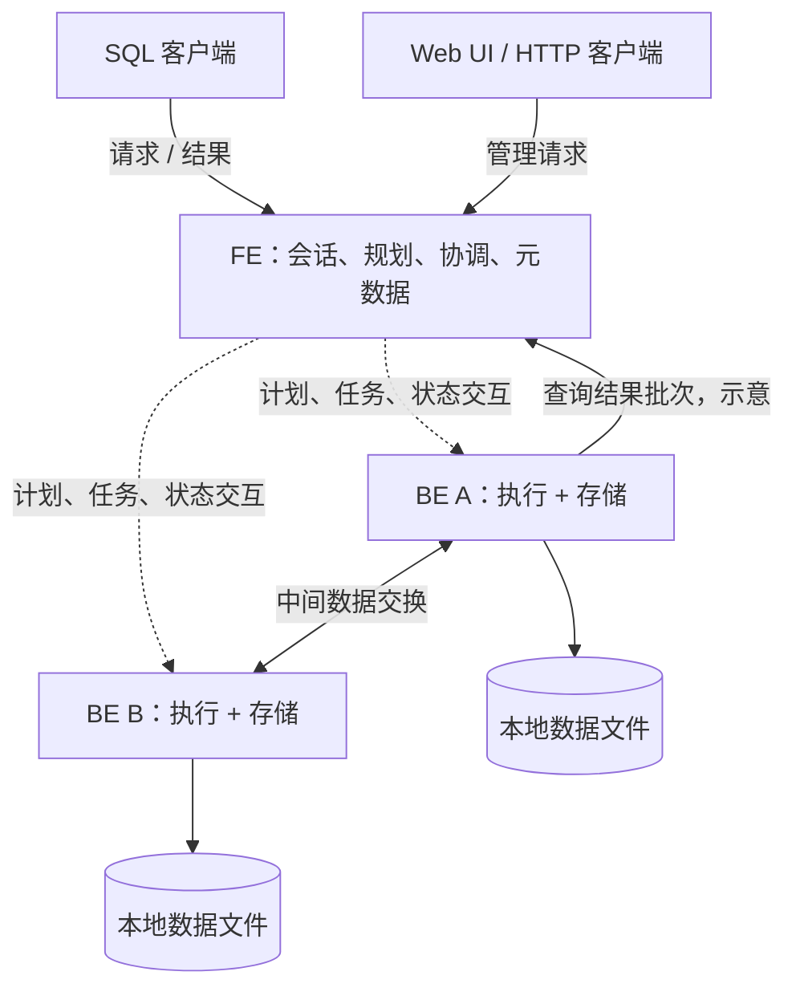
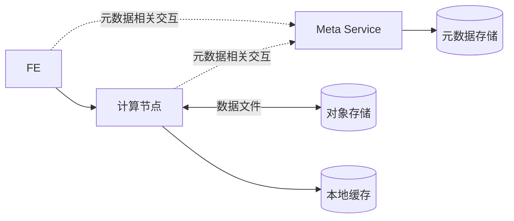

# 第 2 章　系统地图与源码导航

[上一章：从 CRUD 到 OLAP](01-from-crud-to-olap.md) · [全书导航](../README.md) · [下一章：读写闭环](03-table-read-write-cycle.md)

> 教学结构修订：2026-10-14。每章先沿一个问题阅读代码，再做实验、观察结果，最后解释对象和分支。历史正文基线为 `a53b182f810be2b3731c7dfdf6f40ff5a0ad63bd`；本次摘录取自当前本地文件，完整文件 SHA-256 与行号保存在[源码摘录清单](../examples/08-chapter-workshops/source-manifest.json)。运行证据来自报告版本 `doris-0.0.0-a53b182f810` 的二进制，不能仅凭版本前缀认定当前工作目录与二进制逐文件相同。

**本章问题：一次 SQL 跨过 FE/BE 边界时，真正传递的是什么？**

本章验证方式：已归档运行证据 + 源码走查；扩展分支见本章边界。建议先用 20—40 分钟完成主案例，第四部分的扩展阅读可分次完成；这不是新增的每日必交任务。

## 一、源码讲解：先找到决定行为的对象和分支

先沿 Coordinator → 执行 RPC → PInternalService 的职责读，不把它们当作 Java 方法在同一地址空间内相互调用。BE 的 exec_plan_fragment 收到请求后交给工作池，任务被接收与查询已经执行完是两个时刻。

### 先读这段真实代码

文件：`be/src/service/internal_service.cpp`，当前文件第 364—378 行。下面是连续原文摘录，局部片段省略了方法的其他部分；不要把片段当完整实现。

```cpp
void PInternalService::exec_plan_fragment(google::protobuf::RpcController* controller,
                                          const PExecPlanFragmentRequest* request,
                                          PExecPlanFragmentResult* response,
                                          google::protobuf::Closure* done) {
    timeval tv {};
    gettimeofday(&tv, nullptr);
    response->set_received_time(tv.tv_sec * 1000LL + tv.tv_usec / 1000);
    bool ret = _light_work_pool.try_offer([this, controller, request, response, done]() {
        _exec_plan_fragment_in_pthread(controller, request, response, done);
    });
    if (!ret) {
        offer_failed(response, done, _light_work_pool);
        return;
    }
}
```

### 这几行应该怎样读

`response->set_received_time` 记录收到请求的时刻；`try_offer` 把后续处理放进工作池；失败分支调用 `offer_failed`。这里的 `done` 是 RPC 完成回调，不是业务查询最终结果。继续读 `_exec_plan_fragment_in_pthread` 才能看到请求怎样交给执行管理。

### 先分清进程、模块和对象

在 Java 业务系统里，你熟悉一个应用进程内部有 Controller、Service、DAO；它们不因为名字不同就变成独立服务。读 Doris 也要先做这个区分。

FE 是主要使用 Java 实现的进程角色；Nereids、Coordinator、事务管理器是 FE 内的模块或对象。BE 是主要使用 C++ 实现的进程角色；Pipeline、存储引擎和写入通道在其中工作。`cloud/` 是仓库目录，其中包含 Meta Service 等服务代码，不应直接把“Cloud”理解为一个与 FE、BE 完全对称的单一进程。

对于普通内表查询，客户端把 SQL 交给 FE。FE 根据元数据分析、规划并协调执行；BE 读取数据、执行算子、交换中间结果。最终结果通过查询结果通道返回，MySQL 客户端由 FE 接收协议结果。单台开发机器可以同时运行 FE 和 BE，进程职责仍然不同。[官方系统架构](https://doris.apache.org/docs/4.x/features-architecture/system-architecture/)也区分了存算一体和存算分离两种形态。



图中只画一条结果回传线用于说明通道，不表示总由 BE A 返回。查询计划和调度决定具体执行位置。多 FE 的日志复制和导入专用通道也未画入这张查询视角图。

### 六个源码锚点

下表路径相对 `/Users/jiangyuan/open/doris`。这些是本章实际核对的定位点，阅读顺序从进程启动到请求，再到执行和协议。

| 锚点 | 关键方法或定义 | 能确认什么 |
|---|---|---|
| `fe/fe-core/src/main/java/org/apache/doris/DorisFE.java` | `main()`、`start()` | FE 初始化并启动多个服务入口 |
| `fe/fe-core/src/main/java/org/apache/doris/qe/ConnectProcessor.java` | `executeQuery()` | 语句处理过程调用 `executor.execute()` |
| `fe/fe-core/src/main/java/org/apache/doris/nereids/NereidsPlanner.java` | `planWithoutLock()` | 分析、改写、优化等规划阶段 |
| `fe/fe-core/src/main/java/org/apache/doris/qe/Coordinator.java` | `exec()`、`getNext()` | 分布式执行的协调与结果获取入口 |
| `gensrc/proto/internal_service.proto` | `service PBackendService` | 声明执行、取消、取结果、写入和数据传输等 RPC |
| `be/src/service/internal_service.cpp` | `PInternalService::exec_plan_fragment()`、`fetch_data()` | BE 侧可定位到执行与结果请求的处理代码 |

在 `DorisFE.start()` 中，可以看到 `Env` 初始化及等待就绪，随后启动 Thrift 服务、按选项启动 HTTP 服务和 `QeService`。这说明“FE 端口”不是单一概念：SQL 连接、HTTP 请求、内部 RPC 各有入口。查连接问题要先确认自己连接的是哪一种服务。

同样要注意 `ConnectProcessor` 中并非所有方法都包含实际协议处理实现；当前基类的 `processOnce()` 抛出未实现异常。若沿这个方法追踪网络读包，需要继续找具体实现，不能只凭类名宣布找到了入口。本章选 `executeQuery()`，因为这里能直接确认语句执行调用。

## 二、动手实验：先预测，再核对

默认使用已保存的实验材料或只读源码，不需要启动服务。运行环境已停止；若选择重新执行 SQL，先按[实验复现说明](../examples/07-live-lab-20261014/REPRODUCE.md)确认服务、版本与数据状态。初始化、导入和更新脚本不可在现有表上盲目重放。

1. 对照 00-environment.out.txt，画出本次单 FE、单 BE 的进程图，标出 SQL 端口 9030 与 BE 心跳端口 9050；不要把心跳端口当查询数据通道。
2. 打开 30-scale-profile.out.txt 的 EXPLAIN，找到 Fragment/Exchange，再在聚合 Profile 中搜索 Fragment RPC Count。
3. 查看本章 RPC 摘录，把 request、response、done 与工作池分别类比为 RPC 入参、响应、完成回调和异步执行器。

本章实验材料：[00-environment.out.txt](../examples/07-live-lab-20261014/00-environment.out.txt) · [30-scale-profile.out.txt](../examples/07-live-lab-20261014/30-scale-profile.out.txt) · [PROFILE_ANALYSIS.md](../examples/07-live-lab-20261014/PROFILE_ANALYSIS.md)。

## 三、观察结果：先陈述事实，再划清证据范围

环境记录中 FE、BE 都报告 doris-0.0.0-a53b182f810，节点地址为 127.0.0.1。10 万行聚合 Profile 的 Fragment RPC Count 为 2；这不等于两台 BE。

**本章边界：** 这次没有采集网络报文或断点，RPC 字段与方法关系来自源码核对，实例统计来自 Profile。

## 四、回到源码解释：把现象还原成执行过程

源码中的 try_offer 表明接收侧还存在排队与拒绝分支；返回结果需走后续执行/取数链。Fragment 是执行划分，BE 是进程：在一台 BE 上观察到多个 Fragment 或多个 Task 完全正常。

### 用自己的话走完这条链

合上结果后，按“输入 → 关键对象/状态 → 分支条件 → 可观察结果”的顺序回答本章问题：**一次 SQL 跨过 FE/BE 边界时，真正传递的是什么？** 再指出一项尚不能从现有实验得出的结论。能把每个箭头落到本章的方法或证据，比记住术语更接近读懂源码。

### 分别追踪控制信息、业务数据与元数据

把所有 FE/BE 交互都叫作“RPC 调用”会丢掉最重要的区别：不同调用传递的对象和失败后果不同。

**控制信息**告诉节点做什么，例如执行计划、取消请求、发布版本任务。**数据流**承载实际业务行或中间计算结果，例如写入数据批次、Exchange 数据块。**元数据**描述表结构、数据分布、版本等状态，既有 FE 管理的逻辑与路由信息，也有 BE 管理的本地存储信息。

三者可能共享进程或通信基础设施，但不能混为一谈。读方法时先看参数和返回值：它在传递订单，还是传递“到哪个 Tablet 读取哪个版本”的说明？

| 场景 | FE 侧要处理的问题 | BE 侧要处理的问题 |
|---|---|---|
| 建内表 | 表定义、分布与相关元数据 | 接收相应任务，建立所需存储对象 |
| 查内表 | 语义、计划、数据位置与执行协调 | 扫描、计算、中间数据交换 |
| 写内表 | 入口相关规划或事务协调 | 数据接收、转换、落盘与本地状态 |
| 节点异常 | 发现状态变化、调度后续处理 | 报告状态、执行维护任务或返回错误 |

导入方式会改变数据经过的节点。例如 INSERT SQL 请求进入 FE，而 Stream Load 有 HTTP 上传和重定向等专门路径。不能由“FE 是入口”推导出“所有大批量数据必须先经过 FE”。

### Thrift、Protobuf 与生成代码

分布式系统必须让 Java 和 C++ 对消息结构达成一致。Doris 仓库的 `gensrc/` 保存协议定义；构建流程据此生成相关语言的类型或接口。源码中的 `org.apache.doris.proto`、`org.apache.doris.thrift` 等引用，不一定对应手写的业务类。

在 `gensrc/proto/internal_service.proto` 的 `PBackendService` 中，能直接看到 `exec_plan_fragment`、`cancel_plan_fragment`、`fetch_data`、`tablet_writer_add_block`、`transmit_block` 等声明。名字提供了追踪方向，真正语义还要结合参数、发送方与处理方。

不要简单划分成“FE 全用 Thrift、BE 全用 Protobuf”，也不要把传输库与消息定义格式视为同一层。一条路径可能组合多层表示；协议导航见附录 C；本书尚未提供逐字段的跨语言 RPC 专题。

你此前遇到的生成类缺失，正适合用这个结构来理解：编译器报找不到类型，可能是生成或构建依赖链条没有完成。排查应检查协议输入、生成产物和构建顺序，不能直接手写一个同名类补洞。构建入口按仓库要求使用 `build.sh`，不在本章重做环境搭建。

### 仓库地图：按问题选择入口

| 目录 | 第一眼该如何理解 | 常见阅读问题 |
|---|---|---|
| `fe/fe-core/` | FE 主体实现与大量功能编排 | 命令在哪里执行？事务如何完成？ |
| `fe/fe-catalog/`、`fe/fe-connector/` | Catalog 与连接器相关模块 | 外表元数据与连接器接口在哪里？ |
| `fe/fe-authentication/`、`fe/fe-authorization/` | 身份与权限相关模块 | 模块边界和接口是什么？ |
| `fe/fe-foundation/`、`fe/fe-common/` | 共享基础能力 | 哪些对象由多个 FE 模块复用？ |
| `be/src/exec/` | Pipeline、算子、扫描、交换与 Sink | 工作如何在 BE 执行？ |
| `be/src/core/`、`be/src/exprs/` | 核心数据表示、表达式和聚合等 | 一批列数据如何被计算？ |
| `be/src/storage/` | Tablet、Rowset、Segment、事务及维护 | 字节如何组织，版本如何读取？ |
| `be/src/load/`、`be/src/io/`、`be/src/format/` | 写入、I/O 与格式相关实现 | 数据怎样进入或离开执行引擎？ |
| `be/src/service/` | BE 服务入口和 RPC/HTTP 处理 | 请求到达 BE 后从哪里找？ |
| `cloud/src/`、`be/src/cloud/`、FE 的 `cloud/` 包 | 存算分离的服务与协作逻辑 | 元数据和数据的权威来源如何变化？ |
| `ui/` | Web 界面 | 页面动作调用哪个 HTTP API？ |
| `gensrc/` | 协议定义及相关生成工程 | 跨进程对象在哪里定义？ |
| `regression-test/`、FE/BE/Cloud 测试目录 | 行为验证 | 哪种测试能覆盖当前修改？ |

当前目录拆分与旧文章可能不同。例如 BE 执行和存储应从当前的 `exec/`、`storage/` 等目录查起。旧文章给出的路径找不到时，先按类型或方法检索，不要立刻认定功能被删除。

### 存算分离：先在图上留出位置

存算一体内表主线中，BE 承担计算与本地持久存储。存算分离引入对象存储及专门的元数据服务，计算节点仍需要执行查询和写入相关工作，也可能维护本地缓存。它改变了数据所有权、元数据和事务协作，不能理解成只换一个磁盘目录。



这是职责示意，省略了服务部署和具体请求顺序。本书前几章的副本与发布示例都以存算一体为前提；第 25—26 章再逐项比较，避免把两种模式的状态机混在一起。

### 从运行现象找到代码和证据

FE 编译成功、FE 进程启动、SQL 端口可连、BE 已注册且可用、真实内表可读写，是不同的验证层级。例如 `SELECT 1` 可能不需要访问 BE；它成功不能证明内表扫描或写入通道已经可用。`Coordinator.exec()` 附近的说明也提醒调用者，该入口不是为没有协调执行片段的查询准备的。

构建产物通常位于 `output/`。源码根目录的 `conf/`、产物中的配置、服务实际读取的配置可能不完全相同；日志位置也可由配置决定。记录运行环境时，应记录实际启动路径、配置、端口和二进制版本，不把本机成功运行的旧产物视为当前 HEAD 的验证。

可按下面顺序定位一个问题：先用 SQL 或错误信息确认现象，再判断属于连接、规划、执行、写入或可见性哪一层，然后选择对应入口，最后找测试。现有例子包括：

- 规划：`fe/fe-core/src/test/java/org/apache/doris/nereids/NereidsPlannerTest.java`。
- 事务：`fe/fe-core/src/test/java/org/apache/doris/transaction/DatabaseTransactionMgrTest.java`。
- FE 命令：`fe/fe-core/src/test/java/org/apache/doris/nereids/trees/plans/commands/ShowLoadCommandTest.java`。

本次未运行这些仓库测试；服务与 SQL 的已有实测见本章第二、三部分。这些测试是后续局部验证入口。对于 Java 贡献者，先把一个命令的输入、输出、调用对象和测试串起来，已经能形成有边界的源码研究。

术语不必一次记住，遇到陌生对象可查[附录 A](../appendices/A-glossary.md)。下一章把这张地图压缩成一张表的一次写入和一次查询。

### 延伸源码专题

- [专题 1　从真实 EXPLAIN 走到 FE/BE 协议与取消](../deep-dives/01-query-rpc-and-cancellation.md)

---

[上一章：从 CRUD 到 OLAP](01-from-crud-to-olap.md) · [全书导航](../README.md) · [下一章：读写闭环](03-table-read-write-cycle.md)
