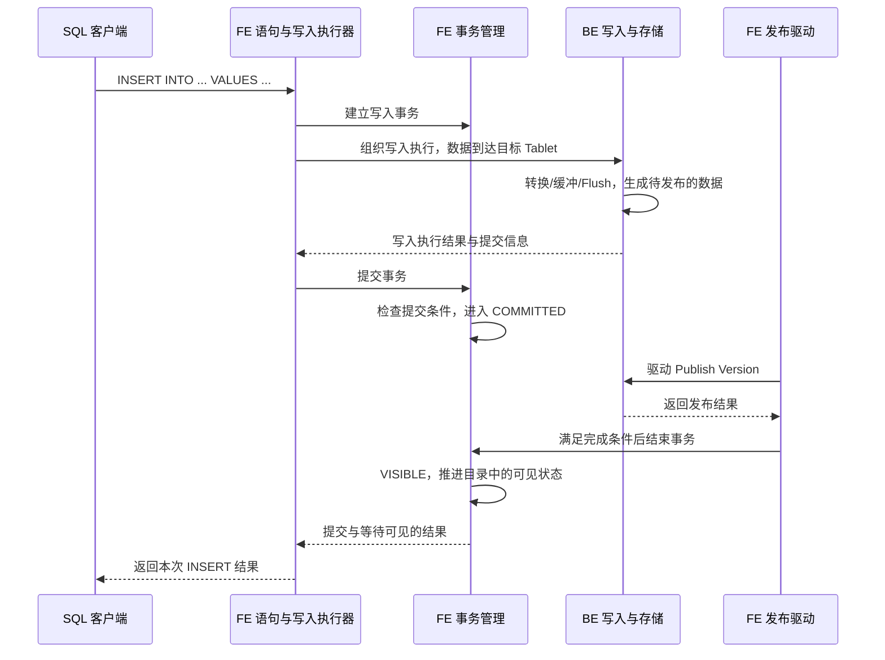
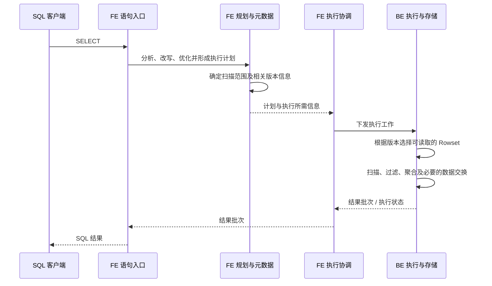

# 第 3 章　一张表的读写闭环

[上一章：系统地图](02-system-and-source-map.md) · [全书导航](../README.md) · [配套 SQL](../examples/01-orders/README.md)

> 教学结构修订：2026-10-14。每章先沿一个问题阅读代码，再做实验、观察结果，最后解释对象和分支。历史正文基线为 `a53b182f810be2b3731c7dfdf6f40ff5a0ad63bd`；本次摘录取自当前本地文件，完整文件 SHA-256 与行号保存在[源码摘录清单](../examples/08-chapter-workshops/source-manifest.json)。运行证据来自报告版本 `doris-0.0.0-a53b182f810` 的二进制，不能仅凭版本前缀认定当前工作目录与二进制逐文件相同。

**本章问题：INSERT 成功以后，下一次 SELECT 为什么能读到它？**

本章验证方式：已归档运行证据 + 源码走查；扩展分支见本章边界。建议先用 20—40 分钟完成主案例，第四部分的扩展阅读可分次完成；这不是新增的每日必交任务。

## 一、源码讲解：先找到决定行为的对象和分支

先看 OlapInsertExecutor.onComplete 的两个状态分支：提交并等到可见才写 VISIBLE，否则可以保留 COMMITTED。你的业务 Service 通常把方法返回作为工作结束；这里要把“执行完成”和“读取版本推进”拆开。

### 先读这段真实代码

文件：`fe/fe-core/src/main/java/org/apache/doris/nereids/trees/plans/commands/insert/OlapInsertExecutor.java`，当前文件第 236—247 行。下面是连续原文摘录，局部片段省略了方法的其他部分；不要把片段当完整实现。

```java
        } else if (Env.getCurrentGlobalTransactionMgr().commitAndPublishTransactionWithRetry(
                database, Lists.newArrayList((Table) table),
                txnId,
                TabletCommitInfo.fromThrift(coordinator.getCommitInfos()),
                ctx.getSessionVariable().getInsertVisibleTimeoutMs(), txnCommitAttachment,
                streamUpdateInfos)) {
            txnStatus = TransactionStatus.VISIBLE;
        } else {
            // Keep the committed status so load accounting and insert result bookkeeping stay aligned.
            txnStatus = TransactionStatus.COMMITTED;
            publishTimedOutAfterCommit = true;
        }
```

### 这几行应该怎样读

`coordinator.getCommitInfos()` 提供执行侧提交信息，经 `TabletCommitInfo.fromThrift` 进入事务调用。布尔返回值为 true 时记录 VISIBLE；false 分支保留 COMMITTED 并标记发布等待超时。因此“等待结束”与“提交已撤销”不能画等号。

### 为什么先用八行数据

本章不是性能实验。八行数据已经能表现过滤、分组、同一用户重复购买、跨城市去重和跨日期过滤。数据小到可以手算，系统链路却仍然涉及规划、写入、存储和查询。

| 日期 | 订单 | 用户 | 城市 | 金额 | 状态 |
|---|---:|---:|---|---:|---|
| 2026-10-01 | 1 | 101 | 北京 | 100.00 | PAID |
| 2026-10-01 | 2 | 102 | 北京 | 80.00 | PAID |
| 2026-10-01 | 3 | 101 | 上海 | 120.00 | PAID |
| 2026-10-01 | 4 | 103 | 上海 | 60.00 | PAID |
| 2026-10-01 | 5 | 101 | 北京 | 20.00 | PAID |
| 2026-10-01 | 6 | 104 | 杭州 | 200.00 | PAID |
| 2026-10-01 | 7 | 105 | 上海 | 90.00 | CANCELLED |
| 2026-10-02 | 8 | 102 | 杭州 | 50.00 | PAID |

完整建表与写入语句见 [setup.sql](../examples/01-orders/setup.sql)，查询见 [queries.sql](../examples/01-orders/queries.sql)。它们是可选择运行的实验材料，不是新的必交作业。需已有可用 BE，且所选存算一体环境允许单副本开发表。请按文件说明逐段执行；这里不会修改你的现有集群。

### 建表语句定义了哪些东西

```sql
CREATE TABLE orders_intro_v1 (
    order_date DATE NOT NULL,
    order_id BIGINT NOT NULL,
    user_id BIGINT NOT NULL,
    city VARCHAR(32) NOT NULL,
    amount DECIMAL(12, 2) NOT NULL,
    status VARCHAR(16) NOT NULL
)
ENGINE=OLAP
DUPLICATE KEY(order_date, order_id)
DISTRIBUTED BY HASH(order_id) BUCKETS 2
PROPERTIES ("replication_num" = "1");
```

选择 Duplicate Key 是为了保留输入明细。这里的 Key 不能按业务数据库的唯一约束理解：相同 Key 再次写入，会保留新增明细，不自动覆盖旧行。`order_date, order_id` 同时提供排序键；我们没有显式定义日期分区，日期列出现在 Key 中也不等于创建了日分区。[Duplicate Key 官方说明](https://doris.apache.org/docs/4.x/table-design/data-model/duplicate/)解释了这种明细保留语义。

`HASH(order_id) BUCKETS 2` 指定分桶方式和桶数。对于这张没有额外物化索引的示例表，可以从单个默认分区、基表索引的两个 Tablet 理解其分布。不能把这个例子推广成“一张表的 Tablet 数永远等于桶数”：多个分区、物化索引等会改变计数。

单副本参数用于降低本地实验的资源要求，不是生产容错建议；两个桶也不要求必须有两台 BE。桶是数据分布单位，BE 是进程节点，一个 BE 可以承载多个 Tablet。建表语法与 Key 列位置等要求参考 [CREATE TABLE 文档](https://doris.apache.org/docs/4.x/sql-manual/sql-statements/table-and-view/table/CREATE-TABLE/)。

金额使用 `DECIMAL(12,2)`，便于把示例计算解释为十进制金额，避免把浮点舍入问题混入第一条读写链路。

### 从 SQL 对象走到存储对象

你在 Java 业务代码里通常把表理解为一组行。Doris 需要进一步回答：这组行分到哪里，哪个节点持有哪一份，以及文件以什么单位生成和读取。

```text
Database
└── Table
    └── Partition
        └── MaterializedIndex（本例只考虑基表索引）
            └── Tablet（分桶形成的数据分片）
                └── Replica（存算一体中的副本位置/状态）

BE 上某个 Tablet 副本的物理数据
└── Rowset
    └── Segment 文件
        └── 列数据、索引及相关结构
```

这是概念层级，不是所有对象都以相同的树结构存在于同一进程。FE 掌握表定义、数据路由和相关版本状态；BE 管理本地 Tablet、Rowset 与文件。Tablet ID 等标识把两边联系起来。

也不要把“一次 INSERT”等同于“一个 Segment”。本次写入会按分布规则触达相关 Tablet，每个 Tablet 上的物理产物还取决于批量、Flush 等条件。精确数量需要观察实际产物，本章不预设。

## 二、动手实验：先预测，再核对

默认使用已保存的实验材料或只读源码，不需要启动服务。运行环境已停止；若选择重新执行 SQL，先按[实验复现说明](../examples/07-live-lab-20261014/REPRODUCE.md)确认服务、版本与数据状态。初始化、导入和更新脚本不可在现有表上盲目重放。

1. 读 01-orders-setup.sql 的建表与一次 INSERT，确认 Duplicate Key 和单副本。保留现有库时不要再次执行这份初始化脚本。
2. 直接读 03-orders-assertions.out.txt 或在已启动的实验环境执行下方只读 SQL，核对 8 行与 720.00 的全表金额。
3. 沿 onComplete → 事务完成 → OlapScanNode 的可见版本选择，写出数据文件与可见目录各自负责的事。

```sql
SELECT COUNT(*), SUM(amount) FROM doris_book.orders_intro_v1;
```

本章实验材料：[01-orders-setup.sql](../examples/07-live-lab-20261014/01-orders-setup.sql) · [03-orders-assertions.out.txt](../examples/07-live-lab-20261014/03-orders-assertions.out.txt) · [33-after-restart.out.txt](../examples/07-live-lab-20261014/33-after-restart.out.txt)。

## 三、观察结果：先陈述事实，再划清证据范围

订单聚合断言已通过；重启后的 33-after-restart.out.txt 仍包含全表 8 行、720.00。580.00 是指定日期 PAID 的金额，不是全表金额。

**本章边界：** 没有制造 COMMITTED 后等待超时。Duplicate Key 的重复 INSERT 会追加数据，回放旧结果比盲目重跑更适合本章。

## 四、回到源码解释：把现象还原成执行过程

写入执行生成可提交的数据；可见性流程推进分区版本；新查询按扫描范围中的版本取数据。重启后仍能读到只证明这次正常持久化与恢复成立，不能把 onComplete 的每个超时分支也算作测过。

### 用自己的话走完这条链

合上结果后，按“输入 → 关键对象/状态 → 分支条件 → 可观察结果”的顺序回答本章问题：**INSERT 成功以后，下一次 SELECT 为什么能读到它？** 再指出一项尚不能从现有实验得出的结论。能把每个箭头落到本章的方法或证据，比记住术语更接近读懂源码。

### 一次 INSERT：数据链路与控制链路一起推进

下面是普通内表 INSERT 的概念时序。FE 执行器、事务管理器、发布驱动在图中分开画，只是为了显示职责，它们属于 FE 内部不同模块。



图里的“数据到达”省略了实际通道和执行节点，不表示每个元组都由某个 Java 方法直接发给最终存储文件。第 15 章会精读这段路径。

这条链路最值得先记住的是：**写入数据、提交事务、发布数据和更新可见状态，是不同动作。** 一个节点已经生成文件，不意味着查询会立即选择这些文件；事务进入 COMMITTED，也还可能等待后续发布和完成条件。

#### 源码证据一：执行写入后还有完成阶段

`fe/fe-core/src/main/java/org/apache/doris/nereids/trees/plans/commands/insert/AbstractInsertExecutor.java` 的 `executeSingleInsert()` 中，能看到前置工作、执行、过滤比例检查、完成前回调、终止状态检查及 `onComplete()`。异常还会进入失败处理。

这说明写入执行与最终完成不是同一个语句；本章只核对这些阶段，不展开其中全部监听器和特殊写入路径。

#### 源码证据二：提交成功与等待可见的结果有区别

同目录 `OlapInsertExecutor.java` 的 `onComplete()` 调用 `commitAndPublishTransactionWithRetry()`。相关分支可概括为下面的教学伪代码：

```text
执行状态为错误 → 尝试终止事务
提交并等待可见返回 true → 记录 VISIBLE
提交后未在等待窗口内达到可见 → 保留 COMMITTED，记录发布等待超时
```

这是省略上下文的结构说明，不是可复制的实现。客户端具体返回内容还受后续处理和会话选项影响，不能只用“SQL 报错/没报错”推断数据一定没写入或已经可见。遇到提交后等待超时，先查原事务状态；盲目重试对 Duplicate Key 表可能追加重复数据。

#### 源码证据三：变为 VISIBLE 有检查条件

`fe/fe-core/src/main/java/org/apache/doris/transaction/DatabaseTransactionMgr.java` 的 `finishTransaction()`，在设置 `TransactionStatus.VISIBLE` 前检查相关版本与副本发布条件，失败分支可以直接返回。后续还涉及状态持久化等待和 `updateCatalogAfterVisible()`。

这里不要把“内存字段赋成 VISIBLE 的那一行”单独当作整个事务已经对所有观察者完成的时间点。锁、日志、目录更新和通知共同形成更完整的边界，第 16 章会沿这些步骤继续解释。

### 查询如何找到刚写入的数据

执行下面的查询，目标是 10 月 1 日各城市的已支付订单：

```sql
SELECT city, COUNT(*) AS order_count, SUM(amount) AS revenue,
       COUNT(DISTINCT user_id) AS buyers
FROM orders_intro_v1
WHERE order_date = '2026-10-01' AND status = 'PAID'
GROUP BY city
ORDER BY city;
```



图中把多个 BE 的工作合在一个参与者内；实际可能包含多实例、中间结果交换和多个执行阶段。八行数据也不保证生成某一种固定计划。

查询读的是其扫描范围所指定的版本数据，不能理解成“把磁盘上所有文件都读一遍”。`fe/fe-core/src/main/java/org/apache/doris/planner/OlapScanNode.java` 中可找到可见版本与 Scan Range 的关联：普通路径的 `addScanRangeLocations()` 读取分区 visibleVersion 并写入扫描范围；`updateScanRangeVersions()` 是 Cloud 批量更新路径。两者不能混作同一部署模式的固定步骤。

BE 的 Rowset 选择也不是简单遍历所有“小于可见版本”的 Rowset 再全部相加。Compaction 可能生成覆盖某段版本范围的新 Rowset，读路径需要选择正确的版本覆盖关系，避免把同一逻辑数据重复读取。具体版本路径放到第 17 章，不把它类比成每行携带同一种全库时间戳。

### 预期结果与它说明的语义

若表最初为空、只写入一次上述八行且已可见，结果应为：

| city | order_count | revenue | buyers |
|---|---:|---:|---:|
| 上海 | 2 | 180.00 | 2 |
| 北京 | 3 | 200.00 | 2 |
| 杭州 | 1 | 200.00 | 1 |

这张表最初由八行输入推导，现已由 2026-10-14 实测输出核对。此例 `ORDER BY city` 按当前普通字符串字节比较路径排列为上海、北京、杭州，不是按拼音排序；可对照 `be/src/core/column/column_string.h` 的 `compare_at()`。原稿只核对了聚合值，本次补正了展示顺序。北京用户 101 买了两次，订单数增加两笔，城市去重人数只计一次。上海取消的订单和杭州第二天的订单都被过滤。

把城市维度去掉，同一天所有已支付订单应有 6 笔，总额 580.00，全局购买用户是 `{101,102,103,104}`，共 4 人。各城市人数相加是 5，因为用户 101 出现在两个城市。

全表行数应为 8。若看到 16，优先检查是否重复执行 INSERT；Duplicate Key 表不会因为 `order_id` 相同而替你去重。这个现象与精确去重查询的语义是两件事。

### 怎样观察，而不是猜测内部行为

第一次观察可限制在三个层级：

| 证据 | 能回答 | 不能单独证明 |
|---|---|---|
| `SHOW CREATE TABLE` 与有序明细查询 | 当前表定义、实际可见数据是否符合实验前提 | BE 内部完整执行过程 |
| 普通 `EXPLAIN SELECT ...` | 计划中有哪些扫描、聚合和交换安排 | 本次 SELECT 的真实耗时和实际处理行数 |
| 一次真实查询的 Profile 与关联日志 | 各阶段运行信息及可观测瓶颈 | 脱离版本、配置和上下文的普遍性能结论 |

普通 EXPLAIN 主要用于查看计划，不在这里伪造一份“标准输出”。保留实际输出后，再标注哪些算子负责扫描、哪些负责聚合、哪里发生分布变化。计划节点数和名称会随版本、优化规则与会话配置变化。

Profile 的启用方式和展示入口以运行版本为准；本章已引用 2026-10-14 的归档 Profile。遇到异常，可以记录 query ID、事务 ID/Label、SQL、时间、实际服务版本和相关日志，再沿各自链路查证。不要预设每种导入都能通过同一个 SHOW 命令完整观察。

### 阅读入口与后续验证

本章正文精读范围集中在下面四个文件：

| 源码路径（相对仓库根目录） | 方法 | 当前阅读目的 |
|---|---|---|
| `fe/fe-core/src/main/java/org/apache/doris/nereids/trees/plans/commands/insert/AbstractInsertExecutor.java` | `executeSingleInsert()` | 分清执行、完成与失败处理 |
| `fe/fe-core/src/main/java/org/apache/doris/nereids/trees/plans/commands/insert/OlapInsertExecutor.java` | `onComplete()` | 找到提交、等待可见的结果分支 |
| `fe/fe-core/src/main/java/org/apache/doris/transaction/DatabaseTransactionMgr.java` | `finishTransaction()`、`updateCatalogAfterVisible()` | 找到可见性条件和目录更新 |
| `fe/fe-core/src/main/java/org/apache/doris/planner/OlapScanNode.java` | `addScanRangeLocations()` | 普通路径读取分区 visibleVersion；Cloud 批量更新另见 `updateScanRangeVersions()` |

已有测试入口是 `fe/fe-core/src/test/java/org/apache/doris/transaction/DatabaseTransactionMgrTest.java`，例如 `testNormal()`。它适合后续结合实现阅读；本次没有运行，也不声称单个测试覆盖全部读写闭环。

到这里，读者已能把“写入一行数据”拆成数据路径与可见性路径，把“执行查询”拆成规划、调度和数据读取。接下来可读[第 4 章](04-request-session-and-command.md)，从熟悉的 Java 请求处理入口深入，而不要求先掌握所有存储细节。

### 延伸源码专题

- [专题 1　从真实 EXPLAIN 走到 FE/BE 协议与取消](../deep-dives/01-query-rpc-and-cancellation.md)

---

[上一章：系统地图](02-system-and-source-map.md) · [全书导航](../README.md) · [配套 SQL](../examples/01-orders/README.md)
