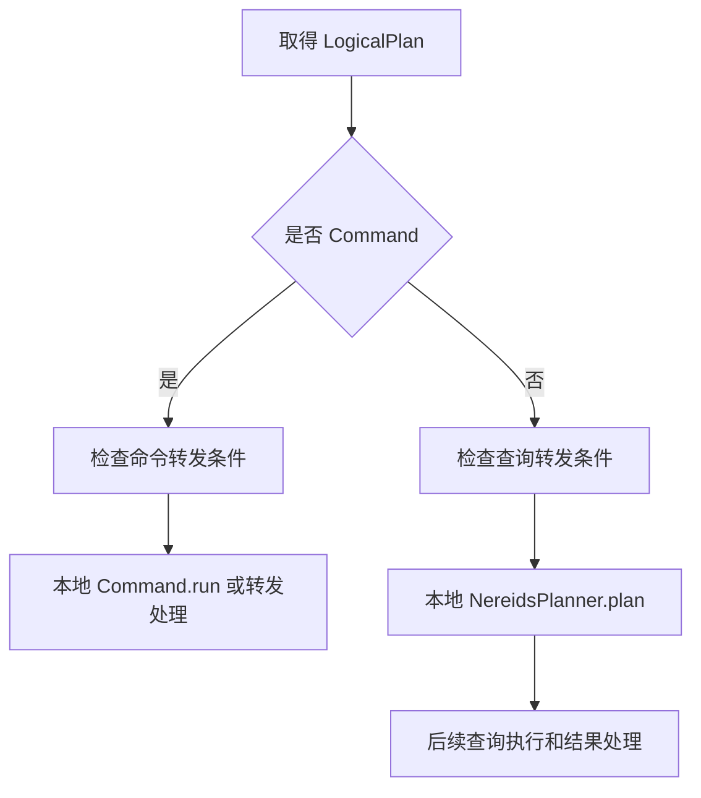

# 第 4 章　连接、会话与语句入口

[全书导航](../README.md) · [前置：系统地图](02-system-and-source-map.md) · [Java 阅读路线：导入入口](14-load-entry-and-lifecycle.md)

> 日期：2026-10-12。源码基线：`a53b182f810be2b3731c7dfdf6f40ff5a0ad63bd`。已阅读本文列出的关键方法；未运行服务、SQL 或测试。主线为普通 MySQL 文本请求；预处理、Arrow Flight、缓存与转发只讲分支边界，不展开全部实现。

## 4.1 从熟悉的请求处理模型开始

在业务服务里，你可能按“接收 HTTP → 解析参数 → 调用 Service → 返回结果”的顺序看代码。Doris FE 也有接收、上下文、分派和结果处理，但 SQL 带来的工作类型更多：一条语句可能只读 FE 的任务记录，也可能触发跨 BE 的扫描，还可能修改元数据或创建异步作业。

比较两个请求：

```sql
SELECT city, SUM(amount) FROM doris_book.orders_intro_v1 GROUP BY city;
SHOW LOAD FROM doris_book;
```

第一条需要分析列与聚合表达式，并为实际数据访问安排执行。第二条描述的是管理命令；在本章追踪的实现中，它从 FE 的相关管理器取得记录，再整理成结果集。两者都使用 SQL 协议返回表格，却没有相同的执行链路。

这里先建立一个原则：**协议层的“请求”与数据库里的“执行计划”是不同层次。** 不能因为一条语句返回了行，就认定它一定经过 BE 扫描和 Exchange。

## 4.2 网络请求在哪里变成语句

当前源码中，MySQL 具体处理类是 `MysqlConnectProcessor`，共享语句处理逻辑在其父类 `ConnectProcessor`。对于普通文本查询，可以按下面的关系读：

```text
MysqlConnectProcessor.processOnce()
  → dispatch()
  → MySQL COM_QUERY 对应的 handleQuery()
  → 共享的 handleQuery(String) / executeQuery(String)
  → 创建 StmtExecutor
  → executor.execute()
```

这个列表是当前文本请求分支的导航，不覆盖登录握手、所有 MySQL 命令或异步事件框架。`dispatch()` 还处理其他协议命令，所以不能把收到的每个包都当作一条 SQL。

在 `ConnectProcessor.executeQuery()` 中，可以看到方言转换、SQL hash、缓存适用性判断、解析和逐语句执行。当前代码把解析出的语句保存在列表中，循环创建 `StmtExecutor`。由此可知，一个收到的 SQL 文本与一次语句执行不一定一一对应；客户端协议能力、执行错误以及多语句规则还会影响后续行为。

正常非缓存路径通过解析器获得语句表示，后续执行器处理 `LogicalPlanAdapter` 中的逻辑计划。不要在这里假定“解析器已经查到了所有列的真实类型”：语法结构与后续语义分析的职责会在第 5 章细分。

## 4.3 会话与语句各自保存什么

`ConnectContext` 在阅读中可以先理解为连接/执行上下文：当前数据库、用户身份、会话变量、查询状态、当前执行器等都从它或关联对象访问。`StatementContext` 则围绕当前语句的分析与规划工作。它们之间存在关联，不能靠名字推断所有字段的生命周期。

对 Java 开发者最实用的阅读方法，是看到字段后问三个问题：谁设置它、哪些路径读取它、何时恢复或清理它。比如当前数据库影响没有显式数据库名的命令；会话参数影响规划或执行行为；query ID 用于跟踪一次查询。这些状态都不能像纯函数的局部变量一样忽略。

语句里的提示也可能临时影响参数。调查参数相关行为时，必须区分会话原值、执行期间实际值和执行结束后的值，不能只在结束后打印一次会话对象就断言整个执行使用了那个配置。本章不穷举参数，只建立这种检查习惯。

## 4.4 `StmtExecutor` 的关键分叉

`StmtExecutor.executeByNereids()` 设置 query ID、计时与语句 ID，取得逻辑计划后，根据计划类型进入不同路径。



这张图省略缓存、预处理和特殊优化路径，只表达两类主分支。Command 分支会调用 `verifyCommandSupported()` 和 `run()`；普通查询分支会创建 `NereidsPlanner` 并调用 `plan()`。这比“所有 SQL 都先生成一套分布式查询计划”更接近实际代码。

但不要反向推导出“Command 永远不用 BE”。INSERT 也是命令，其实现可以组织写入计划和 BE 执行。分支回答的是顶层如何分派，不直接决定后续有没有分布式工作。

### 为什么要转发到另一个 FE

命令可能声明重定向策略，执行器还会结合当前 FE 状态等判断是否转发。当前代码包含防止已转发请求再次无限转发的处理，也存在同步 Journal 的调用，以处理部分元数据同步相关情形。

因此，“连接到了某个 FE”不保证所有工作都在该 FE 本地执行。查日志时需记录连接节点和执行节点，不能只在一个节点找 query ID 就宣布请求没有发生。具体 FE 角色与元数据同步机制留到第 18 章。

## 4.5 用 `SHOW LOAD` 看一条小而完整的链路

`ShowLoadCommand` 继承 `ShowCommand`。当前实现中的角色分工如下：

| 对象/方法 | 负责的工作 |
|---|---|
| `StmtExecutor.executeByNereids()` | 顶层命令分派与相关异常处理 |
| `ShowCommand.run()` | 调用具体 `doRun()`，处理本地发送或代理结果 |
| `ShowLoadCommand.doRun()` | 进入 `handleShowLoad()` |
| `ShowLoadCommand.handleShowLoad()` | 校验、获取记录、排序、转换行、应用 LIMIT |
| `ShowResultSet` | 结果列信息与行数据的表示 |

`ShowCommand.run()` 的代码很适合第一次精读：先调用 `doRun()`；有结果时，如果是代理执行就保存代理结果，否则调用执行器发送结果。它证明“命令如何构造行”与“行如何交给客户端”是可分开的职责。

`ShowLoadCommand.toRedirectStatus()` 返回 `FORWARD_NO_SYNC`。这说明该命令有自己的路由策略；真正是否发生转发仍要沿执行器条件判断，不能只看这个枚举就描述所有部署下的网络路径。

## 4.6 错误为什么不只是一条异常

在 Command 分支中，`StmtExecutor` 分别处理 `QueryStateException`、`UserException` 和其他异常/错误，并更新查询状态或包装异常。客户端观察到的是外层协议与结果处理后的表现，内部抛出异常的类型只是其中一环。

例如 `ShowLoadCommand.validate()` 返回 false 时，`handleShowLoad()` 会把它转换成带提示的 `AnalysisException`。若测试只直接调用 `validate()` 并断言 false，它验证的是内部校验行为，没有验证 SQL 客户端实际收到什么。

定位错误时应保留两条线：异常从哪里产生，查询状态又在哪些地方被设置。取消和超时同样需要追踪执行器与协调对象；本章不把它们简化为“关闭客户端连接就自动撤销所有副作用”。

## 4.7 精读入口与验证方法

以下路径相对源码根目录，方法在本次基线中已核对：

| 文件 | 先读的方法 |
|---|---|
| `fe/fe-core/src/main/java/org/apache/doris/qe/MysqlConnectProcessor.java` | `processOnce()`、`dispatch()`、`handleQuery()` |
| `fe/fe-core/src/main/java/org/apache/doris/qe/ConnectProcessor.java` | `executeQuery()` |
| `fe/fe-core/src/main/java/org/apache/doris/qe/StmtExecutor.java` | `executeByNereids()` |
| `fe/fe-core/src/main/java/org/apache/doris/nereids/trees/plans/commands/ShowCommand.java` | `run()` |
| `fe/fe-core/src/main/java/org/apache/doris/nereids/trees/plans/commands/ShowLoadCommand.java` | `doRun()`、`handleShowLoad()` |

后续观察可选同一个数据库上的 SELECT 与 SHOW LOAD，分别记录返回结果、相关入口和是否产生 BE 执行工作。这里只给观察方向，没有伪造日志或运行结果。命令内部行为的现有测试入口为 `ShowLoadCommandTest`，第 27 章会展开其覆盖边界。

阅读完这条路径后，你已能用熟悉的 Java 请求处理经验找到一个贡献落点：命令输入、校验、信息获取和结果展示。接下来需要知道它展示的“导入任务”究竟是什么。


---

[上一章：第 3 章](03-table-read-write-cycle.md) · [全书导航](../README.md) · [下一章：第 5 章](05-parser-binding-and-rewrite.md)

## 源码深读补充（2026-10-13）

- [专题 1　从真实 EXPLAIN 走到 FE/BE 协议与取消](../deep-dives/01-query-rpc-and-cancellation.md)
