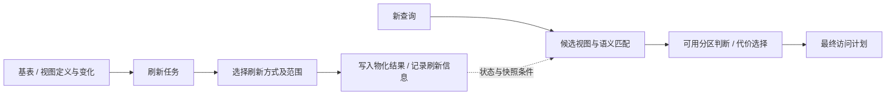

# 第 6 章　优化器如何选择计划

[全书导航](../README.md) · [术语表](../appendices/A-glossary.md)

> 教学结构修订：2026-10-14。每章先沿一个问题阅读代码，再做实验、观察结果，最后解释对象和分支。历史正文基线为 `a53b182f810be2b3731c7dfdf6f40ff5a0ad63bd`；本次摘录取自当前本地文件，完整文件 SHA-256 与行号保存在[源码摘录清单](../examples/08-chapter-workshops/source-manifest.json)。运行证据来自报告版本 `doris-0.0.0-a53b182f810` 的二进制，不能仅凭版本前缀认定当前工作目录与二进制逐文件相同。

**本章问题：优化器知道“估计多少行”，与 BE 实际读了多少行，有什么区别？**

本章验证方式：已归档运行证据 + 源码走查；扩展分支见本章边界。建议先用 20—40 分钟完成主案例，第四部分的扩展阅读可分次完成；这不是新增的每日必交任务。

## 一、源码讲解：先找到决定行为的对象和分支

读 Optimizer.execute 中的顺序：建立 Memo，把统计推导任务放入调度器，随后优化 Group。这里的任务是规划阶段的 Java 工作，不是 BE 的 PipelineTask。统计为选择提供估计，不保存查询结果。

### 先读这段真实代码

文件：`fe/fe-core/src/main/java/org/apache/doris/nereids/jobs/executor/Optimizer.java`，当前文件第 82—102 行。下面是连续原文摘录，局部片段省略了方法的其他部分；不要把片段当完整实现。

```java
            // init memo
            cascadesContext.toMemo();
            if (cboInlinedPlan != null) {
                cascadesContext.getMemo().copyIn(cboInlinedPlan, cascadesContext.getMemo().getRoot(), false);
            }
            // stats derive
            cascadesContext.getMemo().getRoot().getLogicalExpressions()
                    .forEach(groupExpression -> cascadesContext.pushJob(
                            new DeriveStatsJob(groupExpression, cascadesContext.getCurrentJobContext())));
            cascadesContext.getJobScheduler().executeJobPool(cascadesContext);
            if (cascadesContext.getStatementContext().isDpHyp() || isDpHyp(cascadesContext)) {
                // RightNow, dp hyper can only order 64 join operators
                dpHypOptimize();
                cascadesContext.getStatementContext().setDpHyp(false);
                cascadesContext.getStatementContext().setAfterDpHyper(true);
            }
            cascadesContext.pushJob(
                    new OptimizeGroupJob(cascadesContext.getMemo().getRoot(), cascadesContext.getCurrentJobContext()));
            cascadesContext.getJobScheduler().executeJobPool(cascadesContext);

            return null;
```

### 这几行应该怎样读

`toMemo()` 建立候选组织；`DeriveStatsJob` 推导候选所需统计；`OptimizeGroupJob` 使用当前任务上下文继续优化。两次 `executeJobPool` 是推进规划任务，并不是向 BE 发送两次数据查询。

### 合法计划通常不止一种

一张订单表关联城市维表，数据库可以先过滤订单再连接，也可能把较小的一侧广播到多个执行节点。多个表连接时，顺序还会改变中间结果规模。

这些选择不能只看 SQL 的书写顺序。优化器需要保存候选、估计各阶段数据量，并考虑候选满足什么物理要求。它选择的是基于当前信息的较优方案，不是对真实运行耗时的保证。

### Memo 不是 SQL 结果缓存

Nereids 的 Memo 用于组织优化搜索空间。Group 表示一组等价结果的候选，GroupExpression 描述一个算子及其子 Group 关系。多个候选可以共享子问题，不必复制整棵树。

```text
某个结果 Group
├── 候选表达式 A → 子 Group 1、子 Group 2
└── 候选表达式 B → 子 Group 3、子 Group 4
```

这张图不表示每组只有两个候选。它强调：Memo 保存计划选择信息，SQL 结果缓存保存已经计算出来的结果，两者目的不同。

当前 `Optimizer.execute()` 中可以看到进入 Memo、推导统计、按条件执行 Join 重排、提交 `OptimizeGroupJob` 并运行任务调度的过程。是否进入 DPHyp 等路径受会话设置、Join 数量及相关条件影响；不能把某一条算法分支描述为所有查询必经之路。

## 二、动手实验：先预测，再核对

默认使用已保存的实验材料或只读源码，不需要启动服务。运行环境已停止；若选择重新执行 SQL，先按[实验复现说明](../examples/07-live-lab-20261014/REPRODUCE.md)确认服务、版本与数据状态。初始化、导入和更新脚本不可在现有表上盲目重放。

1. 查看 15-stats.sql/out.txt，确认执行过 ANALYZE WITH SYNC、SHOW TABLE STATS 和 EXPLAIN。保留采集时间，不把当前表统计当永久真值。
2. 把 EXPLAIN 的估计与 30-scale-profile 的实际行数分别放入“计划”和“执行”两列，不直接跨不同表比较数值。
3. 在 Optimizer.execute 中找到 DeriveStatsJob 与 OptimizeGroupJob，解释为什么先推导统计，再比较代价。

```sql
EXPLAIN SELECT city,COUNT(*),SUM(amount)
FROM doris_book.orders_intro_v1 WHERE amount>100 GROUP BY city;
```

本章实验材料：[15-stats.sql](../examples/07-live-lab-20261014/15-stats.sql) · [15-stats.out.txt](../examples/07-live-lab-20261014/15-stats.out.txt) · [PROFILE_ANALYSIS.md](../examples/07-live-lab-20261014/PROFILE_ANALYSIS.md)。

## 三、观察结果：先陈述事实，再划清证据范围

本轮统计收集与计划生成成功。10 万行案例另有ScanRows/RowsProduced=50000的 Profile；两份记录不是同一查询的 ANALYZE 前后对照，不能推出“收集统计使查询变快”。

**本章边界：** 没有实测统计更新前后计划切换，也没有运行物化视图刷新/改写实验。

## 四、回到源码解释：把现象还原成执行过程

Memo 保存候选计划，Stats 表达输入规模等估计，Cost 按模型评价候选。若未来遇到估计失真，先把同一次查询的估计节点与实际节点对齐，再查统计来源、过滤选择率、连接关系。不要先改代价常数。

### 用自己的话走完这条链

合上结果后，按“输入 → 关键对象/状态 → 分支条件 → 可观察结果”的顺序回答本章问题：**优化器知道“估计多少行”，与 BE 实际读了多少行，有什么区别？** 再指出一项尚不能从现有实验得出的结论。能把每个箭头落到本章的方法或证据，比记住术语更接近读懂源码。

### 统计信息为什么会改变决定

假设订单原始数据有一亿行，日期过滤后可能剩一万行，也可能剩八千万行。即使 SQL 形状相同，后续连接、聚合和网络传输的成本也完全不同。

优化器关注的不只有表行数，还包括列值分布、不同值数量、NULL 等相关信息及算子间的推导。NDV 是不同值数量的估计；它不是某次 COUNT DISTINCT 的真实运行结果。

`StatsCalculator.estimate()` 以及 Filter、Join、Aggregate 对应的估计路径是阅读入口。当前 `NereidsPlanner.optimize()` 还会在特定条件下依据统计有效性处理 Join reorder 设置。由此可见，“统计未知”本身就会影响搜索行为，而不是简单把所有缺失值填成零。

估计误差会传播：底层过滤后行数低估，可能使一个连接策略看起来很便宜；连接输出再被低估，会影响上层聚合或分布安排。定位坏计划应从最早明显偏离的估计开始，而非只责怪最后一个算子。

### 物理属性是候选的约束

“结果相同”不等于“可以直接接到同一个父算子”。父节点可能要求数据按连接键分布，或者按某些列排序。物理计划除了计算什么，还必须描述输出具备什么属性。

如果子计划不满足要求，就可能需要重分布或排序来补足。一个局部算子本身便宜，加上必要的数据交换后可能更贵；这就是不能只给每个节点单独排成本的原因。

`RequestPropertyDeriver` 是检查父子属性需求的入口之一。`CostCalculator.calculateCost()` 在当前实现中构造计划上下文，再把计算交给 `CostModel`。不要把返回的代价数字当成毫秒：它是模型中的比较量，真实耗时还受缓存、并发、资源等待与运行数据影响。

### 用连接策略理解搜索结果

| 策略概念 | 做法 | 需要付出的成本或满足的前提 |
|---|---|---|
| Broadcast | 把适合的一侧复制到多个参与者 | 发送量与参与者数量有关，接收端需要容纳构建数据 |
| Shuffle | 按键重新分布相关输入 | 网络、序列化、倾斜与接收端负载 |
| 利用已有分布 | 复用可满足连接要求的数据布局 | 必须证明实际布局与属性满足条件 |

这张表是代价思考方式，不是选择规则或参数建议。不能只凭“小表”两个字断言一定广播，也不能凭两个表都按同名列分桶就断言没有网络交换。

物化视图也会提供候选访问路径。使用预计算结果之前必须处理匹配、表达式语义及一致性等约束；“有一个 MV”并不意味着当前查询必然改写到它。刷新与改写的两个独立判断见本章“异步物化视图的刷新与改写是两条链路”；完整增量维护算法仍需专题展开。

### 从源码到证据

| 文件（相对仓库根目录） | 目的 |
|---|---|
| `fe/fe-core/src/main/java/org/apache/doris/nereids/jobs/executor/Optimizer.java` | `execute()`：Memo、统计、优化任务 |
| `fe/fe-core/src/main/java/org/apache/doris/nereids/memo/Memo.java` | `copyIn()` 等：候选组织 |
| `fe/fe-core/src/main/java/org/apache/doris/nereids/memo/GroupExpression.java` | 候选表达式与子 Group |
| `fe/fe-core/src/main/java/org/apache/doris/nereids/stats/StatsCalculator.java` | 统计推导入口 |
| `fe/fe-core/src/main/java/org/apache/doris/nereids/cost/CostCalculator.java` | 代价模型分派 |
| `fe/fe-core/src/main/java/org/apache/doris/nereids/properties/RequestPropertyDeriver.java` | 属性需求 |

可参考 `fe/fe-core/src/test/java/org/apache/doris/nereids/memo/MemoTest.java` 和 `fe/fe-core/src/test/java/org/apache/doris/nereids/stats/StatsCalculatorTest.java`。本次仅确认这些入口，没有声称测试已覆盖某个性能问题。

后续验证应保存 SQL、表定义、统计条件、会话参数、计划和 Profile，再比较估计与实际。八行示例能解释计划结构，不能用来证明生产规模下哪种策略更快。对贡献而言，先确认统计推导是否违反已知数据条件，通常比直接调整代价常数更容易形成可复核问题。

### 补充：异步物化视图的刷新与改写是两条链路

> 2026-10-13 全书检查补充。以下核对当前源码的代表性入口，未执行刷新或改写实验。

假设每天都计算城市销售额，可以先保存预计算结果，再尝试让查询读取它。但必须分别回答：预计算数据如何更新？查询在什么条件下允许使用这些数据？刷新成功与改写成功不是同一状态。



`MTMVTask.run()` 每次重新分析定义 SQL 的基表关系，检查定义仍可用，协调分区，建立刷新上下文，再按当前请求组织尝试。当前分支包含 IVM、PARTITIONS、COMPLETE；是否允许回退及回退范围有明确条件，不能把 AUTO 理解成所有失败都可以无限重试。

这一实现已经超出“定时重新跑一次全表 SQL”的模型。它还记录分区级工作；某次任务最终失败并不自动证明此前没有提交任何刷新分组。排查时应一起看任务状态、已完成范围和对应快照，而非只看最后一个状态词。

查询侧的 `MTMVRewriteUtil.getMTMVCanRewritePartitions()` 先检查关系和视图候选状态，再按分区判断。当前代码区分 grace period 与 `forceConsistent`，在需要比较时准备快照并调用 `MTMVPartitionUtil.isMTMVPartitionSync()`。因此“刷新过一次”不代表永远可用，“当前基表变化了”也需要结合所选一致性策略和查询涉及分区解释。

这里得到的是可用分区集合，不是完整 SQL 改写证明。表达式、Join、聚合等语义匹配和优化选择仍有独立步骤；结果新鲜度条件与代价条件不能相互替代。

| 源码路径（相对仓库根目录） | 具体入口与作用 |
|---|---|
| `fe/fe-core/src/main/java/org/apache/doris/job/extensions/mtmv/MTMVTask.java` | `run()`：刷新准备、尝试选择与异常处理 |
| `fe/fe-core/src/main/java/org/apache/doris/mtmv/MTMVRewriteUtil.java` | `getMTMVCanRewritePartitions()`：候选与分区可用性 |
| `fe/fe-core/src/main/java/org/apache/doris/mtmv/MTMVPartitionUtil.java` | `isMTMVPartitionSync()`：分区同步判断的继续阅读入口 |
| `fe/fe-core/src/test/java/org/apache/doris/mtmv/MTMVTaskTest.java` | 刷新任务测试入口，未运行 |

尚未补齐：刷新任务的调度/持久化/恢复全链路、IVM 的增量代数及支持边界、实际改写前后计划与刷新故障实验。这一节补齐系统关系，不把上述专题标为完成。

### 延伸源码专题

- [专题 2　列身份、统计、分布属性与增量物化视图](../deep-dives/02-optimizer-statistics-and-mv.md)

---

[全书导航](../README.md) · [术语表](../appendices/A-glossary.md)
