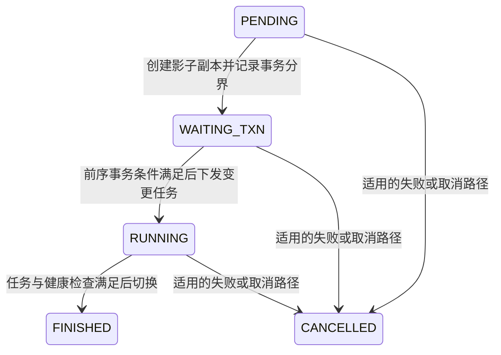

# 第 13 章　更新、合并与存储演进

[全书导航](../README.md) · [术语表](../appendices/A-glossary.md)

> 日期：2026-10-12。源码基线：`a53b182f810be2b3731c7dfdf6f40ff5a0ad63bd`。本章是源码阅读版 v1：关键入口与文中明确标出的分支已核对，未运行 Doris SQL、单测或性能实验。图和算例为教学示意；测试文件仅为后续验证入口，不代表已运行或完整覆盖。

## 13.1 更新一条订单，不一定原地改一个文件

业务上订单状态从 CREATED 变为 PAID，是同一个对象的更新。列式存储内部可以通过新写入、版本和删除信息共同表示这个变化，不要求把原文件中的那几个字节原地覆盖。

Unique Key 的逻辑结果与具体物理实现需要分开。Merge-on-Write 会在写入相关阶段处理同键数据的可见关系，让读取少承担部分合并工作；它不意味着旧文件马上消失，也不意味着没有并发版本问题。

## 13.2 Delete Bitmap：知道哪些物理行不应再参与

同一个键的新旧记录可能分布在不同 Rowset/Segment 中。Delete Bitmap 是 MOW 路径里表达相关行失效信息的重要结构。读取不能只凭“找到最新 Rowset”就忽略所有旧数据，因为旧 Rowset 还可能包含其他键的有效记录。

行位置依赖物理对象身份；Compaction 改变物理布局时，相应映射和删除信息也需保持正确。当前 `Tablet`、存储删除相关代码与 Compaction 路径存在这些交互，不能把 bitmap 当作一个永不变化的全表行号集合。

本章未逐行证明 MOW 各种并发更新算法，只建立必需的对象关系。具体改动必须继续核对发布、Compaction 与 bitmap 更新的同步条件。

## 13.3 部分列更新为何不能只看列清单

假设更新订单只提供 `order_id,status`，金额字段怎么办？可能需要保留旧值，也可能按照整行 UPSERT 规则填默认值。答案取决于表模型、导入方式、配置和版本，并不能只从 SQL 省略了 amount 推导。

官方[部分列更新说明](https://doris.apache.org/zh-CN/docs/4.x/data-operate/update/partial-column-update/)区分了相关模式及实现取舍。某些路径需要补齐数据，某些新能力又采用不同组织方式；本章不把所有部分更新概括为同一种“读旧行再写整行”。

实验时应同时检查被更新列、未提供列和不存在键的行为，并记录模式配置。仅看到 status 改对了，还不能证明金额没有被错误覆盖。

## 13.4 Compaction：物理整理保持逻辑结果

持续写入会积累多个 Rowset。Compaction 选择输入、合并数据、生成新的输出，再更新 Tablet 的 Rowset 组织和相关元数据。它应在适用的数据模型和版本语义下保持逻辑结果，不是把输入重新作为一次业务导入累计。

当前 `Compaction::merge_input_rowsets()` 将处理分为准备、执行、完成等阶段。`Tablet::modify_rowsets()` 负责 Rowset 集合变更的一部分工作，其中包含同版本替换的特殊顺序说明。这表明“新文件生成成功”仍只是整个过程的一段。

```text
选择合并输入
→ 创建读取与输出工作
→ 合并并生成结果
→ 更新 Rowset/版本及相关信息
→ 旧对象进入后续生命周期与回收处理
```

Base、Cumulative 等合并策略有不同选择范围与触发条件，本章不硬编码一套所有版本共用的阈值。合并减少读取开销的同时占用 CPU、I/O 和空间，应结合导入与查询负载观察。

## 13.5 为什么不能立即删除输入文件

查询可能已经持有旧 Rowset 的 Reader。合并完成后，新查询可选择新布局，老查询仍需其已经取得的数据对象。物理回收必须尊重生命周期，不能只看某个 Rowset 已从当前可选集合移除。

当前 `StorageEngine::start_delete_unused_rowset()` 检查共享引用计数和是否需要删除等条件，并区分本地与远端文件处理。这个入口展示了“逻辑退出当前集合”和“物理文件可删除”的区别；完整版本选择与回收关系见第 17 章。

## 13.6 Schema Change 与两类物化结果

修改列结构可能只改变某些元信息，也可能需要重写或转换存量数据；实际取决于修改类型与实现路径。它必须考虑并发导入、已有版本及读取兼容性，不能把 FE 接受 ALTER 当作所有物理工作瞬时结束。

同步物化索引参与表内的存储和写入组织，异步物化视图则有自己的构建/刷新及查询改写条件。二者都与预计算有关，但生命周期不同。遇到缺失或延迟的数据，应先确定对象类型，再找负责它的任务与版本。

Schema Change 的代表性作业状态机见本章 13.8 节；异步物化视图的刷新与改写见第 6 章 6.7 节。轻量变更和增量维护的全部细节仍未展开。

## 13.7 入口与验证重点

| 路径（相对仓库根目录） | 关注问题 |
|---|---|
| `be/src/storage/tablet/tablet.cpp` | `modify_rowsets()` 及 bitmap 相关调用 |
| `be/src/storage/compaction/compaction.cpp` | `merge_input_rowsets()` 各阶段 |
| `be/src/storage/storage_engine.cpp` | `start_delete_unused_rowset()` |
| `be/src/storage/delete/` | 删除信息计算的后续入口 |
| `be/src/storage/schema_change/` | 结构变更专题入口 |
| `fe/fe-core/src/main/java/org/apache/doris/mtmv/` | 异步物化视图专题入口 |

测试入口包括 `be/test/storage/compaction/base_compaction_test.cpp` 与 `be/test/storage/compaction/cumulative_compaction_test.cpp`。一次有效验证应比较合并前后的查询语义，并覆盖相关版本和并发条件；只检查输出文件变少不足以证明正确。本文未运行这些测试，也未触发集群 Compaction。


## 13.8 补充：需要影子索引的 Schema Change 如何推进

> 2026-10-13 全书检查补充。以下选择 `SchemaChangeJobV2` 的代表性路径；不能套用于全部 ALTER、轻量变更或 Cloud 特有流程。未运行 ALTER 或恢复实验。

如果改变存量数据的表示，需要在旧数据仍可服务时准备新表示。该路径利用 shadow index 组织新布局，并通过事务分界与任务完成检查安排切换。



这是普通作业状态示意；具体取消、超时和回放行为仍以各方法为准。

`runPendingJob()` 先检查表稳定性，再创建 shadow index 副本；随后取得 `watershedTxnId`，转为 WAITING_TXN 并记录 EditLog。影子对象面向内部导入组织，与用户已经看到新 Schema 是不同状态。

`runWaitingTxnJob()` 检查分界之前的相关导入事务；条件未满足则继续等待，满足后组织 BE Schema Change 任务并进入 RUNNING。分界的价值是区分旧工作和新布局的协调范围，不能只因 SQL 已受理就切换所有读取。

`runRunningJob()` 检查表是否仍存在、任务是否完成及失败情况。任务完成后还检查影子副本健康和版本追赶，在表写锁内执行 `commitShadowIndex()`、完成处理及表状态更新，写入完成日志。代码明确要求完成日志在表写锁内，以避免并发新增分区破坏回放条件。

由此可以区分三个用户现象：WAITING_TXN 卡住先看相关前序事务；RUNNING 卡住先看 BE 任务与失败原因；任务结束但恢复异常则继续看日志与 replay。Shadow 文件存在不是完成切换的证据，失败也不能通过直接把 jobState 改成 FINISHED 来解决。

| 源码路径（相对仓库根目录） | 阅读方法 |
|---|---|
| `fe/fe-core/src/main/java/org/apache/doris/alter/AlterJobV2.java` | `JobState`、`run()` 与按状态分派 |
| `fe/fe-core/src/main/java/org/apache/doris/alter/SchemaChangeJobV2.java` | `runPendingJob()`、`runWaitingTxnJob()`、`runRunningJob()`，再对照 replay 分支 |
| `fe/fe-core/src/test/java/org/apache/doris/alter/SchemaChangeJobV2Test.java` | `testSchemaChange1()`、`testSerializeOfSchemaChangeJob()` 等入口，未运行 |

尚需深入：FE 如何选择轻量或重写路径、BE 转换算法、并发导入与失败恢复测试。此处已经解释了状态推进，但没有证明全部 ALTER 兼容性。


---

[上一章：第 12 章](12-index-pruning-and-complex-types.md) · [全书导航](../README.md) · [下一章：第 14 章](14-load-entry-and-lifecycle.md)

## 源码深读补充（2026-10-13）

- [专题 3　从一列读取到更新、索引与 Schema Change](../deep-dives/03-storage-updates-and-indexes.md)
