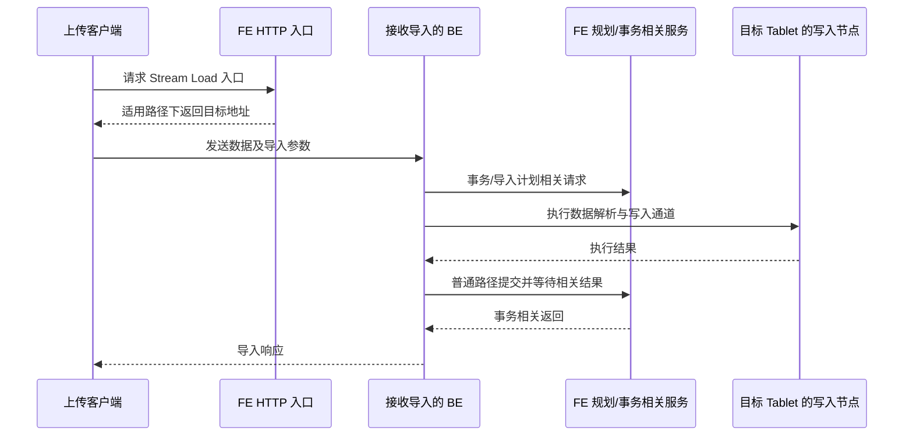

# 第 14 章　导入入口与任务生命周期

[全书导航](../README.md) · [前置：请求入口](04-request-session-and-command.md) · [相关章节：事务与可见性](16-transaction-commit-publish-visible.md)

> 日期：2026-10-12。源码基线：`a53b182f810be2b3731c7dfdf6f40ff5a0ad63bd`。本章围绕存算一体普通导入；Group Commit、2PC、Cloud 和新旧任务框架只标明差异，未运行导入实验。官方 4.x 文档用于接口概念参考，不等同于本地 HEAD 的发布版本。

## 14.1 先问：数据在哪里，谁来推动它

“导入”描述了最终目标，却没有说明数据怎么进来。业务程序手里已有一批订单，可以上传；数据已在对象存储，可以让系统读取；Kafka 持续产生数据，需要一个长期运行的消费作业；数据本来就能通过 SQL 读取，也可以用 INSERT SELECT 写入目标表。

| 入口 | 典型数据位置与触发方式 | 应首先观察什么 |
|---|---|---|
| INSERT | SQL 中的值，或 SELECT 的输出 | 语句执行结果、事务与可见性 |
| Stream Load | 客户端通过 HTTP 发送文件/流 | 本次响应、Label、Txn ID、行数和状态 |
| Broker Load | 提交批量读取外部文件的作业 | 作业受理、调度、执行和终态 |
| Routine Load | 长期消费 Kafka 数据 | 作业状态、任务、消费进度与错误 |

Broker Load 是异步批量导入，提交作业与完成导入是不同时间点；Routine Load 会持续生成消费任务。它们不能按“发一个请求、只看这个请求的返回值”来理解。[Broker Load 文档](https://doris.apache.org/docs/4.x/data-operate/import/import-way/broker-load-manual/)和 [Routine Load 文档](https://doris.apache.org/docs/4.x/data-operate/import/import-way/routine-load-manual/)分别说明了这两种使用模型。

对于 Stream Load，通常通过本次 HTTP 交互取得导入结果；这不意味着实现内部没有异步执行或等待，也不意味着每个超时都发生在同一阶段。

## 14.2 三种对象：请求、作业和事务

业务中一个“同步接口”常常对应后台多个动作。在 Doris 中更要区分以下层次：

- **请求**：一次 SQL 或 HTTP 交互，具有客户端连接和等待时限。
- **作业/任务**：负责调度或持续推进工作，可以超过某次请求的生命周期。
- **事务**：负责本次相关数据写入的提交与可见状态。

它们不是简单的一对一关系。长期运行的 Routine Load 作业可以产生多次任务和事务；异步作业的执行与回调也不只发生在最初请求线程里。调查重复写入或超时时，首先写清自己正在说哪一层的状态。

例如 `FINISHED` 常见于作业状态，`VISIBLE` 是事务状态；即便二者有关联，也不能拿一个状态字符串替代另一个对象的全部条件。当前 `LoadJob` 代码还包含 COMMITTED、RETRY 等路径，不能把网页上的简化状态图当成唯一枚举表。

## 14.3 Stream Load：沿数据流与控制调用一起读

普通路径的概念过程是：HTTP 请求选择接收节点，BE 建立导入上下文并推动执行，数据进入目标 Tablet 的写入链路，事务控制与 FE 协作，最后形成响应。当前 FE `LoadAction` 中能看到 `_stream_load` 路由、目标节点选择和重定向处理；也有不同策略分支，因此图只表示一个常见路径。

图中“接收 BE”和“写入节点”是职责划分，可以在同一台 BE，也可以涉及多个节点。它不是某次抓包的严格时间排序：流式数据处理、规划和接收可能交错。

精读当前 `be/src/service/http/action/stream_load.cpp`，可以在 `_on_header()` 找到普通分支的 `begin_txn()`，在 `_handle()` 找到执行和事务完成相关处理。代码中存在 `pre_commit_txn()` 与 `commit_txn()` 的分支，说明两阶段提交不能硬套普通的一次完成流程。

对应 `be/src/load/stream_load/stream_load_executor.cpp` 提供 `execute_plan_fragment()`、`begin_txn()`、`commit_txn()`、`rollback_txn()` 等入口。由这些入口再往下，才进入具体 RPC、数据通道和存储对象；本章停在导入生命周期，第 15 章展开物理写入。

## 14.4 一个 FE 调度器如何推进异步作业

选 `load/loadv2/LoadJobScheduler.java` 的 `process()` 精读，可以看到很接近业务中后台队列的组织方式：检查待调度队列，判断部分任务资源条件，取出作业，调用 `loadJob.execute()`。

最值得注意的是不同失败有不同含义：

| 当前代码分支 | 行为 | 阅读上的含义 |
|---|---|---|
| 队列为空 | 本轮返回 | 没有工作不属于导入失败 |
| 队首是 BrokerLoadJob 且相关任务池无空闲线程 | 本轮返回 | 作业可能仍在等待调度 |
| `LoadException` | 调用取消作业的处理 | 执行前后失败会进入作业生命周期 |
| `RejectedExecutionException` | 放回队列并结束本轮 | 当前资源拒绝不直接等于永久失败 |

这不是全部 Doris 导入共用的唯一调度器。当前仓库还存在 Routine Load 调度器和其他任务管理框架。我们选择一个具体实现讲清楚，避免把相似类名拼成不存在的统一调用链。

如果用户报告“导入一直没有开始”，你已经有了更准确的调查顺序：确认作业是否创建、是否进入对应队列、资源是否允许出队、是否执行后进入其他状态。只有最后才轮到目标 Tablet 是否生成文件。

## 14.5 `SHOW LOAD` 展示的记录从哪里来

`ShowLoadCommand.handleShowLoad()` 是一个观察入口，不是写入入口。当前代码先校验条件，再根据模式从 `LoadManager` 或 Cloud 实现获取记录，还会调用 `JobManager` 获取导入信息。若 `isStreamLoad` 为真，则使用 `StreamLoadRecordMgr` 的记录作为最终展示集合。

随后它选择排序规则、构造字符串行、应用 LIMIT，最后生成 `ShowResultSet`。这意味着“查不到记录”至少有几类可能原因：数据库/Label 条件不对、走了不同记录来源、记录没有保留，或作业确实不存在。不能直接推出“数据从未写入”。

Stream Load 的历史展示有相应记录配置与保留条件，应核对实际版本；官方文档也把历史记录与普通响应区分。[Stream Load 文档](https://doris.apache.org/docs/4.x/data-operate/import/import-way/stream-load-manual/)

## 14.6 Label、过滤行与重试

Label 用于标识导入批次，并参与重复请求处理。它的作用有数据库范围、状态与保留周期等条件；不能从“我用了 Label”直接推出整条上游业务永不丢失、永不重复。

响应出现 Label 已存在时，应先检查原任务状态和这次上传是否确实对应同一批数据。发布等待超时也应先沿原事务查证；换一个 Label 重新上传，可能把同一批订单作为新导入接受。对 Duplicate Key 表，这会保留重复明细。

行数同样要分开看：输入总行、成功加载、格式或类型等原因过滤、条件未选中的行，不一定相等。遇到错误行时先核对字段映射、格式和业务数据；调大过滤比例会改变允许的数据损失范围，不能把“任务成功”自动等价为“每一行都正确加载”。

这些是观察原则。本章没有执行上传，也没有对具体连接器承诺端到端投递语义。

## 14.7 源码与验证入口

路径均相对仓库根目录：

| 文件 | 阅读位置 |
|---|---|
| `fe/fe-core/src/main/java/org/apache/doris/httpv2/rest/LoadAction.java` | `_stream_load` 路由及重定向相关分支 |
| `be/src/service/http/action/stream_load.cpp` | `_on_header()`、`_handle()` |
| `be/src/load/stream_load/stream_load_executor.cpp` | `begin_txn()`、`execute_plan_fragment()`、`commit_txn()` |
| `fe/fe-core/src/main/java/org/apache/doris/load/loadv2/LoadJobScheduler.java` | `process()`、`submitJob()` |
| `fe/fe-core/src/main/java/org/apache/doris/load/loadv2/LoadJob.java` | 状态更新、执行及事务回调相关方法 |
| `fe/fe-core/src/main/java/org/apache/doris/nereids/trees/plans/commands/ShowLoadCommand.java` | `handleShowLoad()` |

后续实验可以选择同一小批数据，只采用一种入口，保存完整响应、Label/Txn ID 和查询结果。必须先说明表初始状态与重试次数，不把多次上传混成一次实验。SHOW 展示行为可参考现有 `ShowLoadCommandTest`；HTTP 上传与落盘需要另选回归或集成验证，本次未执行任何测试。

---

[上一章：第 13 章](13-updates-compaction-and-schema-evolution.md) · [全书导航](../README.md) · [下一章：第 15 章](15-physical-write-path.md)

## 源码深读补充（2026-10-13）

- [专题 4　副本写入、导入确认与恢复](../deep-dives/04-load-replicas-and-recovery.md)
