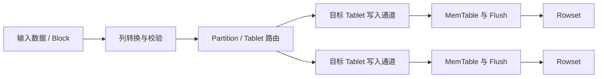

# 第 15 章　一批数据如何写进 BE

[全书导航](../README.md) · [术语表](../appendices/A-glossary.md)

> 教学结构修订：2026-10-14。每章先沿一个问题阅读代码，再做实验、观察结果，最后解释对象和分支。历史正文基线为 `a53b182f810be2b3731c7dfdf6f40ff5a0ad63bd`；本次摘录取自当前本地文件，完整文件 SHA-256 与行号保存在[源码摘录清单](../examples/08-chapter-workshops/source-manifest.json)。运行证据来自报告版本 `doris-0.0.0-a53b182f810` 的二进制，不能仅凭版本前缀认定当前工作目录与二进制逐文件相同。

**本章问题：数据写到 Rowset 后，为什么还需要 Publish？**

本章验证方式：已归档运行证据 + 源码走查；扩展分支见本章边界。建议先用 20—40 分钟完成主案例，第四部分的扩展阅读可分次完成；这不是新增的每日必交任务。

## 一、源码讲解：先找到决定行为的对象和分支

DeltaWriter.commit_txn 进入 RowsetBuilder 的本地事务步骤；它不是 FE 的全局完成通知。沿 write → wait_flush → build_rowset → commit_txn，再接 EnginePublishVersionTask，区分物理产物与可查询版本。

### 先读这段真实代码

文件：`be/src/load/delta_writer/delta_writer.cpp`，当前文件第 242—246 行。下面是连续原文摘录，局部片段省略了方法的其他部分；不要把片段当完整实现。

```cpp
Status DeltaWriter::commit_txn() {
    std::lock_guard<std::mutex> l(_lock);
    SCOPED_TIMER(_commit_txn_timer);
    return _rowset_builder->commit_txn();
}
```

### 这几行应该怎样读

`std::lock_guard` 在作用域结束时自动释放 `_lock`，相当于有确定退出边界的加锁；`SCOPED_TIMER` 统计这个局部步骤；返回值来自 `_rowset_builder->commit_txn()`。方法名相同不代表它就是 FE 事务的 VISIBLE 转换。

### 本章接在哪里

第 14 章讲请求、作业和导入入口，第 16 章讲事务完成。本章填上中间的物理数据路径：输入 Block 如何被分到目标 Tablet，如何进入 MemTable，如何形成 Rowset，最终如何参与发布。

范围为存算一体普通内表写入。当前代码存在不同通道、writer 版本以及特殊表路径，下面选代表性实现解释共同职责，不声称每种导入依次调用同一组函数。

### 从输入列到目标分片

导入需要把外部字段或 SQL 输出转换成目标表所需的列。类型转换、空值、长度和过滤等问题，应在相关阶段产生明确的行处理结果，而不是把不能写入的数据默默当成成功。

转换后还要决定目标分区与桶。当前 `OlapTabletFinder::find_tablets()` 先进行分区查找，再处理合格行的 Tablet 定位。当前实现包含按行定位、随机桶或批次相关模式，所以图中的“路由”只是一个职责名称。



图中画两个目标只是示意。副本传输和通道具体协议尚未展开，不能从它推导副本写入顺序或提交数量要求。

### DeltaWriter 把写入与存储对象衔接起来

`DeltaWriter::write()` 接收 Block 与该 Tablet 对应的行信息，并交给 MemTable writer。代码还能看到 Flush 并发相关等待，说明写入速度会受后台落盘能力约束，而非无限积累内存。

`build_rowset()` 和 `commit_txn()` 又把工作交给 Rowset builder。这里的名字值得特别注意：**BE 本地 `commit_txn()` 不等于 FE 全局事务已经 VISIBLE。** 它登记和保存本地事务关联的 Rowset 等状态，是分布式完成链路的一部分。

如果日志只看到 BE commit 成功，下一步应继续查 FE 提交/发布与可见状态；不要直接把这一条日志当作客户端查询一定能看到数据的证据。

## 二、动手实验：先预测，再核对

默认使用已保存的实验材料或只读源码，不需要启动服务。运行环境已停止；若选择重新执行 SQL，先按[实验复现说明](../examples/07-live-lab-20261014/REPRODUCE.md)确认服务、版本与数据状态。初始化、导入和更新脚本不可在现有表上盲目重放。

1. 读 26 双分区 INSERT 输出，标出 txnId=16、两个目标分区和客户端 VISIBLE。
2. 阅读本章 DeltaWriter 摘录，继续进入 RowsetBuilder.commit_txn；在纸上分别标注持有的锁、生成的 Rowset、交付的事务对象。
3. 回看 20—24 的 2PC 记录，解释为什么成功接收三行后仍能查询到旧计数，直到最终提交才改变。

本章实验材料：[26-partition-table.out.txt](../examples/07-live-lab-20261014/26-partition-table.out.txt) · [20-two-phase-precommit.response.json](../examples/07-live-lab-20261014/20-two-phase-precommit.response.json) · [21-before-2pc-commit.out.txt](../examples/07-live-lab-20261014/21-before-2pc-commit.out.txt) · [24-after-2pc-commit.out.txt](../examples/07-live-lab-20261014/24-after-2pc-commit.out.txt)。

## 三、观察结果：先陈述事实，再划清证据范围

双分区 INSERT 完成后两个分区都可读；独立 2PC 案例在 PRECOMMITTED 时仍为 3/60，最终 commit 后为 6/120。两组记录是不同事务，不能串成 txnId=16 的同一条日志。

**本章边界：** 没有采集 MemTable Flush 次数、Rowset 文件数量或副本写入确认日志；这些细节不能由最终行数倒推。

## 四、回到源码解释：把现象还原成执行过程

本地 commit_txn 负责把写入产物交给本地事务管理，查询还要等待版本发布与目录推进。只有把本地锁保护的动作和 FE 全局事务边界分开，才能理解“文件可能已经存在，但查询还不可见”。

### 用自己的话走完这条链

合上结果后，按“输入 → 关键对象/状态 → 分支条件 → 可观察结果”的顺序回答本章问题：**数据写到 Rowset 后，为什么还需要 Publish？** 再指出一项尚不能从现有实验得出的结论。能把每个箭头落到本章的方法或证据，比记住术语更接近读懂源码。

### MemTable：内存中的组织与 Flush

当前 `MemTable::insert()` 使用输入 Block 和行下标等信息组织内容。随后排序、聚合或同键处理会根据模型及配置进入相应路径。Duplicate Key、Aggregate Key、Unique Key 不应被描述成在内存中做完全相同的动作。

Flush 把整理后的数据交给后续文件写出流程。异步 Flush 允许前台与后台交错，但也需要等待、错误传播和取消处理。`wait_flush()` 的存在提醒我们：提交依赖的产物可能还没准备完，不能只因为已经发起 Flush 就构建成功结果。

一次输入批次、一个 MemTable、一个 Segment、一个 Rowset 不是固定一对一映射。批次大小、写入目标、Flush 条件和文件组织都会改变数量。性能分析应记录实际产物，而不是用 SQL 次数估计文件数。

### RowsetBuilder 与本地事务

当前 `RowsetBuilder::init()` 的路径包含事务准备；`build_rowset()` 组织构建输出；`RowsetBuilder::commit_txn()` 调用存储引擎的 TxnManager。阅读时要同时追资源持有与失败清理：某个步骤失败后，待用文件和事务记录由谁处理？

`TxnManager` 有 prepare、commit、publish 等不同入口。名字与 FE 阶段相似，但对象范围不同：这里面向本地 Tablet 等存储状态，FE 还要协调全部相关数据和副本。把两个层次画在同一状态框里，会丢失失败定位所需的信息。

### Publish 把本地产物接入可读取组织

当前 `engine_publish_version_task.cpp` 的 `publish_version_and_add_rowset()` 是明确的代码窗口：先调用 TxnManager 的发布处理，再把 Rowset 加入 Tablet 的相关组织，同时记录出错的 Tablet。

但单个 BE 的动作完成仍不等于整个事务已对查询可见。FE 还需检查发布结果、版本连续性和其他完成条件，见第 16 章。这个边界解释了为什么“文件存在”“BE 发布成功”“FE VISIBLE”可以是三个不同观察点。

### 源码与验证

| 路径（相对仓库根目录） | 阅读入口 |
|---|---|
| `be/src/exec/sink/vtablet_block_convertor.cpp` | 输入转换 |
| `be/src/exec/sink/vtablet_finder.cpp` | `find_tablets()` |
| `be/src/load/delta_writer/delta_writer.cpp` | `write()`、`wait_flush()`、`build_rowset()`、`commit_txn()` |
| `be/src/load/memtable/memtable.cpp` | `insert()`、排序与聚合组织 |
| `be/src/storage/rowset_builder.cpp` | 本地产物与事务衔接 |
| `be/src/storage/task/engine_publish_version_task.cpp` | `publish_version_and_add_rowset()` |

可读 `be/test/load/delta_writer/delta_writer_test.cpp`、`be/test/load/memtable/memtable_sort_test.cpp` 和 `be/test/storage/txn/txn_manager_test.cpp`。未运行这些测试。

后续验证应从同一个事务关联输入行数、目标 Tablet、Flush/Rowset 和发布结果。不要直接改内存限额掩盖持续增长，也不要删除不熟悉的文件来“修好”可见性；先确认它处于未完成写入、等待发布还是待回收状态。

### 延伸源码专题

- [专题 4　副本写入、导入确认与恢复](../deep-dives/04-load-replicas-and-recovery.md)

---

[全书导航](../README.md) · [术语表](../appendices/A-glossary.md)
