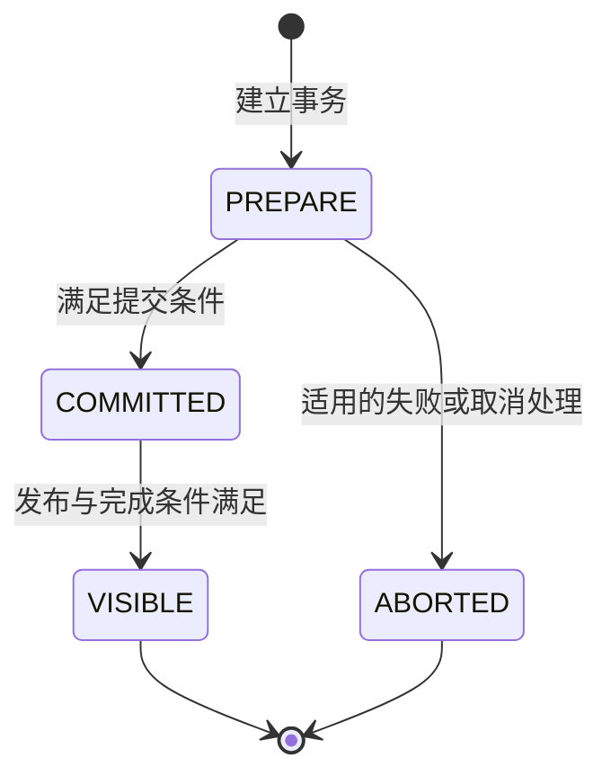

# 第 16 章　事务：Begin、Commit、Publish、Visible

[全书导航](../README.md) · [前置：导入生命周期](14-load-entry-and-lifecycle.md) · [贡献阅读路线：从现象到模块](27-from-symptom-to-module.md)

> 日期：2026-10-12。源码基线：`a53b182f810be2b3731c7dfdf6f40ff5a0ad63bd`。主线为存算一体、普通内表事务；已阅读关键 FE 方法，未运行事务测试或故障实验。2PC、子事务、Cloud、Binlog/TSO 和特殊表路径不在本章建立完整语义模型。

## 16.1 一个很具体的问题：为什么已经提交却还看不见

第 3 章已经看到，INSERT 写入后还有提交和等待可见的处理。现在把问题缩小：BE 已经接收数据，FE 也接受了事务提交，为什么 SELECT 仍可能没有读到它？

因为分布式写入的完成需要协调多个对象：实际写入产物、相关 Tablet 的副本、分区版本、事务记录和查询使用的可见状态。提交确认与这些状态最终满足查询条件之间，可以存在时间差。

对于业务开发者，可以把它理解为“已经作出提交决定”和“读路径已经可以按规则使用新数据”两个层次。这个类比只帮助区分阶段，不意味着 Doris 使用了某种通用消息队列事务方案。

## 16.2 状态机的主干与范围

当前 `TransactionStatus` 包含 `PREPARE`、`COMMITTED`、`VISIBLE`、`ABORTED`、`PRECOMMITTED`。下图只画本章普通路径：



`PRECOMMITTED` 对应的路径需要另看两阶段提交；不能因为图里省略就说实现只有四种状态。子事务也会改变提交信息的组织。`TransactionStatus.isFinalStatus()` 将 VISIBLE 与 ABORTED 判为终态，是一个比“状态名字看起来像结束”更直接的代码证据。

COMMITTED 后的超时不能按 PREPARE 阶段的失败处理：不应假定此时可以任意回滚并安全重发。具体接口的终止条件要以实现为准。

## 16.3 Begin：先建立一份可追踪的状态

`DatabaseTransactionMgr.beginTransaction()` 是按数据库组织事务的一个入口。阅读时应关注它接收的表标识、Label、请求标识、协调者/来源以及超时等信息，并继续看事务状态如何登记。

事务 ID 让后续提交、发布和查询状态可以指向同一个工作单元；Label 则提供另一种与导入批次相关的定位方式。两者不是可以任意互换的字符串。只保存业务“订单批次号”，却丢掉服务实际返回的 Label/Txn ID，会让超时后的查证困难很多。

Begin 也不意味着 FE 已经把全部订单保存在事务对象中。大批业务数据走写入通道，事务对象保存的是协调这个过程所需的信息。读代码时看字段，区分数据内容与数据位置、提交状态。

## 16.4 Commit：检查写入结果并组织版本信息

`DatabaseTransactionMgr.commitTransaction()` 的主线包括：检查事务状态、核对提交信息、准备状态转换、在相关同步范围内再次核对状态并执行提交、处理持久化，最后更新提交后的目录状态。

普通路径中的 `unprotectedCommitTransaction()` 会按涉及的表和分区生成提交信息，使用分区的 `nextVersion`，填充到事务记录中。当前实现特意在提交信息准备好后再把状态设为 COMMITTED，以免发布线程观察到“已经提交但提交信息还没填好”的组合。

这个顺序是源码分析中很值得关注的约束：字段赋值并非只有值对不对，还要看其他线程什么时候能观察到它。不能随意把状态赋值移到方法开头来“让代码更简洁”。

提交条件也不是“所有 BE 返回里超过一半成功”。数据分散在多个 Tablet 上，必须沿相关 Tablet/副本和表配置判断是否满足条件。整批统计成功节点数会掩盖某个 Tablet 没有足够可用数据的情况。具体副本条件存在配置和特殊路径，本章不硬编码一个普遍适用的数字公式。

### 内存修改、日志与方法返回不是同一个时间点

当前提交代码可以选择 `enqueueTransactionState()` 或 `persistTransactionState()`，并在适用条件下 `awaitTransactionState()`，之后还有 `updateCatalogAfterCommitted()`。因此，看到 `setTransactionStatus(COMMITTED)` 不能直接宣称那一行就是客户端可依赖的完整持久化边界。

解释可靠性时要同时看调用者持锁条件、内存状态、日志等待和失败行为。第 18 章会继续解释 FE 日志，本章只保留这条必须核对的边界。

## 16.5 Publish：由后台工作推进

`PublishVersionDaemon.runAfterCatalogReady()` 调用发布逻辑。`publishVersion()` 获取待发布事务，取得相关 BE 信息，驱动发布任务并尝试完成事务。`genPublishTask()` 与 `addPublishVersionTask()` 等方法组织 `PublishVersionTask`。

因此，普通提交调用的返回等待与后台发布不是同一个循环。客户端等待结束，并不自动让后台停止推进；某次任务没完成，也不必然表示事务已经转为 ABORTED。

BE 发布的存储动作可结合第 15、17 章的本地事务和 Rowset 解释。本章不把“FE 发出了 PublishVersionTask”当作“BE 已成功执行”，更不当作“FE 已经推进可见状态”。需要继续追任务结果及完成检查。

## 16.6 Finish：为什么前一个版本会挡住后一个

普通路径 `finishCheckPartitionVersion()` 中有一个清楚的条件：分区当前 `visibleVersion` 应等于本事务该分区提交版本减一，否则返回未满足条件并记录等待信息。

例如，假设某分区当前可见版本是 9，事务 A 对应版本 10，事务 B 对应版本 11。即便 B 的某些物理发布工作先完成，普通顺序检查仍不允许仅因“11 的文件已准备好”就跳过 10 推进到 11。这维护了这里所要求的版本连续性。

这是一个教学例子，不是本机日志；也不能泛化为“所有数据库共享一个全局版本队列”。不同分区有各自版本，事务又可能涉及多个分区。跨分区完成需要结合事务整体检查与锁范围，不能为某个分区挑一个成功结果就宣布整笔事务可见。

`finishTransaction()` 在适用的版本检查之后还检查发布副本条件；成功后修改事务状态、处理相关日志并调用 `updateCatalogAfterVisible()`。后者最终更新分区可见版本等目录信息。查询端再通过扫描范围使用相关版本，接回第 3 章的读路径。

本章未证明所有语句/事务模式下的全库快照隔离语义；不能从单条普通分区检查推导出那样的结论。

## 16.7 提交并等待可见：一个布尔值背后的阶段差异

`GlobalTransactionMgr.commitAndPublishTransaction()` 的普通重载提供了很清晰的阅读窗口：

```text
按时限获取相关表锁
→ 在锁范围内提交
→ 释放锁
→ 从总时限中扣除提交耗时
→ 用剩余时间等待事务完成
```

如果提交已经耗尽时限，该方法可以返回 false，表示等待发布的时间不足；这不是“提交过程根本没发生”。若还有剩余时间，会调用 `DatabaseTransactionMgr.waitForTransactionFinished()`。

后者检查状态，在 COMMITTED 时等待可见信号，并以最终是否 VISIBLE 返回布尔值。这种接口必须连同异常、状态和调用者一起解释。返回 false、抛异常、客户端断开连接，不能统一转换成“回滚后重试”。

`OlapInsertExecutor.onComplete()` 调用带重试的事务接口时，也区分 VISIBLE 和提交后等待超时的 COMMITTED 结果；不同入口如何呈现给客户端还需看其后续响应处理。

## 16.8 故障观察表

| 现象 | 优先核对 | 暂时不能下的结论 |
|---|---|---|
| 客户端超时，没有完整响应 | 原事务是否存在、是否提交、当前状态 | 这批数据一定没写入 |
| COMMITTED 停留较久 | 发布任务结果、版本连续性、副本条件、日志 | 直接改状态成 VISIBLE 就能修好 |
| 某 BE 已有新 Rowset | 对应事务与发布状态、FE 可见版本 | 所有查询现在都会读到它 |
| 后一版本等前一版本 | 同一分区前序事务及其完成条件 | 全集群所有表都被阻塞 |
| 同一批次重试后行数翻倍 | Label、重试次数、表模型 | 聚合引擎一定算重了 |

这张表是诊断方向，不是具体故障的根因报告。没有日志和状态证据时，应保留未知项。

## 16.9 六个阅读入口与测试边界

| 文件（相对仓库根目录） | 核对位置 |
|---|---|
| `fe/fe-core/src/main/java/org/apache/doris/transaction/TransactionStatus.java` | 枚举、`isFinalStatus()` |
| `fe/fe-core/src/main/java/org/apache/doris/transaction/GlobalTransactionMgr.java` | `commitAndPublishTransaction()` |
| `fe/fe-core/src/main/java/org/apache/doris/transaction/DatabaseTransactionMgr.java` | Begin/Commit/Finish、版本检查和目录更新 |
| `fe/fe-core/src/main/java/org/apache/doris/transaction/PublishVersionDaemon.java` | `publishVersion()`、任务生成、完成尝试 |
| `fe/fe-core/src/main/java/org/apache/doris/nereids/trees/plans/commands/insert/OlapInsertExecutor.java` | `onComplete()` |
| `fe/fe-core/src/test/java/org/apache/doris/transaction/DatabaseTransactionMgrTest.java` | `testNormal()` 及各事务场景测试 |

已阅读的 `testNormal()` 检查了预先准备的事务数量、Label 映射和部分状态；它不是从真实 BE 写入到查询可见的端到端证明。选择测试时需要先读夹具和实际断言，不靠测试名字推断覆盖范围。本章没有运行该测试，也没有注入发布故障。

对于下一次真实问题，先画出停在哪个阶段，再选择入口和测试；这会比先盯着某条异常尝试改代码更容易建立可靠结论。


---

[上一章：第 15 章](15-physical-write-path.md) · [全书导航](../README.md) · [下一章：第 17 章](17-mvcc-snapshots-and-rowset-lifetime.md)

## 源码深读补充（2026-10-13）

- [专题 4　副本写入、导入确认与恢复](../deep-dives/04-load-replicas-and-recovery.md)
