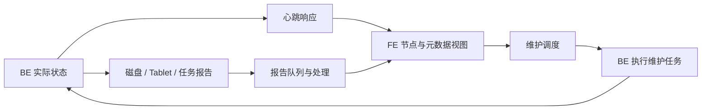

# 第 19 章　节点管理与后台维护

[全书导航](../README.md) · [术语表](../appendices/A-glossary.md)

> 日期：2026-10-13。源码基线：`a53b182f810be2b3731c7dfdf6f40ff5a0ad63bd`。正文 v1；已核对文中明确分析的关键方法和入口，未启动集群、执行 SQL、运行测试或进行故障实验。示意图不代表本机实测拓扑。

## 19.1 “节点活着”与“数据可用”不是同一句话

BE 进程存在，不代表某个 Tablet 副本有目标版本；心跳成功，也不保证所有磁盘、任务与数据都健康。反过来，一次网络请求失败也不能仅凭这一条日志断言该节点上的数据已经永久丢失。

集群管理需要不断收集状态，把实际状态与期望状态比较，再安排修复或调整。这里既有周期性观察，也有异步任务，不能把整个系统画成一次同步的“检查失败就复制”。

## 19.2 注册、心跳与报告

注册建立 FE 对节点身份和连接信息的认识；心跳提供节点可达性及相关运行状态；报告进一步传递任务、磁盘、Tablet 等信息。它们解决的问题不同。

当前 `HeartbeatMgr.runAfterCatalogReady()` 组织心跳工作并处理返回，`handleHbResponse()` 按响应类型更新相关节点对象。具体失败计数与状态判断还要进入节点实现；本章不假设“失败一次立即永久下线”。

`ReportHandler` 则按请求内容区分任务、磁盘、Tablet 等报告，构造相应任务并进入队列。报告里还有版本/顺序相关信息。这说明收到报告与完成状态对账之间可以有异步处理，不应把一条接收日志当作所有状态已经更新。

这是职责闭环，省略真实 RPC 方向及完整协议。心跳响应与报告不是一条通道的两种名称。

## 19.3 副本修复在修什么

一个 Tablet 可能存在副本数量不足、某份副本版本落后、存储介质或位置不符合要求等问题。修复应针对具体异常选择源与目标，还要考虑版本、资源和调度限制。

当前 `TabletScheduler.runAfterCatalogReady()` 会处理正在运行的 Tablet 任务，再调度待处理项。`schedulePendingTablets()` 中还有适用性、状态和错误分支。由此可见，修复请求进入队列后，不保证下一轮立刻开始复制。

如果源副本无法提供所需数据，增加一个空目标并不会恢复丢失的版本。应先确认健康数据来源，再讨论复制资源。一个查询是否可继续，还取决于它是否能选择到满足版本要求的副本。

## 19.4 Repair、Balance 与退出节点

Repair 优先解决数据可用性或副本状态问题；Balance 关注分布与负载等布局目标，两者可能使用部分共用调度机制，但动机不同。

节点退出也不是停止进程的同义词。计划内退出通常需要先确认数据迁移和副本安排满足条件；直接停止节点只是制造了不可达状态，后续系统仍需判断并处理。具体操作命令和完成标准应按运行版本及部署模式核实，本章不提供会修改现有集群的脚本。

高可用不是“永远不报错”。即使存在冗余，短暂调度、重试、恢复和资源压力仍可能影响延迟。分析时需要把错误、恢复时间与最终数据完整性分开记录。

## 19.5 备份为何不能由副本替代

副本帮助系统在部分节点故障时继续提供数据；备份用于保留可恢复的历史副本及必要元信息。误删或错误更新可能通过正常流程影响所有在线副本，所以在线副本不能自动满足历史恢复要求。

同样，只有数据文件而缺少相应元信息和恢复流程，也不一定得到可用的备份。当前 FE 的 `backup/` 提供备份恢复相关入口；支持对象、仓库类型及部署模式要逐项确认，不能把本章扩展成全功能灾备承诺。

## 19.6 一条排障证据链

假设用户说某张表突然查询失败，可按四层收集证据：节点是否可达；对应 Tablet 的副本和版本；修复任务是否已进入队列/运行；任务失败是否指向源数据、资源或目标条件。

每层都需要时间与标识：BE ID、Tablet ID、事务/版本、任务状态。不要只贴一段包含 ERROR 的日志就选一个配置调大。报告延迟、调度等待和实际数据损坏需要不同证据。

## 19.7 源码与测试

| 路径（相对仓库根目录） | 阅读位置 |
|---|---|
| `fe/fe-core/src/main/java/org/apache/doris/system/HeartbeatMgr.java` | 心跳组织与响应处理 |
| `fe/fe-core/src/main/java/org/apache/doris/master/ReportHandler.java` | 报告分类、排队与处理 |
| `fe/fe-core/src/main/java/org/apache/doris/clone/TabletScheduler.java` | `handleRunningTablets()`、`schedulePendingTablets()` |
| `fe/fe-core/src/main/java/org/apache/doris/system/Backend.java` | 节点状态对象 |
| `fe/fe-core/src/main/java/org/apache/doris/backup/` | 备份恢复专题入口 |

可参考 `fe/fe-core/src/test/java/org/apache/doris/system/HeartbeatMgrTest.java` 和 `fe/fe-core/src/test/java/org/apache/doris/backup/BackupHandlerTest.java`。本章没有停节点、删除副本或执行备份恢复，也未运行测试。未来故障实验应使用隔离数据并保留前后状态，不能拿当前学习集群的唯一数据验证破坏性操作。

---

[上一章：第 18 章](18-metadata-journal-and-fe-ha.md) · [全书导航](../README.md) · [下一章：第 20 章](20-authentication-authorization-and-entrypoints.md)

## 源码深读补充（2026-10-13）

- [专题 5　元数据持久化、维护作业与正常授权链](../deep-dives/05-metadata-maintenance-and-access.md)
