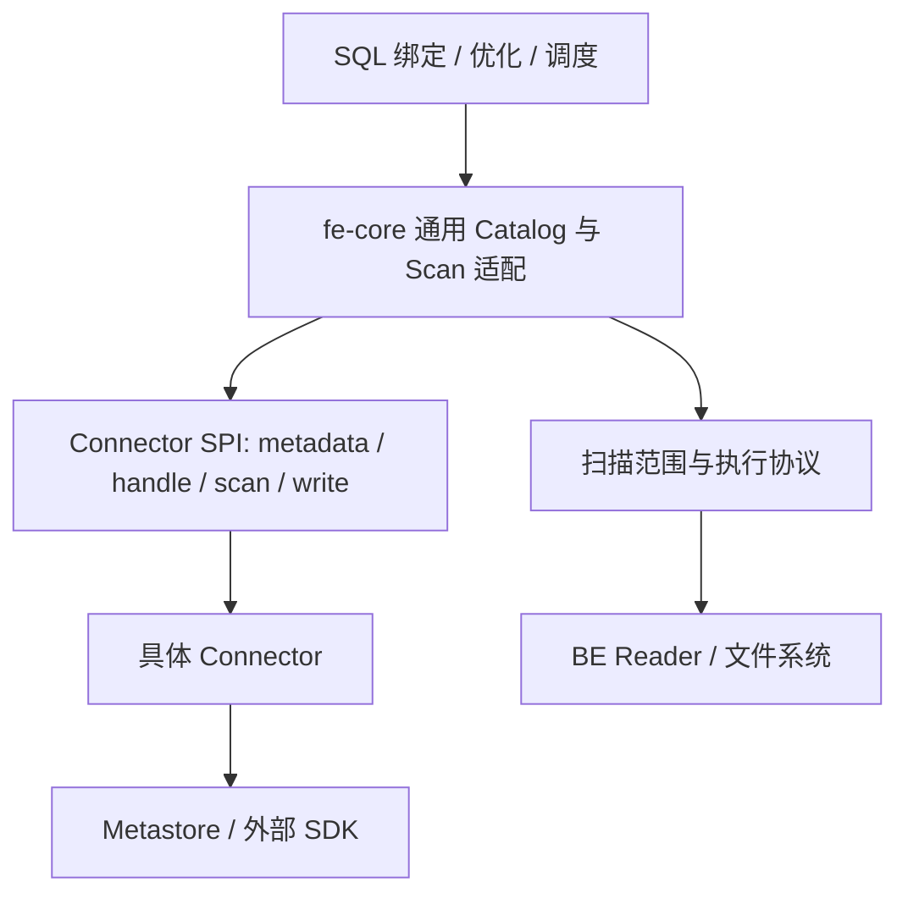

# 第 22 章　Catalog 与 Connector 的分层设计

[全书导航](../README.md) · [术语表](../appendices/A-glossary.md)

> 日期：2026-10-13。源码基线：`a53b182f810be2b3731c7dfdf6f40ff5a0ad63bd`。正文 v1；已核对代表性源码与模块说明，未启动集群、执行 SQL 或运行测试。图为职责示意，不是本机实测拓扑。

## 22.1 表名背后为什么还要有 Catalog

业务系统通常把数据库连接交给连接池，再通过 DAO 访问表。Doris 查询可能同时引用内部订单表和外部湖表，因此在 database、table 之上还需要 Catalog：它提供一组命名空间以及找到这些对象的方式。

内部表由 Doris 管理数据模型、Tablet 和写入事务；外表的名字、Schema、快照或文件集合来自外部系统。二者都能参与 SQL 绑定和计划生成，但不能由“都叫 Table”推断它们拥有相同的数据生命周期。删除 Catalog、删除远端表、回收对象文件也不是同一个动作，必须沿具体 DDL 能力判断。

可以把 Catalog 理解成接入一个数据世界的入口，Connector 则是该世界与 Doris 引擎之间的实现协议。Catalog 实例持有配置与生命周期；Connector 类型可以有多个实例，分别连接不同环境。

## 22.2 当前代码的三层边界

当前 `fe/fe-connector/README.md` 给出的边界很明确：Connector 不依赖 fe-core；fe-core 通过中性接口和 handle 获取能力。这样可以分别演进引擎和数据源实现，减少“每增加一种源，就在通用规划器里加一个类型分支”的压力。

`ConnectorProvider` 负责识别类型和创建实例；`Connector` 暴露元数据、扫描等能力；`ConnectorMetadata` 面向数据库、表和列等信息。不是所有 Connector 都实现所有能力，更不能从能读推断能写或支持任意 DDL。能力发现让引擎先判断接口是否可用，再进入对应路径。

Metastore 层负责元数据后端的访问，文件系统层负责存储访问属性等职责。Iceberg 表格式、承载元数据的 Catalog 后端、保存文件的对象存储是三个不同维度；“使用 Iceberg”并没有唯一确定另外两个维度。

## 22.3 从配置到语句作用域

通用工厂负责把 Catalog 类型和配置连接到插件实例；`PluginDrivenExternalCatalog` 是当前框架的引擎侧适配对象。插件管理包含发现、API 兼容性检查和名称管理，详细加载职责见第 24 章。

真正查询时，`PluginDrivenMetadata.get(session, connector)` 从语句作用域获得元数据对象。源码以 Catalog ID 组成缓存键，经 `getOrCreateMetadata` 创建或复用；语句结束时由作用域管理释放。这解决同一语句重复访问同一 Catalog 时的对象复用与资源回收问题。

这里有两个容易混淆的缓存：

| 层次 | 目的 | 阅读时要追踪的边界 |
|---|---|---|
| 语句内 memo | 同一语句重复使用解析结果或资源 | 语句结束、取消、异常以及特殊结果协议的结束时间 |
| 跨查询元数据缓存 | 减少远端请求 | 键、有效期、刷新、失效、身份与版本条件 |

语句内复用不意味着全局永远复用，也不能把刷新数据库列表理解成清空所有文件、统计和快照缓存。Iceberg 实现还分别维护表、manifest、格式等缓存，开关和使用条件各不相同。

## 22.4 从元数据走向扫描

FE 需要知道列类型以完成绑定，需要统计信息辅助优化，还需要把一次扫描拆成可调度的范围。这三类需求相关，却不是同一个接口返回一切。

`PluginDrivenScanNode` 继承文件查询扫描节点的通用组织方式，将源相关规划委托给 `ConnectorScanPlanProvider.planScan`。返回的 `ConnectorScanRange` 随后进入 split 分配和执行协议转换。BE 接收足够的文件、格式、列与过滤信息，执行真正读取；不能据此假定 BE 会调用 FE 的 Java Connector 对象。

普通同步规划和流式获取 split 可以并存。遇到大量文件，理解“何时生产范围、何时消费范围、谁关闭生产者”往往比仅找到 `getSplits()` 更有价值。

## 22.5 刷新问题如何定位

假设远端表新增一列，Doris 暂时看不到。先记录同一张表的 Catalog、Schema 与查询时间，再区分：名字发现没有更新、表 Schema 缓存未失效、当前语句已经固定旧元数据，还是实际连到了另一个环境。此时直接改 Reader 通常距离问题太远。

如果列能解析，但扫描报类型错误，则继续检查 handle 中的类型与读取端所见的文件 Schema。表结构可以演进，旧文件不会因为 FE 看到了新 Schema 就自动重写。

对 Java 开发者，适合从一个明确的元数据契约进入贡献：输入属性如何校验、刷新后哪个对象应重建、异常如何携带表身份。先定义可验证行为，再选择实现层，避免把连接器改动扩散到通用规划器。

## 22.6 源码入口

以下路径相对 Doris 仓库根目录。

| 入口 | 本章用途 |
|---|---|
| `fe/fe-connector/README.md` | 模块依赖、SPI 能力与引擎适配的总体约定 |
| `fe/fe-connector/fe-connector-spi/` | ConnectorProvider、Connector 和中性接口 |
| `fe/fe-core/src/main/java/org/apache/doris/datasource/plugin/PluginDrivenMetadata.java` | `get` 与语句作用域 memo |
| `fe/fe-core/src/main/java/org/apache/doris/datasource/scan/PluginDrivenScanNode.java` | 源相关规划与通用 Scan 的接合 |
| `fe/fe-connector/fe-connector-iceberg/src/main/java/org/apache/doris/connector/iceberg/IcebergConnector.java` | 实例资源、缓存与能力提供 |

下一章用一次 Iceberg 查询把这些接口连起来。

---

[上一章：第 21 章](21-resource-governance-observability-and-ui.md) · [全书导航](../README.md) · [下一章：第 23 章](23-external-table-query.md)

## 源码深读补充（2026-10-13）

- [专题 7　外部范围、缓存失效与 UDF 生命周期](../deep-dives/07-connectors-udf-and-ecosystem.md)
