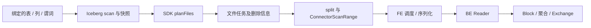

# 第 23 章　一条外表查询的完整链路

[全书导航](../README.md) · [术语表](../appendices/A-glossary.md)

> 教学结构修订：2026-10-14。每章先沿一个问题阅读代码，再做实验、观察结果，最后解释对象和分支。历史正文基线为 `a53b182f810be2b3731c7dfdf6f40ff5a0ad63bd`；本次摘录取自当前本地文件，完整文件 SHA-256 与行号保存在[源码摘录清单](../examples/08-chapter-workshops/source-manifest.json)。运行证据来自报告版本 `doris-0.0.0-a53b182f810` 的二进制，不能仅凭版本前缀认定当前工作目录与二进制逐文件相同。

**本章问题：Iceberg 文件都找到了，为什么还不等于正确读到表？**

本章验证方式：源码走查与状态推演；无该主题的集群实测。建议先用 20—40 分钟完成主案例，第四部分的扩展阅读可分次完成；这不是新增的每日必交任务。

## 一、源码讲解：先找到决定行为的对象和分支

沿 IcebergScanPlanProvider.planScan 追 table handle、filter、snapshot 与 scan ranges，再把它交给 BE Iceberg Reader。文件列表只是一次表语义的物理载体，Schema 演进和 delete files 仍然影响结果。

### 先读这段真实代码

文件：`fe/fe-connector/fe-connector-iceberg/src/main/java/org/apache/doris/connector/iceberg/IcebergScanPlanProvider.java`，当前文件第 436—454 行。下面是连续原文摘录，局部片段省略了方法的其他部分；不要把片段当完整实现。

```java
    public List<ConnectorScanRange> planScan(ConnectorSession session, ConnectorScanRequest request) {
        IcebergTableHandle icebergHandle = (IcebergTableHandle) request.getTableHandle();
        try {
            // The reuse key deliberately omits projected columns because they do not change Iceberg split
            // planning. Reader compatibility still depends on whether metadata columns are requested, so
            // validate every call before a cached range list can be returned.
            validateMetadataColumnReader(session, request.getColumns());
            if (session == null || !session.isExternalScanTaskReuseEnabled()) {
                return planScanInternal(session, icebergHandle, request.getColumns(),
                        request.getFilter(), request.isCountPushdown());
            }
            if (icebergHandle.isSystemTable()) {
                // System tables read connector metadata through their own readers; never reuse them.
                return planScanInternal(session, icebergHandle, request.getColumns(),
                        request.getFilter(), request.isCountPushdown());
            }
            // Statement-scoped reuse: within one statement the identical scan (same table, same
            // snapshot/ref/schema pin, same filter, same COUNT pushdown) plans once and every
            // duplicated relation shares the result. The scope is NONE for offline planning and tests,
```

### 这几行应该怎样读

先校验元数据列 Reader，再判断是否启用外部扫描任务复用；系统表走独立规划。这样即使可能命中范围缓存，也没有跳过 Reader 兼容性检查。后续缓存键和真正 split 规划需要继续进入该方法余下部分。

### 用同一个分析问题换一处数据来源

假设订单位于 Iceberg 表中，仍然要统计某天各城市销售额。SQL 的分组语义没有变化，变化的是扫描叶子如何确定数据集合。

```sql
-- 教学查询，假设已有 lake.sales.orders；本书没有创建该外部环境。
SELECT city, SUM(amount)
FROM lake.sales.orders
WHERE order_date = DATE '2026-10-01'
GROUP BY city;
```

本章选择当前 Connector 框架的 Iceberg 普通数据扫描为主线。系统表、COUNT 下推与流式 split 是分支，不能把下面的示意当成所有查询的固定调用栈。

### 绑定表，也要确定读取的版本

名字绑定先得到表和列。Iceberg 的数据文件集合由表元数据和快照描述，不能通过列举目录中的所有 Parquet 文件代替。目录中可能同时存在旧快照文件、尚未进入当前快照的文件及删除文件。

`IcebergScanPlanProvider` 接收带有表身份和快照等信息的 handle。在构建 scan 时，源码按 ref 或 snapshot ID 固定相应读取视图。这里的快照是外表自身的版本语义，不是 Doris 内表 Partition 的 visible version。

同一语句内扫描复用的 key 包括表、快照/ref/Schema、过滤条件与 COUNT 下推等维度；源码还把复用空间按 Catalog 和 query ID 区分。可见“表名相同”远远不足以证明两个扫描可互换。系统表等路径有单独处理，离线测试的空作用域也不等同于线上语句作用域。

## 二、动手实验：先预测，再核对

默认使用已保存的实验材料或只读源码，不需要启动服务。运行环境已停止；若选择重新执行 SQL，先按[实验复现说明](../examples/07-live-lab-20261014/REPRODUCE.md)确认服务、版本与数据状态。初始化、导入和更新脚本不可在现有表上盲目重放。

1. 阅读 planScan 及 planScanInternal，把快照/引用、过滤条件、投影列与 COUNT 下推分别写入输入卡；标记可复用路径与直接规划路径。
2. 打开 IcebergPredicateConverterTest 和 FloatSemanticsTest，各选一条断言，区分“成功转换”与“因语义不能安全转换”。这是读测试，不是运行外表。
3. 沿 IcebergScanRange 到 iceberg_reader.cpp，找范围携带的文件与删除信息，解释为什么 Parquet Reader 单独读出的行不能保证就是 Iceberg 表结果。

本地只读入口（不连接外部服务、不修改配置）：

```bash
cd /Users/jiangyuan/open/doris
rg -n 'planScan|planScanInternal|validateMetadataColumnReader' 'fe/fe-connector/fe-connector-iceberg/src/main/java/org/apache/doris/connector/iceberg/IcebergScanPlanProvider.java'
```

## 三、观察结果：先陈述事实，再划清证据范围

当前源码可见：复用前仍执行 validateMetadataColumnReader；关闭扫描复用或系统表分支进入独立规划。没有真实 Iceberg 查询输出，也没有 delete file 数据集运行结果。

**本章边界：** 源码走查未覆盖所有表格式、类型映射和外部系统版本；本地内表查询不能代替该验证。

## 四、回到源码解释：把现象还原成执行过程

缓存键必须覆盖影响扫描语义的输入；投影变化与快照变化并不承担同一种语义。Reader 既读文件，也解释表格式附带的删除/Schema 信息。遇到行数不对，应沿“快照 → 范围 → 删除处理 → 精确过滤”逐层缩小。

### 用自己的话走完这条链

合上结果后，按“输入 → 关键对象/状态 → 分支条件 → 可观察结果”的顺序回答本章问题：**Iceberg 文件都找到了，为什么还不等于正确读到表？** 再指出一项尚不能从现有实验得出的结论。能把每个箭头落到本章的方法或证据，比记住术语更接近读懂源码。

### 谓词如何变成更少的文件



普通路径经 Iceberg SDK 的 `planFiles()` 获得文件任务，再用 `TableScanUtil.splitFiles` 划分读取范围；可选 manifest 缓存和流式生产范围会改变组织方式。Split 通常是调度单位，不应简单等同于一个完整文件。

谓词转换影响哪些文件可以安全排除。比如日期条件可能帮助利用分区信息，但 Iceberg 的分区变换不必对应一列原样分区值。当前实现的 `ignorePartitionPruneShortCircuit()` 明确让 Iceberg 按自身 SDK 谓词重新规划，避免通用分区裁剪的空结果被直接当成最终零行。

下推必须保持 SQL 语义。浮点、NULL、类型转换和时区可能影响可转换性；减少文件是优化目标，不能因此漏掉合法行。文件级裁剪得到候选数据后，仍需保留尚未被完整满足的过滤条件。看到 EXPLAIN 出现 predicate 并不能独自证明底层 I/O 已减少。

### BE 读取的不只是 Parquet

当前普通 Iceberg 数据扫描的异常包装分支注明使用 File Scanner V2；BE 的 `format_v2/table/iceberg_reader.cpp` 组合文件 Reader 与 Iceberg 表语义。

文件 Reader 负责字节、编码与列值；表 Reader 还需要处理列身份、Schema 演进和删除语义。Iceberg 的 equality delete 根据字段值判断删除，position delete 根据文件中的位置定位。只读取数据文件而忽略相关删除信息，会返回逻辑上已删除的行。

Schema 演进也要求区别列名和字段身份。列重命名、文件缺少新字段、嵌套字段变化，都不能仅靠“第几列”拼接。源码中 field ID、name mapping 与缺失字段表达式因此属于正确性链路，而非可有可无的性能优化。

输出形成 Doris 的 Block 后，聚合与 Exchange 回到第 8—9 章的执行框架。系统表则可能经过 JNI Reader；不要由一条普通查询推断所有 Iceberg 表都走相同 Reader。

### 和内表、JDBC 比较

| 维度 | Doris 内表 | 本章 Iceberg 路径 | JDBC 对照 |
|---|---|---|---|
| 数据集合依据 | Tablet/Rowset 版本 | 外部快照与文件任务 | 远端数据库执行及其隔离语义 |
| 扫描单位 | Tablet 相关范围 | 文件 split 与附加信息 | 取决于具体 Connector 的远端查询组织 |
| 数据解释 | Doris 存储格式 | 表格式语义叠加文件格式 | 驱动值到 Doris 类型的映射 |
| 诊断重点 | 版本、Reader、存储 I/O | 元数据规划、文件读取、删除处理 | 下推 SQL、远端执行、传输与类型 |

JDBC 这一列是架构对照，并未逐一核实本基线支持的下推操作；不能据此承诺某个数据库、函数或事务模式兼容。

### 把慢查询拆成两段

若 FE 长时间尚未下发任务，先看元数据、manifest 规划和 split 生成。若 BE 已扫描，则看对象读取、字节数、列解码及删除过滤。小文件多可能同时放大两段成本，不能仅看数据总容量。

有实测条件时应固定快照、SQL、Session 参数与缓存条件，分别保留规划耗时、扫描字节和结果。修改谓词转换时，结果等价和边界用例比单条速度数字更优先。

### 源码与测试入口

| 路径（相对仓库根目录） | 阅读目标 |
|---|---|
| `fe/fe-connector/fe-connector-iceberg/src/main/java/org/apache/doris/connector/iceberg/IcebergScanPlanProvider.java` | `planScan`、快照选择、`splitFiles` 和流式分支 |
| `fe/fe-connector/fe-connector-iceberg/src/main/java/org/apache/doris/connector/iceberg/IcebergScanRange.java` | 范围携带的信息 |
| `be/src/format_v2/table/iceberg_reader.cpp` | 文件格式之上的删除与 Schema 语义 |
| `fe/fe-connector/fe-connector-iceberg/src/test/java/org/apache/doris/connector/iceberg/IcebergPredicateConverterTest.java` | 谓词转换的已有用例入口 |
| `fe/fe-connector/fe-connector-iceberg/src/test/java/org/apache/doris/connector/iceberg/IcebergPredicateConverterFloatSemanticsTest.java` | 浮点语义的边界用例入口 |

上述测试仅核对入口，未运行。下一章转向外部系统如何写入和消费 Doris。

### 延伸源码专题

- [专题 7　外部范围、缓存失效与 UDF 生命周期](../deep-dives/07-connectors-udf-and-ecosystem.md)

---

[全书导航](../README.md) · [术语表](../appendices/A-glossary.md)
