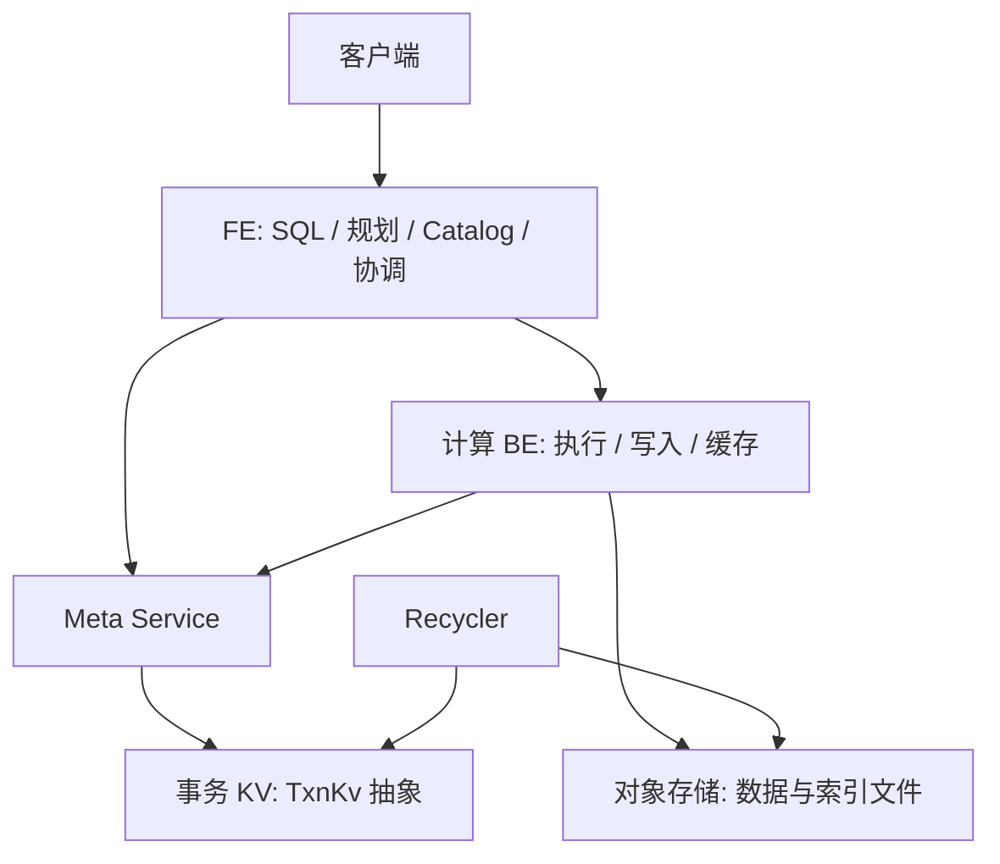

# 第 25 章　对象存储与元数据服务

[全书导航](../README.md) · [术语表](../appendices/A-glossary.md)

> 日期：2026-10-13。源码基线：`a53b182f810be2b3731c7dfdf6f40ff5a0ad63bd`。正文 v1；已核对代表性源码与模块说明，未启动集群、执行 SQL 或运行测试。图为职责示意，不是本机实测拓扑。

## 25.1 分离的是持久数据与计算资源

存算一体中，BE 的本地存储和计算共同承担内表服务；存算分离把持久数据放到共享存储，并通过专门的元数据服务协调 Rowset、版本和事务等状态。SQL 的聚合、Join 和列式执行仍然存在，改变的是获取数据和维护权威状态的方式。

不能将它简化成“本地文件路径换成 S3 URL”。多个计算节点能看到相同对象文件，并不意味着它们自然知道哪些文件已经提交、哪些版本属于一次读取、哪些文件可以删除。对象存储保存字节，数据库元数据描述这些字节的意义。

## 25.2 重画组件图

这是职责示意。实际部署可拆分服务、配置资源和副本；本书没有验证一套正在运行的 Cloud 集群。Meta Service 的后端通过 `TxnKv` 抽象访问，仓库有 FoundationDB 相关实现；接口抽象本身不代表任何 KV 产品都可直接替换。

FE 依旧承担 SQL、逻辑 Catalog 和查询协调，FE 元数据体系并未消失。Cloud 元数据服务接管的是本篇讨论的存储事务和相关权威状态，不能把“元数据服务”理解成 FE 所有内存对象都搬入该进程。

## 25.3 四种状态不能混在一起

| 状态 | 代表对象 | 判断问题 |
|---|---|---|
| 逻辑定义与控制信息 | 数据库、表、Schema、计算资源信息 | 如何绑定和组织访问？ |
| 存储事务元数据 | Rowset、事务、版本记录 | 哪些数据属于已提交可读视图？ |
| 持久文件 | Segment、索引等对象 | 字节在哪里，能否完整读取？ |
| 计算节点本地缓存 | 文件块、Tablet 的本地元信息视图 | 这次访问是否需要远程拉取或同步？ |

同一个 Tablet 在计算节点有本地对象，并不表示它在该节点独占拥有持久数据。`CloudTablet` 在读取前可以通过 Meta Service 同步 Rowset 信息；本地对象是服务本次执行的视图，必须与权威版本协调。

文件已上传却事务未提交时，它不是自然可查询的数据。反过来，元数据指向一个对象也不证明此刻访问没有网络或存储错误；两类故障有不同的诊断入口。

## 25.4 TxnKv 为什么强调提交结果

`cloud/src/meta-store/txn_kv.h` 定义创建事务、读写和提交等接口。上层把多个元数据变更组织为事务，底层冲突或提交大小限制会影响处理路径。

尤其要区分明确失败与提交结果不确定。接口中的 `TXN_MAYBE_COMMITTED` 不能解释成“肯定未写入”；恢复逻辑需要根据业务身份查询或幂等处理。这个问题与你熟悉的 RPC 超时相同：返回通道出错，不等于服务端没有产生效果。

读取此类代码时，应同时画业务事务 ID 与底层 KV 事务边界。一个 Doris 事务处理过程可能包含重试或多个底层事务，二者不能因为都叫 transaction 就一一对应。

## 25.5 计算资源与文件缓存

计算资源可以按工作负载组织，查询需要选定合适的计算节点；“数据在共享存储”不等于任意节点随时都有相同延迟。节点还受资源、网络和缓存状态影响。

文件缓存将远端读取过的内容保存在本地，减少后续远端访问。它主要改变读取成本，并不替代事务提交或决定版本可见性。重启、扩容、调度改变都可能带来冷缓存，比较性能时应记录缓存命中情况和远端读取字节。

计算节点不持有唯一持久副本，也不能粗略称为“没有状态”：它仍维护执行中的任务、内存对象和缓存。节点退出对在途查询的影响，与持久数据是否丢失是两件事。

## 25.6 读代码时的定位顺序

从 FE 的 Cloud 事务实现确认谁发起请求，再进入 Meta Service 的业务处理，再到 TxnKv；遇到读路径则从 CloudTablet 的版本同步进入 Reader 和文件缓存。不要先钻入底层 KV API 而失去业务事务的含义。

| 路径（相对仓库根目录） | 阅读目标 |
|---|---|
| `fe/fe-core/src/main/java/org/apache/doris/cloud/transaction/CloudGlobalTransactionMgr.java` | FE 的 Cloud 事务协调与 RPC |
| `cloud/src/meta-service/meta_service_txn.cpp` | begin / precommit / commit / abort 等业务处理 |
| `cloud/src/meta-store/txn_kv.h` | 底层事务接口与错误语义 |
| `be/src/cloud/cloud_storage_engine.cpp` | Cloud 存储引擎组织 |
| `be/src/cloud/cloud_tablet.cpp` | 本地 Tablet 元信息与同步 |
| `be/src/io/cache/block_file_cache.h` | 本地文件块缓存对象 |

下一章把上传、登记、提交、读取与回收连接起来，重点检查每一步完成究竟能证明什么。

---

[上一章：第 24 章](24-integration-and-extension.md) · [全书导航](../README.md) · [下一章：第 26 章](26-cloud-read-write-and-maintenance.md)

## 源码深读补充（2026-10-13）

- [专题 8　Cloud 元数据提交、Compaction 与回收](../deep-dives/08-cloud-compaction-and-recycler.md)
