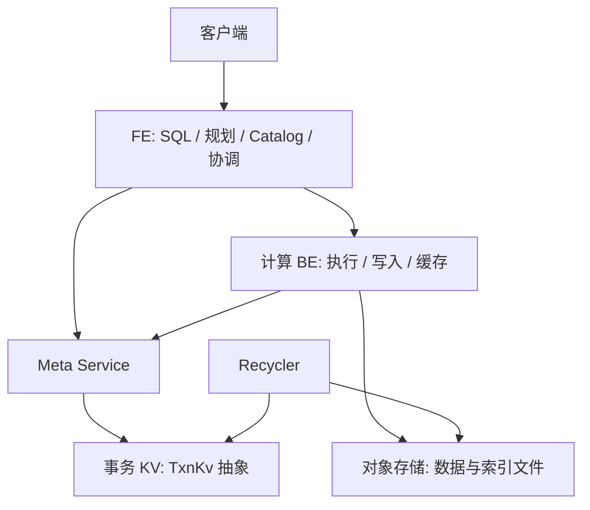

# 第 25 章　对象存储与元数据服务

[全书导航](../README.md) · [术语表](../appendices/A-glossary.md)

> 教学结构修订：2026-10-14。每章先沿一个问题阅读代码，再做实验、观察结果，最后解释对象和分支。历史正文基线为 `a53b182f810be2b3731c7dfdf6f40ff5a0ad63bd`；本次摘录取自当前本地文件，完整文件 SHA-256 与行号保存在[源码摘录清单](../examples/08-chapter-workshops/source-manifest.json)。运行证据来自报告版本 `doris-0.0.0-a53b182f810` 的二进制，不能仅凭版本前缀认定当前工作目录与二进制逐文件相同。

**本章问题：对象文件上传成功，为什么还不能判断事务是否提交？**

本章验证方式：源码走查与状态推演；无该主题的集群实测。建议先用 20—40 分钟完成主案例，第四部分的扩展阅读可分次完成；这不是新增的每日必交任务。

## 一、源码讲解：先找到决定行为的对象和分支

把持久文件、业务事务元数据、逻辑 Catalog、本地缓存分成四种状态。再看 TxnErrorCode：TXN_MAYBE_COMMITTED 与明确未提交的错误不是同一语义。这个边界与你熟悉的 RPC 超时问题直接相连。

### 先读这段真实代码

文件：`cloud/src/meta-store/txn_kv_error.h`，当前文件第 25—43 行。下面是连续原文摘录，局部片段省略了方法的其他部分；不要把片段当完整实现。

```cpp

enum class [[nodiscard]] TxnErrorCode : int {
    TXN_OK = 0,
    TXN_KEY_NOT_FOUND = 1,
    TXN_CONFLICT = -1,
    TXN_TOO_OLD = -2,
    TXN_MAYBE_COMMITTED = -3,
    TXN_RETRYABLE_NOT_COMMITTED = -4,
    TXN_TIMEOUT = -5,
    TXN_INVALID_ARGUMENT = -6,
    TXN_KEY_TOO_LARGE = -7,
    TXN_VALUE_TOO_LARGE = -8,
    TXN_BYTES_TOO_LARGE = -9,
    // other unidentified errors.
    TXN_UNIDENTIFIED_ERROR = -10,
    // the data is invalid.
    TXN_INVALID_DATA = -11,
    TXN_TOO_MANY_WATCHES = -12,
};
```

### 这几行应该怎样读

这里是枚举定义，不是重试算法。`TXN_MAYBE_COMMITTED` 与 `TXN_RETRYABLE_NOT_COMMITTED` 是两个不同值；上层必须保留这种区别。哪一类底层错误映射为它们、调用者怎样查证，需要继续看 txn_kv.cpp 和业务提交处理。

### 分离的是持久数据与计算资源

存算一体中，BE 的本地存储和计算共同承担内表服务；存算分离把持久数据放到共享存储，并通过专门的元数据服务协调 Rowset、版本和事务等状态。SQL 的聚合、Join 和列式执行仍然存在，改变的是获取数据和维护权威状态的方式。

不能将它简化成“本地文件路径换成 S3 URL”。多个计算节点能看到相同对象文件，并不意味着它们自然知道哪些文件已经提交、哪些版本属于一次读取、哪些文件可以删除。对象存储保存字节，数据库元数据描述这些字节的意义。

### 重画组件图



这是职责示意。实际部署可拆分服务、配置资源和副本；本书没有验证一套正在运行的 Cloud 集群。Meta Service 的后端通过 `TxnKv` 抽象访问，仓库有 FoundationDB 相关实现；接口抽象本身不代表任何 KV 产品都可直接替换。

FE 依旧承担 SQL、逻辑 Catalog 和查询协调，FE 元数据体系并未消失。Cloud 元数据服务接管的是本篇讨论的存储事务和相关权威状态，不能把“元数据服务”理解成 FE 所有内存对象都搬入该进程。

### 四种状态不能混在一起

| 状态 | 代表对象 | 判断问题 |
|---|---|---|
| 逻辑定义与控制信息 | 数据库、表、Schema、计算资源信息 | 如何绑定和组织访问？ |
| 存储事务元数据 | Rowset、事务、版本记录 | 哪些数据属于已提交可读视图？ |
| 持久文件 | Segment、索引等对象 | 字节在哪里，能否完整读取？ |
| 计算节点本地缓存 | 文件块、Tablet 的本地元信息视图 | 这次访问是否需要远程拉取或同步？ |

同一个 Tablet 在计算节点有本地对象，并不表示它在该节点独占拥有持久数据。`CloudTablet` 在读取前可以通过 Meta Service 同步 Rowset 信息；本地对象是服务本次执行的视图，必须与权威版本协调。

文件已上传却事务未提交时，它不是自然可查询的数据。反过来，元数据指向一个对象也不证明此刻访问没有网络或存储错误；两类故障有不同的诊断入口。

## 二、动手实验：先预测，再核对

默认使用已保存的实验材料或只读源码，不需要启动服务。运行环境已停止；若选择重新执行 SQL，先按[实验复现说明](../examples/07-live-lab-20261014/REPRODUCE.md)确认服务、版本与数据状态。初始化、导入和更新脚本不可在现有表上盲目重放。

1. 打开 txn_kv_error.h 的枚举与 txn_kv.h 的 Transaction 接口，分别定位 TXN_MAYBE_COMMITTED、TXN_RETRYABLE_NOT_COMMITTED 和 commit。
2. 做三张事件卡：上传完成但元数据未提交；元数据提交成功；提交应答丢失。为每张卡写“已知 / 未知 / 下一次查询需使用的业务身份”。
3. 沿 meta_service_txn.cpp 的错误处理查状态查询或重试依据，把 Doris 事务 ID 与一次底层 KV 事务分开。不要将本地 BE 的实验当 Cloud 环境。

本地只读入口（不连接外部服务、不修改配置）：

```bash
cd /Users/jiangyuan/open/doris
rg -n 'TXN_MAYBE_COMMITTED|TXN_RETRYABLE_NOT_COMMITTED' 'cloud/src/meta-store/txn_kv_error.h'
```

## 三、观察结果：先陈述事实，再划清证据范围

这是故障语义推演：应答丢失只留下结果不确定，不能直接断言业务未生效。枚举定义是源码事实；三张事件卡没有在 FoundationDB/Meta Service 集群中执行。

**本章边界：** Cloud/对象存储/事务 KV 环境未启动；没有提供伪造的 S3 路径或成功日志。

## 四、回到源码解释：把现象还原成执行过程

文件字节与决定它们归属的元数据需要配合。MaybeCommitted 迫使调用者围绕稳定业务身份确认状态，而不是盲目重新生成一套事务。文件缓存可以降低读成本，却不能替代这层权威状态。

### 用自己的话走完这条链

合上结果后，按“输入 → 关键对象/状态 → 分支条件 → 可观察结果”的顺序回答本章问题：**对象文件上传成功，为什么还不能判断事务是否提交？** 再指出一项尚不能从现有实验得出的结论。能把每个箭头落到本章的方法或证据，比记住术语更接近读懂源码。

### TxnKv 为什么强调提交结果

`cloud/src/meta-store/txn_kv.h` 定义创建事务、读写和提交等接口；错误枚举位于它包含的 `cloud/src/meta-store/txn_kv_error.h`。上层把多个元数据变更组织为事务，底层冲突或提交大小限制会影响处理路径。

尤其要区分明确失败与提交结果不确定。接口中的 `TXN_MAYBE_COMMITTED` 不能解释成“肯定未写入”；恢复逻辑需要根据业务身份查询或幂等处理。这个问题与你熟悉的 RPC 超时相同：返回通道出错，不等于服务端没有产生效果。

读取此类代码时，应同时画业务事务 ID 与底层 KV 事务边界。一个 Doris 事务处理过程可能包含重试或多个底层事务，二者不能因为都叫 transaction 就一一对应。

### 计算资源与文件缓存

计算资源可以按工作负载组织，查询需要选定合适的计算节点；“数据在共享存储”不等于任意节点随时都有相同延迟。节点还受资源、网络和缓存状态影响。

文件缓存将远端读取过的内容保存在本地，减少后续远端访问。它主要改变读取成本，并不替代事务提交或决定版本可见性。重启、扩容、调度改变都可能带来冷缓存，比较性能时应记录缓存命中情况和远端读取字节。

计算节点不持有唯一持久副本，也不能粗略称为“没有状态”：它仍维护执行中的任务、内存对象和缓存。节点退出对在途查询的影响，与持久数据是否丢失是两件事。

### 读代码时的定位顺序

从 FE 的 Cloud 事务实现确认谁发起请求，再进入 Meta Service 的业务处理，再到 TxnKv；遇到读路径则从 CloudTablet 的版本同步进入 Reader 和文件缓存。不要先钻入底层 KV API 而失去业务事务的含义。

| 路径（相对仓库根目录） | 阅读目标 |
|---|---|
| `fe/fe-core/src/main/java/org/apache/doris/cloud/transaction/CloudGlobalTransactionMgr.java` | FE 的 Cloud 事务协调与 RPC |
| `cloud/src/meta-service/meta_service_txn.cpp` | begin / precommit / commit / abort 等业务处理 |
| `cloud/src/meta-store/txn_kv.h` | 底层事务接口与错误语义 |
| `be/src/cloud/cloud_storage_engine.cpp` | Cloud 存储引擎组织 |
| `be/src/cloud/cloud_tablet.cpp` | 本地 Tablet 元信息与同步 |
| `be/src/io/cache/block_file_cache.h` | 本地文件块缓存对象 |

下一章把上传、登记、提交、读取与回收连接起来，重点检查每一步完成究竟能证明什么。

### 延伸源码专题

- [专题 8　Cloud 元数据提交、Compaction 与回收](../deep-dives/08-cloud-compaction-and-recycler.md)

---

[全书导航](../README.md) · [术语表](../appendices/A-glossary.md)
