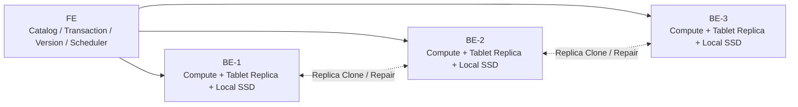
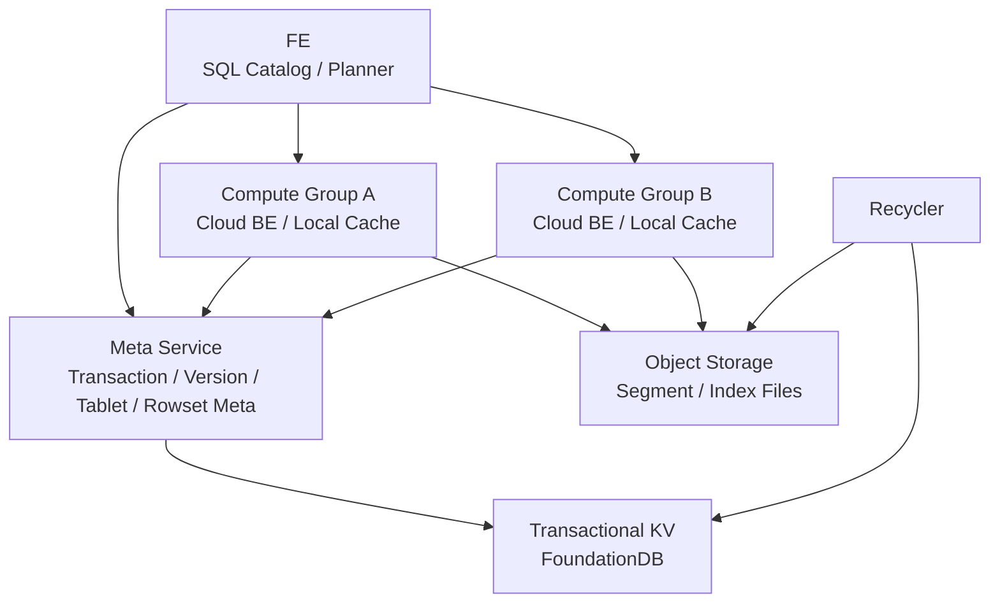
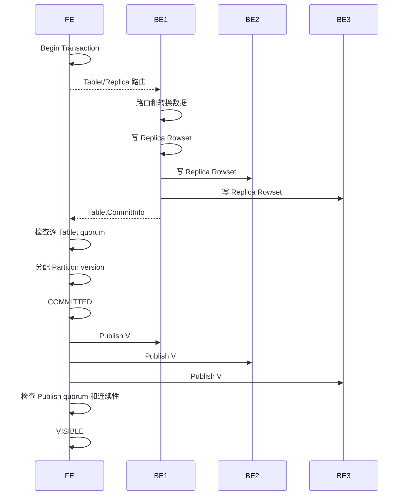
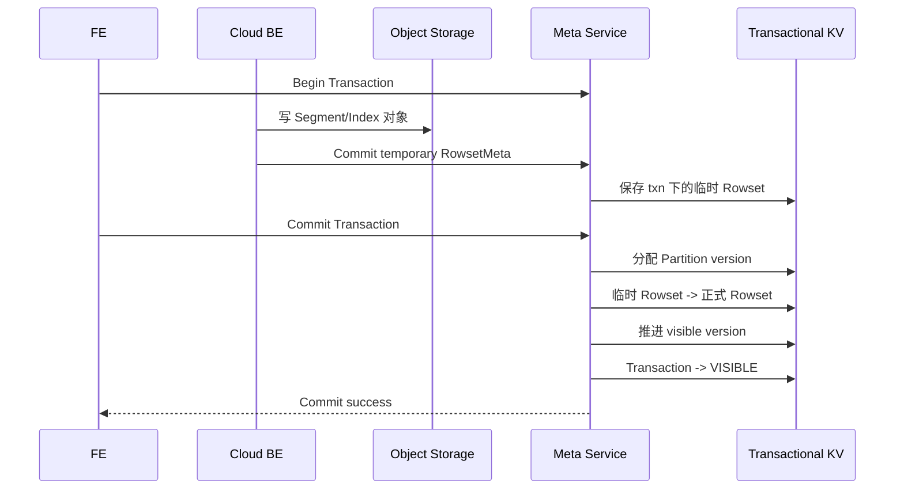

# Doris 存算一体与存算分离架构探讨

## 1. 背景

Doris 同时支持存算一体和存算分离两种部署形态。两种架构对用户都提供 Table、Partition、Tablet、Rowset、事务和快照查询等概念，但它们的底层数据所有权、事务提交方式、故障恢复和扩缩容方式差异很大。

最容易产生的误解是：

```text
存算分离 = 把 BE 本地磁盘路径替换成 S3 路径
```

实际上，存算分离不仅改变了 Segment 文件放在哪里，还改变了：

- 谁拥有 Tablet 和 Rowset 的权威元数据
- 谁管理事务和 Partition 版本
- Rowset 如何从临时状态变为可见
- Replica 的含义
- 查询节点如何获得最新快照
- Compaction 的结果如何被其他节点共享
- 计算节点故障后怎样恢复
- 无主对象文件如何回收

两种架构最核心的区别可以压缩成两句话：

```text
存算一体：Tablet 的多个物理副本就是数据本身，
          版本靠副本写入、quorum 和 Publish 收敛。

存算分离：对象存储中的文件是数据本身，
          Meta Service 中的事务性 Rowset 元数据决定哪些文件可见。
```

配套阅读：

- [Doris 元数据管理探讨](doris_metadata_management_discussion.md)
- [Doris 事务与 MVCC 实现探讨](doris_transaction_mvcc_discussion.md)
- [Doris 数据写入全流程](doris_data_write_full_flow.md)
- [Apache Doris 学习路线图](doris_learning_roadmap.md)

## 2. 架构总览

### 2.1 存算一体



一个三副本 Tablet 表示为：

```text
Tablet 100
  -> BE-1 Replica：Rowset + Segment + 本地 TabletMeta
  -> BE-2 Replica：Rowset + Segment + 本地 TabletMeta
  -> BE-3 Replica：Rowset + Segment + 本地 TabletMeta
```

每个 BE 同时承担：

- 查询和导入计算
- Tablet Replica 持久化
- Rowset/Segment 管理
- 本地事务管理
- Publish Version
- Compaction
- 副本 Clone 和迁移

在这种架构中，“计算节点”和“存储节点”是同一批进程。

### 2.2 存算分离



持久状态被拆成两部分：

```text
Object Storage
  -> Segment 文件
  -> Inverted Index 文件
  -> Delete Bitmap 文件等大对象

Meta Service / Transactional KV
  -> Transaction
  -> Partition Version
  -> Tablet Meta
  -> Rowset Meta
  -> Rowset 与对象文件的引用关系
  -> Delete Bitmap 元数据
  -> Compaction / Schema Change Job 状态
```

Cloud BE 本地保存：

```text
查询和导入执行状态
可重新同步的 CloudTablet/RowsetMeta
对象文件缓存
临时写入文件和中间计算结果
```

这些本地状态很重要，但不再是已提交数据的唯一权威来源。因此 Cloud BE 常被称为无状态计算节点，更准确地说是“持久数据无状态、运行期和缓存有状态”。

## 3. 一张总对比表

| 维度 | 存算一体 | 存算分离 |
|---|---|---|
| 持久数据 | BE 本地磁盘 | S3、HDFS 等共享存储 |
| 数据面元数据 | 各 BE 的 Tablet/RowsetMeta | Meta Service |
| SQL Catalog | FE 内存 Catalog + Journal | 仍由 FE 管理，并与 Meta Service 协调数据面对象 |
| 事务管理 | FE `DatabaseTransactionMgr` | Meta Service，FE 通过 `CloudGlobalTransactionMgr` 调用 |
| 元数据持久化 | FE BDBJE + BE 本地 TabletMeta | FE Journal + Meta Service 的事务 KV |
| 数据冗余 | Doris 管理多个 Tablet Replica | 依赖对象存储自身冗余 |
| 写入复制 | 向多个 Replica 写入或单副本写后拉取 | 写共享对象存储，不为每个计算节点复制持久数据 |
| 提交条件 | 每个 Tablet 达到写入 quorum | 对象文件写好，Meta Service 原子提交 Rowset/版本元数据 |
| 可见性发布 | FE 向 BE 下发 PublishVersionTask | Meta Service 将临时 Rowset 正式化并推进版本 |
| 查询位置 | 在持有健康 Replica 的 BE 上执行 | 在当前 Compute Group 选计算节点 |
| 扩容 | 增加 BE 后要迁移和平衡副本 | 增加计算节点，通常无需搬迁持久数据 |
| Compaction | 每个 Replica 分别执行 | 某个计算节点执行一次，结果由所有节点共享 |
| 节点故障 | 丢失计算能力和一份持久副本 | 丢失计算状态与缓存，持久数据仍在共享存储 |
| 修复方式 | Clone/Repair Replica | 重新路由并同步元数据、回填缓存 |
| 本地磁盘 | 持久数据载体 | Cache 和临时空间 |
| 工作负载隔离 | 通常共享同一组 BE | 可建立多个 Compute Group 共享数据 |
| 主要优势 | 本地 IO、低延迟、依赖组件较少 | 弹性、资源隔离、共享数据、减少 Doris 层存储放大 |
| 主要代价 | 扩缩容和副本维护较重 | 组件更多，依赖远程存储、缓存和 Meta Service |

## 4. 数据所有权发生了什么变化

### 4.1 存算一体：Replica 是数据所有者

在存算一体中，FE 记录：

```text
Tablet 100
  -> Replica 1 on BE-1
  -> Replica 2 on BE-2
  -> Replica 3 on BE-3
```

这三个 Replica 不是路由占位符，而是三份真实的持久数据。每个副本都有自己的：

- TabletMeta
- RowsetMeta
- Segment 文件
- Delete Bitmap
- VersionGraph
- Compaction 结果

如果 BE-1 的磁盘损坏，Replica 1 的持久数据就真的丢失了。Doris 必须从 Replica 2 或 Replica 3 Clone 一份新数据。

### 4.2 存算分离：对象存储是数据所有者

在存算分离中，Segment 文件位于共享对象存储。一个 Compute Group 中某台 Cloud BE 被选中处理 Tablet，只表示：

```text
这个请求由这台计算节点执行
```

并不表示：

```text
只有这台节点拥有 Tablet 的持久数据
```

其他 Compute Group 的节点也可以通过 Meta Service 获得同一 Tablet 的 RowsetMeta，再读取同一批对象文件。

所以存算分离中的两个“位置”要区分：

```text
执行位置：当前 Compute Group 中负责计算的 BE
持久位置：Storage Vault / Object Storage 中的对象
```

## 5. 元数据架构差异

### 5.1 存算一体的两层元数据

FE 管理逻辑和拓扑元数据：

```text
Database
  -> OlapTable
     -> Partition
        -> MaterializedIndex
           -> Tablet
              -> Replica -> backendId/pathHash/version
```

BE 管理本机物理元数据：

```text
Tablet Replica
  -> Rowset
     -> Segment
  -> VersionGraph
  -> DeleteBitmap
  -> Local TxnManager
```

FE 必须持续知道每个 Tablet 有哪些物理 Replica，因为以下操作都依赖它：

- 写入 quorum
- Publish quorum
- 查询选副本
- Replica 健康检查
- Clone 和 Balance
- BE 下线和磁盘故障恢复

### 5.2 存算分离的三层元数据

存算分离中，可以把元数据分成三层。

第一层：FE SQL Catalog

- Database、Table、Partition 名称和结构
- Column、Key 模型和 Partition 规则
- 物化视图、权限和 SQL 对象
- Planner 和 Compute Group 路由需要的信息

第二层：Meta Service 数据面元数据

- Transaction
- Partition visible version
- Tablet Index/Meta
- 临时和正式 RowsetMeta
- Rowset 与对象文件的引用
- Delete Bitmap
- Tablet Job 和统计信息

第三层：Cloud BE 可重建缓存元数据

- 当前加载到内存的 CloudTablet
- 已同步到本机的 Rowset 列表
- 本地缓存中的 Segment 状态
- 正在执行的导入、查询和 Compaction 状态

所以 Meta Service 不是替代整个 FE。FE 仍然负责 SQL Catalog、语义分析和查询规划；Meta Service 接管的是与共享存储数据一致性强相关的数据面元数据和事务版本。

### 5.3 CloudPartition 为什么没有本地 nextVersion

存算一体的 `Partition` 在 FE 内存中维护：

```text
visibleVersion
nextVersion
```

Cloud 模式下，版本由 Meta Service 管理。`CloudPartition.getNextVersion()` 不在 FE 本地分配版本；查询需要的快照版本也可以通过 Meta Service 获取，并使用缓存降低 RPC 开销。

这是非常关键的架构变化：

```text
存算一体：FE 内存 Partition 是版本权威来源。
存算分离：Meta Service 的事务 KV 是版本权威来源。
```

相关代码：

- `fe/fe-core/src/main/java/org/apache/doris/cloud/catalog/CloudPartition.java`
- `fe/fe-core/src/main/java/org/apache/doris/cloud/catalog/CloudTablet.java`
- `fe/fe-core/src/main/java/org/apache/doris/cloud/catalog/CloudReplica.java`
- `cloud/src/meta-store/txn_kv.cpp`

## 6. Tablet 和 Replica 的含义变化

### 6.1 Tablet 仍然存在

存算分离并没有取消 Tablet。Tablet 仍然承担：

- Partition/Index 内的数据分片
- 行路由和 bucket 映射
- Rowset 和版本组织
- 查询并行度划分
- Compaction 调度单位

改变的是 Tablet 的物理承载方式。

### 6.2 CloudReplica 更像计算路由

FE 中的 `CloudTablet` 仍保留一个 `CloudReplica`，代码甚至明确表示 Cloud Tablet 只有一个 Replica 对象。

但这个 Replica 主要用来：

- 兼容 FE 原有 Tablet/Replica 规划抽象
- 将 Tablet 映射到当前 Compute Group 的某台 BE
- 支持 Colocate 和 bucket 映射
- 为查询、导入和后台任务选择执行节点

它不是对象存储中数据冗余份数的直接表达。

例如：

```text
同一个 Tablet 100
  -> Compute Group A 映射到 BE-A2
  -> Compute Group B 映射到 BE-B1
  -> 两边读取同一份共享 Rowset 对象
```

因此不能把存算一体中的 `replication_num=3` 直觉直接套到 CloudReplica 上。

## 7. 写入流程差异

### 7.1 存算一体写入



文字版：

```text
1. FE 创建 PREPARE 事务。
2. FE 提供 Tablet -> 多个 Replica 的路由。
3. Sink 向多个 BE 写入同一个 Tablet。
4. 各 BE 在本地生成 pending Rowset。
5. BE 返回 TabletCommitInfo。
6. FE 逐 Tablet 检查 load quorum。
7. FE 为每个 Partition 分配 nextVersion。
8. 事务持久化为 COMMITTED。
9. FE 向相关 BE 下发 PublishVersionTask。
10. BE 将 pending Rowset 发布为 [V-V]。
11. FE 检查 Publish quorum 和版本连续性。
12. 事务变为 VISIBLE，推进 visibleVersion。
```

这里的难点是：多个物理副本可能处于不同阶段。

```text
BE-1：写入成功，Publish 成功
BE-2：写入成功，Publish 超时
BE-3：写入失败
```

FE 需要持续判断还能否达到 quorum，并记录失败版本、调度修复。

### 7.2 存算分离写入



文字版：

```text
1. FE 通过 Meta Service 创建事务。
2. Cloud BE 根据 Partition/Tablet 规则路由数据。
3. CloudDeltaWriter 生成 Segment 和索引文件。
4. 文件写入 Object Storage。
5. RowsetMeta 以 transactionId 关联的临时状态写入 Meta Service。
6. FE 或 BE 请求 Meta Service commit transaction。
7. Meta Service 读取 Partition 当前版本。
8. Meta Service 给临时 Rowset 分配 [V+1, V+1]。
9. Meta Service 写入正式 RowsetMeta。
10. Meta Service 推进 Partition visible version。
11. Meta Service 将事务置为 VISIBLE。
12. 查询节点同步新 RowsetMeta 并读取对象文件。
```

这里没有“把同一份 Rowset 向三个持久化 Cloud BE 副本分别 Publish”的步骤，因为持久文件已经位于共享存储。

## 8. Cloud Rowset 的两个提交

理解存算分离写入时，必须区分两个提交。

### 8.1 commit_rowset

`CloudDeltaWriter.commit_rowset()` 调用 Meta Service 保存 RowsetMeta。此时 Rowset 仍然属于某个事务，可以理解为：

```text
对象文件已经写完
RowsetMeta 已登记
但还没有正式 Partition 版本
查询不能读取
```

Meta Service 通常按照事务 ID 保存临时 RowsetMeta。

### 8.2 commit_txn

`commit_txn` 才决定事务可见性。Meta Service 会扫描该事务的临时 Rowset，然后完成：

```text
读取 Tablet -> Table/Partition 映射
读取 Partition 当前版本
为 Rowset 写入正式版本
把临时 RowsetMeta 转换为正式 RowsetMeta
推进 Partition version
更新 Tablet/Table statistics
更新事务状态
```

因此：

```text
commit_rowset = 某个 Tablet 的物理输出已经准备好
commit_txn    = 整个事务的 Rowset 和版本关系正式生效
```

这与存算一体的对应关系大致是：

| 存算一体 | 存算分离 |
|---|---|
| BE `TxnManager.commit_txn()` | Meta Service `commit_rowset()` |
| FE Commit 分配版本 | Meta Service `commit_txn()` 分配版本 |
| BE Publish Rowset | Meta Service 将临时 RowsetMeta 正式化 |
| FE 推进 visibleVersion | Meta Service 推进 Partition version |

这只是语义对照，不表示两边代码是一一对应关系。

## 9. Immediate Commit 与 Lazy Commit

### 9.1 Immediate Commit

普通立即提交路径中，Meta Service 尝试在一个底层事务 KV 事务内完成：

```text
临时 RowsetMeta -> 正式 RowsetMeta
给 Rowset 分配 [V+1, V+1]
Partition version -> V+1
Transaction -> VISIBLE
更新统计和相关索引
```

这样可见性边界就是底层 KV 事务提交：

```text
KV 事务提交前：查询只能得到旧版本
KV 事务提交后：查询可以得到新版本和对应 RowsetMeta
```

不会出现“Partition 已经返回新版本，但正式 RowsetMeta 还没有写入”的半完成状态。

### 9.2 为什么需要 Lazy Commit

一个事务可能包含大量 Tablet/Rowset，导致单个底层 KV 事务太大。Lazy Commit 会先记录：

```text
Transaction = COMMITTED
Partition 存在 pending transaction
```

随后由后台 `TxnLazyCommitter` 将临时 Rowset 正式化并推进事务到 VISIBLE。

```text
PREPARE
  -> COMMITTED
  -> 后台完成元数据转换
  -> VISIBLE
```

它看起来和存算一体的 COMMITTED/VISIBLE 两阶段很像，但等待的对象不同：

```text
存算一体：等待多个物理 Replica 完成 Publish。
Lazy Commit：等待 Meta Service 分批/异步完成较大的元数据提交。
```

两者都要求前序版本连续，都不能随意跳过占用的事务。

相关代码：

- `cloud/src/meta-service/meta_service_txn.cpp`
- `cloud/src/meta-service/txn_lazy_committer.cpp`
- `fe/fe-core/src/main/java/org/apache/doris/cloud/transaction/CloudGlobalTransactionMgr.java`

## 10. 事务一致性边界的变化

### 10.1 存算一体

一致性依赖多层机制叠加：

```text
FE 事务 Journal
+ 每个 Tablet 的副本写入 quorum
+ Partition nextVersion
+ 多 BE Publish Version
+ Publish quorum
+ visibleVersion 连续推进
+ 失败副本 Repair
```

它面对的是多个独立本地磁盘副本之间的状态收敛问题。

### 10.2 存算分离

一致性边界变成：

```text
Object Storage 中不可变对象已经持久化
+ Meta Service 的事务 KV 原子提交对象引用和版本
```

对象文件本身可以在事务提交前就存在，但只要 Meta Service 没有把对应 RowsetMeta放入正式版本空间，查询就不知道它存在。

可以把它理解成“元数据指针提交”：

```text
数据对象先写好
事务原子更新哪些对象属于可见快照
```

这与很多 Lakehouse Table Format 的思想有相似之处，但 Doris 的 Tablet、Rowset、Delete Bitmap 和查询执行仍然是自己的实现。

## 11. 查询流程差异

### 11.1 存算一体查询

```text
FE 读取内存 partition.visibleVersion
  -> 为每个 Tablet 选择版本追平的健康 Replica
  -> 查询发送到 Replica 所在 BE
  -> BE 从本地 Tablet 捕获连续 Rowset 路径
  -> 读取本地 Segment
```

计算位置受到数据副本位置约束。某台 BE 不拥有目标 Tablet Replica，就不能直接把它当成本地 Tablet 扫描。

### 11.2 存算分离查询

```text
FE 从 Meta Service 获取 Partition 快照版本
  -> 在当前 Compute Group 为 Tablet 选择计算 BE
  -> CloudTablet 检查本地 RowsetMeta 是否覆盖查询版本
  -> 不够新则调用 sync_rowsets()
  -> 从 Meta Service 获得正式 RowsetMeta
  -> 本地 Cache 命中则读取缓存
  -> Cache Miss 则读取 Object Storage
```

代码中的 `CloudTablet.sync_rowsets()` 会在本地 `_max_version` 小于查询目标版本时，从 Meta Service 同步 RowsetMeta。

所以 Cloud 查询中三层职责是：

```text
Meta Service：决定这个快照包含哪些 Rowset
Object Storage：提供 Rowset 对应的持久文件
Cloud BE：执行扫描、计算并缓存文件
```

### 11.3 缓存为什么不影响正确性

缓存只改变性能：

```text
Cache Hit  -> 本地 SSD/内存读取
Cache Miss -> Object Storage 读取并回填
```

查询正确性依赖的是 Meta Service 返回的 RowsetMeta 和对象存储中的持久对象，而不是某台 Cloud BE 是否提前缓存了数据。

因此 Cloud BE 缓存全部丢失会导致冷读变慢，但不会让已经提交的数据消失。

相关代码：

- `be/src/cloud/cloud_tablet.cpp`
- `be/src/cloud/cloud_tablet_mgr.cpp`
- `be/src/cloud/cloud_meta_mgr.cpp`
- `fe/fe-core/src/main/java/org/apache/doris/cloud/catalog/CloudPartition.java`

## 12. MVCC 的相同与不同

### 12.1 相同点

两种架构都保留：

- Partition 级快照版本
- Rowset 版本范围
- 查询固定目标版本
- 连续版本路径
- Compaction 不改变逻辑快照
- Unique Key MOW 的 Delete Bitmap 语义

从用户视角仍可以理解为：

```text
查询启动时获得 Partition visible version，
之后读取覆盖该版本的 Rowset 快照。
```

### 12.2 不同点

存算一体：

```text
FE 的 visibleVersion 是查询闸门
BE 本地 VersionGraph 是 Rowset 路径来源
每个 Replica 可能有不同的实际追平状态
```

存算分离：

```text
Meta Service 的 Partition version 是权威快照
Meta Service 的正式 RowsetMeta 是路径来源
Cloud BE 同步后构造本地可重建的版本视图
```

所以存算分离减少了“多个持久 Replica 的版本是否一致”这一层问题，但增加了 Meta Service 同步、缓存新鲜度和远程对象读取问题。

## 13. Unique Key MOW 和 Delete Bitmap

存算分离并没有因为使用对象存储就取消 Unique Key MOW。恰恰相反，共享存储会使并发更新 Delete Bitmap 的协调更加显式。

主要变化包括：

- Delete Bitmap 的权威元数据由 Meta Service 管理。
- 大 Delete Bitmap 可以保存为对象文件，再由 Meta Service 保存引用。
- 写入事务需要避免并发更新同一表的 Delete Bitmap 产生冲突。
- FE/Meta Service 使用 Delete Bitmap Update Lock 等机制串联必要的更新。
- Cloud BE 查询时需要同步 Rowset 和对应 Delete Bitmap。

核心原则不变：

```text
旧 Segment 不原地修改，
新版本通过 Delete Bitmap 屏蔽旧版本中的重复 Key。
```

相关代码：

- `be/src/cloud/cloud_engine_calc_delete_bitmap_task.cpp`
- `be/src/cloud/cloud_txn_delete_bitmap_cache.cpp`
- `be/src/cloud/delete_bitmap_file_reader.cpp`
- `be/src/cloud/delete_bitmap_file_writer.cpp`
- `be/src/cloud/cloud_meta_mgr.cpp`

## 14. Compaction 差异

### 14.1 存算一体 Compaction

三个 Replica 通常分别对自己的本地 Rowset 执行 Compaction：

```text
BE-1: [2-2] + [3-3] + [4-4] -> [2-4]
BE-2: [2-2] + [3-3] + [4-4] -> [2-4]
BE-3: [2-2] + [3-3] + [4-4] -> [2-4]
```

它们的逻辑版本范围一致，但物理 Rowset ID、执行时刻和文件可能不同。

优点：

- 副本局部自治
- 使用本地磁盘完成
- 单副本 Compaction 失败不一定影响其他副本

代价：

- 多副本重复消耗 CPU 和 IO
- 产生多份 Compaction 写放大
- 各副本可能暂时具有不同物理布局

### 14.2 存算分离 Compaction

某个 Cloud BE 获得 Compaction Job：

```text
从 Meta Service 获取输入 Rowset
  -> 从 Cache/Object Storage 读取旧文件
  -> 生成新的 [2-4] Rowset
  -> 写入 Object Storage
  -> 向 Meta Service 提交 Rowset 替换关系
```

其他 Compute Group 不需要重复执行同一份 Compaction。它们下次同步元数据后直接使用新的 `[2-4]` Rowset。

这显著减少了 Doris 层的多副本 Compaction 放大，但也带来新的要求：

- Compaction Job 需要租约或状态协调。
- 输出文件写完但元数据提交失败时会产生无主对象。
- 旧 Rowset 不能在查询快照仍引用时被删除。
- 新 Rowset 应根据需要进行 Cache Warmup。

相关代码：

- `be/src/cloud/cloud_cumulative_compaction.cpp`
- `be/src/cloud/cloud_base_compaction.cpp`
- `be/src/cloud/cloud_full_compaction.cpp`
- `be/src/cloud/cloud_storage_engine.cpp`
- `cloud/src/meta-service/meta_service_job.cpp`

## 15. 为什么需要 Recycler

对象存储通常不支持与 Meta Service 的 KV 更新组成一个跨系统原子事务。

因此可能出现：

```text
对象文件写成功
Meta Service commit_rowset/commit_txn 失败
```

此时对象存储中存在文件，但没有任何正式 RowsetMeta 引用它。它不能被查询看到，却会持续占用空间。

反过来，Compaction、DROP、Schema Change、事务 Abort 后，也会产生不再需要但不能立即删除的对象。

Recycler 负责：

- 清理 Abort/超时事务的临时 Rowset 对象
- 清理不再引用的 Rowset/Segment
- 清理被 DROP 的 Tablet、Index、Partition 数据
- 清理过期 Stage/Copy 对象
- 配合快照和保留期避免过早删除
- 检查 Meta Service 元数据与对象存储的一致性

所以 Recycler 不是普通的磁盘 GC，而是存算分离架构中“跨元数据系统和对象存储最终回收”的关键组件。

相关代码：

- `cloud/src/recycler/`

## 16. 故障模型差异

### 16.1 存算一体 BE 故障

```text
BE 挂掉
  -> 同时失去计算能力和一份持久 Replica
  -> 查询切换到其他健康 Replica
  -> 写入只要仍满足 quorum 可以继续
  -> Tablet Scheduler 创建 Clone 任务
  -> 从健康 Replica 复制数据到新位置
```

故障恢复的核心是“重新补齐数据副本”。

### 16.2 存算分离 Compute BE 故障

```text
Cloud BE 挂掉
  -> 丢失执行状态和本地 Cache
  -> 已提交对象仍在 Object Storage
  -> RowsetMeta 和版本仍在 Meta Service
  -> FE 把后续任务路由到其他计算节点
  -> 新节点同步 RowsetMeta 并按需回填缓存
```

故障恢复的核心是“重新安排计算并重建缓存”，通常不需要 Clone 全量持久数据。

### 16.3 存算分离并没有消灭 HA

可靠性责任发生了转移：

```text
Doris BE 多副本可靠性
    ->
Object Storage 可靠性
+ Transactional KV 可靠性
+ Meta Service 可用性
+ 网络可用性
```

如果 Object Storage、Meta Service 或事务 KV 不可用，计算节点即使存活，也可能无法提交新事务或读取未缓存的数据。

因此存算分离减少的是数据副本管理和计算节点状态，不是分布式系统整体复杂性。

## 17. 扩容、缩容与资源隔离

### 17.1 存算一体扩容

新增 BE 后：

```text
增加计算能力
+ 增加本地存储容量
+ 触发 Tablet Rebalance
+ 从旧 BE 向新 BE 复制 Replica
```

计算和存储按照同一个节点粒度扩展。如果只缺 CPU 但不缺磁盘，也必须增加带磁盘的 BE；如果只缺存储，也会一起增加计算资源。

### 17.2 存算分离扩容

新增 Cloud BE 或 Compute Group 后：

```text
增加计算能力
不迁移 Object Storage 中的持久数据
重新计算 Tablet 到执行 BE 的映射
按查询逐渐建立本地 Cache
```

存储容量由对象存储独立扩展。

### 17.3 Compute Group 隔离

多组计算节点可以共享同一份数据：

```text
Compute Group A：在线报表
Compute Group B：ETL 和大查询
Compute Group C：临时分析
              -> 共享相同 Object Storage 和 Meta Service 数据
```

这样大 ETL 可以占满 B 组 CPU 和内存，而不直接抢占 A 组执行线程。不过它们仍可能共享：

- Object Storage 带宽
- Meta Service 和事务 KV
- 全局写入版本
- Compaction 资源

因此 Compute Group 提供的是很强的计算资源隔离，不代表所有底层资源完全隔离。

## 18. 性能差异

### 18.1 存算一体性能特点

优势：

- Segment 位于本地 SSD，读取延迟低。
- 数据位置相对稳定，Cache 行为容易理解。
- 没有每次 Cache Miss 的远程对象读取。
- 事务和查询依赖组件相对少。

问题：

- 三副本写入和 Compaction 带来写放大。
- 数据热点会同时成为计算和磁盘热点。
- 扩容后需要搬迁大量数据。
- 大查询可能挤占承载数据的 BE。

### 18.2 存算分离性能特点

优势：

- 多个 Compute Group 可以独立扩缩容。
- 热数据通过本地 SSD Cache 获得接近本地盘的性能。
- Compaction 输出和持久数据可以跨计算组共享。
- Doris 层不再保存三份相同 Segment。

问题：

- Cache 冷启动时依赖对象存储吞吐和延迟。
- 大扫描可能消耗大量远程带宽。
- Meta Service 同步可能进入查询关键路径。
- 对象存储限流和网络抖动会影响查询、导入。
- Cache 容量、淘汰和 Warmup 成为重要调优项。

因此存算分离的真实性能通常取决于：

```text
计算能力
+ 本地 Cache 命中率
+ Object Storage 带宽/延迟
+ Meta Service 延迟
+ 数据访问冷热分布
```

不能只比较 BE 的 CPU 和内存规格。

## 19. 成本模型差异

### 存算一体

大致成本：

```text
计算节点
+ 本地高性能磁盘
+ replication_num 倍持久数据
+ 多副本 Compaction IO
+ 扩缩容数据迁移成本
```

### 存算分离

大致成本：

```text
弹性计算节点
+ Object Storage 容量
+ Object Storage 请求和流量
+ 本地 Cache 磁盘
+ Meta Service / FDB
+ Recycler
```

存算分离通常降低 Doris 层的三副本容量和重复 Compaction 成本，但可能增加对象存储请求、远程流量和元数据服务成本。

最终成本取决于工作负载：

- 热数据比例
- 查询重复度
- 扫描数据量
- 写入和 Compaction 频率
- 跨可用区流量
- Compute Group 弹性利用率

## 20. 常见误解

### 20.1 存算分离没有 Tablet

错误。Tablet 仍然是 Doris 的数据分片、路由、版本和并行执行单位，只是不再绑定一份唯一的本地持久 Replica。

### 20.2 Cloud BE 完全无状态

不准确。Cloud BE 有查询状态、导入状态、Tablet/RowsetMeta 缓存、Data Cache 和后台任务。只是这些状态通常可以从 Meta Service 和 Object Storage 重建。

### 20.3 数据写入对象存储后就可见

错误。没有正式 RowsetMeta 和 Partition version，即使对象文件已经存在，查询也不会读取。

### 20.4 存算分离不需要多副本

Doris 层通常不再为每个 Tablet 保存三份本地 Segment，但 Object Storage、事务 KV 和 Meta Service 本身仍需要高可用和数据冗余。副本责任被下沉到基础设施，不是彻底消失。

### 20.5 扩容后完全没有成本

持久数据通常不需要 Rebalance，但新增节点会经历 Cache 冷启动，也可能改变 Tablet 执行映射，带来对象存储流量和短期性能波动。

### 20.6 存算分离一定比存算一体快

不一定。高 Cache 命中和弹性并发场景可能非常快；强依赖本地 SSD 延迟、数据持续冷读或网络条件不佳时，存算一体可能更稳定。

## 21. 如何选型

### 更适合存算一体的场景

- 追求稳定、可预测的本地 SSD 延迟
- 数据集和计算量相对稳定
- 计算与存储增长比例接近
- 集群规模不需要频繁扩缩容
- 不希望引入 Object Storage、Meta Service、FDB、Recycler 等组件
- 对 Cache 冷启动和对象存储抖动敏感
- 已经具有成熟的 BE 副本运维经验

### 更适合存算分离的场景

- 查询负载有明显波峰波谷
- 需要快速增加或缩减计算资源
- 多个业务希望共享一份数据但隔离计算资源
- 存储规模很大，希望降低 Doris 层多副本放大
- ETL、在线查询、临时分析需要使用不同 Compute Group
- 可以接受并管理 Object Storage 延迟和 Cache Warmup
- 有能力运维 Meta Service、事务 KV、Storage Vault 和 Recycler

### 选型时应该量化的问题

```text
数据总量和日增量是多少？
热数据占比是多少？
查询重复读取的比例是多少？
单次查询扫描量是多少？
对象存储吞吐、延迟和流量价格是多少？
计算是否需要按小时快速弹性？
是否需要多 Compute Group 隔离？
现有团队更擅长维护本地副本还是 Cloud 基础设施？
```

## 22. 源码阅读路线

### 22.1 FE Cloud Catalog

- `fe/fe-core/src/main/java/org/apache/doris/cloud/catalog/CloudPartition.java`
- `fe/fe-core/src/main/java/org/apache/doris/cloud/catalog/CloudTablet.java`
- `fe/fe-core/src/main/java/org/apache/doris/cloud/catalog/CloudReplica.java`
- `fe/fe-core/src/main/java/org/apache/doris/cloud/datasource/CloudInternalCatalog.java`

重点理解：

```text
Cloud Partition 的版本从哪里来？
CloudReplica 如何按 Compute Group 选择 BE？
DDL 如何同时更新 FE Catalog 和 Meta Service 对象？
```

### 22.2 FE Cloud Transaction

- `fe/fe-core/src/main/java/org/apache/doris/cloud/transaction/CloudGlobalTransactionMgr.java`
- `fe/fe-core/src/main/java/org/apache/doris/cloud/rpc/MetaServiceProxy.java`

重点对比普通 `GlobalTransactionMgr`：

```text
beginTransaction() 在哪里持久化？
commitTransaction() 是否还在 FE 本地分配 Partition 版本？
Unique Key MOW 在 commit 前增加了哪些步骤？
```

### 22.3 Cloud BE 写入与读取

- `be/src/cloud/cloud_delta_writer.cpp`
- `be/src/cloud/cloud_rowset_builder.cpp`
- `be/src/cloud/cloud_meta_mgr.cpp`
- `be/src/cloud/cloud_tablet.cpp`
- `be/src/cloud/cloud_tablet_mgr.cpp`
- `be/src/cloud/cloud_storage_engine.cpp`

主线：

```text
CloudDeltaWriter.commit_rowset()
  -> CloudMetaMgr.commit_rowset()

CloudTablet.sync_rowsets()
  -> CloudMetaMgr.sync_tablet_rowsets_unlocked()
```

### 22.4 Meta Service

- `cloud/src/meta-service/meta_service.cpp`
- `cloud/src/meta-service/meta_service_txn.cpp`
- `cloud/src/meta-service/meta_service_partition.cpp`
- `cloud/src/meta-service/meta_service_job.cpp`
- `cloud/src/meta-service/txn_lazy_committer.cpp`
- `cloud/src/meta-store/txn_kv.cpp`
- `cloud/src/meta-store/keys.h`

主线：

```text
begin_txn()
commit_rowset()
commit_txn_immediately()
commit_txn_eventually()
get_version()
get_rowset()
```

### 22.5 Cloud Compaction 与 Recycler

- `be/src/cloud/cloud_cumulative_compaction.cpp`
- `be/src/cloud/cloud_base_compaction.cpp`
- `be/src/cloud/cloud_full_compaction.cpp`
- `cloud/src/recycler/`

重点理解：

```text
谁获得 Compaction Job？
输出 Rowset 如何原子替换输入 Rowset？
旧文件何时可以回收？
如何识别没有元数据引用的对象？
```

## 23. 小白版：公共仓库模型

### 存算一体

把三个 BE 想成三个独立仓库：

```text
同一批货物分别送到三个仓库
每个仓库都保存一套完整货架和货物
至少多数仓库签收后，总部批准入库
总部再通知各仓库把新批次上架
某个仓库损坏，要从其他仓库重新复制一份货物
```

### 存算分离

把 Object Storage 想成一个公共大仓库，把 Compute BE 想成多个临时分拣中心：

```text
货物先送进公共仓库
Meta Service 保存“哪些箱子属于哪个批次”的目录
目录事务提交后，新批次才对顾客可见
任何分拣中心都可以按目录从公共仓库取货
分拣中心自己的缓存丢失，只需要重新取货
无人引用的旧箱子由 Recycler 定期清理
```

这个比喻最关键的区别是：

```text
存算一体通过多仓库保存多份货物获得可靠性。
存算分离通过公共仓库的可靠性和原子目录获得可靠性。
```

## 24. 总结

存算分离最根本的变化不是存储介质，而是权威状态的位置：

```text
存算一体：
    FE 保存事务和 Partition 可见版本；
    多个 BE Replica 保存实际 Rowset；
    quorum + Publish 使副本状态收敛。

存算分离：
    FE 继续保存 SQL Catalog；
    Object Storage 保存不可变数据文件；
    Meta Service 保存事务、版本和 Rowset 权威元数据；
    Compute BE 同步元数据并按需缓存数据。
```

两种架构的共同语义仍然是：

```text
数据文件先生成但不可见
事务提交时获得 Partition 版本
查询固定 visible version
BE 读取覆盖该快照的连续 Rowset 路径
Compaction 改变物理布局但不改变逻辑快照
```

真正不同的是实现一致性的手段：

```text
存算一体：逐 Tablet 多副本 quorum + 跨 BE Publish + Replica Repair

存算分离：共享对象文件 + Meta Service 事务性元数据提交
          + 可重建计算缓存 + Recycler 最终回收
```

因此，存算分离不是简单地“更现代”或“全面优于”存算一体。它用更复杂的共享存储和元数据基础设施，换取计算弹性、工作负载隔离和更低的数据复制成本；存算一体则用本地持久副本和更直接的数据路径，换取低延迟、可预测性和较少的外部依赖。
