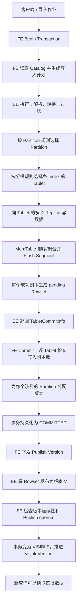

# Doris 数据写入全流程：从一行数据到查询可见

## 1. 这篇文档要回答什么

向 Doris 写入一批数据，看起来只是一次 `Stream Load`、`INSERT INTO` 或 `Broker Load`，内部却同时经过了两条相互配合的链路：

```text
数据链路：解析数据 -> 选择 Partition/Tablet -> 写副本 -> 生成 Rowset
控制链路：开启事务 -> 检查副本 -> 分配版本 -> Publish -> 推进 visibleVersion
```

这篇文档以存算一体模式下的普通 OLAP 表写入为主线，串起这些核心概念：

- FE 元数据
- 事务及其状态
- Table、Partition、MaterializedIndex
- Tablet 和 Replica
- BE 的 MemTable、Segment、Rowset
- Commit Transaction 和 Publish Version
- Partition 版本与查询可见性
- 副本多数派、失败重试和数据修复

Stream Load、Broker Load、Routine Load 和 `INSERT INTO` 的入口、数据来源及调度方式不同，但进入执行阶段后，最终大多汇合到相同的 OLAP Table Sink、Tablet 写入和事务发布语义。

> 本文描述的是主干语义。不同 Doris 版本可能使用经典 `LoadChannel` 写入链路或较新的 `LoadStream / VTabletWriterV2` 链路，内部类名和 RPC 会变化，但 Partition、Tablet、副本、Rowset、事务版本和可见性的关系基本不变。

配套阅读：

- [Doris 元数据管理探讨](doris_metadata_management_discussion.md)
- [Doris 事务与 MVCC 实现探讨](doris_transaction_mvcc_discussion.md)

## 2. 先看全景图



一句话压缩：

```text
FE 用元数据决定“写到哪里”，BE 把数据写成 Rowset；
FE 再用事务和 Partition 版本决定“什么时候能被查询看到”。
```

## 3. 先分清这些对象

### 3.1 FE 中的逻辑和路由元数据

一张 OLAP 表的核心层次可以近似理解为：

```text
Database
  -> OlapTable
     -> Partition
        -> MaterializedIndex
           -> Tablet
              -> Replica
```

| 对象 | 它解决的问题 | 写入时的作用 |
|---|---|---|
| `OlapTable` | 表结构和表属性是什么 | 提供列、Key 模型、分区规则、分桶规则、副本策略等 |
| `Partition` | 数据属于哪个粗粒度范围 | 按 RANGE/LIST 等规则先做第一次水平切分；同时承担版本管理 |
| `MaterializedIndex` | 数据要以哪些物化结构保存 | 基表 Index 和同步物化索引都可能在一次写入中产生数据 |
| `Tablet` | 一个 Partition/Index 内的数据分片 | 按 HASH 或 RANDOM 分桶后，确定一行要进入哪个逻辑分片 |
| `Replica` | Tablet 的物理副本放在哪里 | 指明应向哪些 BE 写入，并用于 quorum、查询选副本和修复 |

这里最容易混淆的是 Tablet 和 Replica：

```text
Tablet 是逻辑分片。
Replica 是这个逻辑分片在某台 BE 上的一份物理拷贝。
```

例如副本数为 3：

```text
Tablet 10086
  -> Replica on BE-1
  -> Replica on BE-2
  -> Replica on BE-3
```

这三个副本都表示同一个 Tablet，正常情况下应具有相同的逻辑版本和数据内容。

### 3.2 BE 中的物理数据对象

BE 上的数据结构大致是：

```text
Tablet Replica
  -> Rowset 0-1
     -> Segment files
  -> Rowset 2-2
     -> Segment files
  -> Rowset 3-5       # 可能是压缩后的 Rowset
     -> Segment files
```

| 对象 | 含义 |
|---|---|
| `MemTable` | 一次写入过程中用于排序、聚合和缓冲的数据 |
| `Segment` | 列式存储文件，是实际持久化的数据文件 |
| `Rowset` | 一组 Segment 及其元数据，是 Tablet 的版本单位 |
| `Tablet` | 在一台 BE 上管理该副本的 Rowset、版本图和 Tablet 元数据 |
| `TxnManager` | 管理 BE 本地尚未发布的事务 Rowset，以及 publish/rollback |

新写入生成的 Rowset 一开始没有正式的 Partition 版本，只挂在本地事务下，因此也不会进入查询使用的正式版本路径。

### 3.3 FE 元数据和 BE 数据元数据不是一回事

可以把 Doris 的元数据分成两层：

```text
FE 元数据：表、分区、Tablet 拓扑、副本位置、事务状态、visibleVersion
BE 元数据：本机 Tablet、Rowset、Segment、Delete Bitmap、本地事务映射
```

FE 不保存每个 Segment 的实际内容，BE 也不独立决定一个全局事务何时对用户可见。两边通过事务 ID、Tablet ID、Partition ID 和版本号把控制面与数据面对齐。

## 4. 写入开始前：DDL 已经准备好了什么

创建表时，FE 已经完成以下工作：

1. 创建 Table、Partition、MaterializedIndex、Tablet、Replica 等元数据对象。
2. 根据副本分配策略选择承载 Replica 的 BE 和磁盘路径。
3. 向相应 BE 下发创建 Tablet 副本的任务。
4. 将这些元数据变更写入 FE EditLog，并由 FE HA 机制复制和恢复。
5. 在 `TabletInvertedIndex` 中建立从 `tabletId` 到 DB、Table、Partition、Index、Replica 的反向索引。

所以，正常写入并不是临时决定“创建几个 Tablet”。大多数时候它是在已有的 Partition/Tablet/Replica 拓扑上写入一个新 Rowset。

自动分区是一个例外：如果数据命中了不存在的分区，写入执行器会请求 FE 创建 Partition，获得新增 Partition 的 Tablet 和副本位置，再增量打开写入通道。

## 5. 阶段一：导入入口和 Begin Transaction

### 5.1 不同入口，逐渐汇合

常见入口的前半段不同：

| 写入方式 | 数据从哪里来 | 谁组织执行 |
|---|---|---|
| Stream Load | 客户端通过 HTTP 推送 | FE 建事务和计划，某个 BE 接收并执行 |
| Broker Load | HDFS/S3 等外部文件 | FE 创建 Load Job 并调度多个执行任务 |
| Routine Load | Kafka 等持续数据源 | FE 周期性切分小事务并调度 |
| `INSERT INTO ... SELECT` | 查询结果 | FE 规划查询，结果经 OLAP Table Sink 写入 |
| Group Commit | 多个小批写合并 | 将多个小写入聚合，减少 Rowset 和事务发布开销 |

它们通常都会形成：

```text
一个 transactionId
一个 loadId
一份目标表写入计划
若干执行 Fragment / Sink
```

### 5.2 FE 创建事务

事务入口主要在：

- `GlobalTransactionMgr`
- `DatabaseTransactionMgr`
- `TransactionState`

Begin Transaction 大致完成：

```text
确认当前 FE 可以处理写请求
检查 label / requestId 的幂等性
检查事务数量和超时配置
生成 transactionId
记录涉及的 DB、Table、协调者和数据源类型
创建状态为 PREPARE 的 TransactionState
持久化事务元数据
```

此时只说明“有一笔写入开始了”，还没有分配 Partition 的正式数据版本。

典型状态主线是：

```text
PREPARE -> COMMITTED -> VISIBLE
```

写入失败且尚未提交时通常是：

```text
PREPARE / PRECOMMITTED -> ABORTED
```

## 6. 阶段二：FE 生成写入快照和路由信息

FE 的 `OlapTableSink` 会从内存 Catalog 中抽取这次写入需要的元数据，并发送给执行 BE。核心内容可以分为三组。

### 6.1 Schema 信息

包括：

- 目标列和类型
- Key 模型：Duplicate、Aggregate、Unique Key 等
- 基表和物化索引的 Schema
- Schema version/hash
- 部分列更新、自动增量列等写入属性

它回答的是：

```text
输入行要转换成什么列式数据？
需要为哪些 Index 生成数据？
排序、聚合或去重语义是什么？
```

### 6.2 Partition 和 Tablet 信息

`TOlapTablePartitionParam` 中会包含：

- Partition 类型和分区列
- RANGE 的上下界或 LIST 的值集合
- 每个 Partition 的 ID
- 每个 MaterializedIndex 的 Tablet ID 列表
- 分桶列、bucket 数量
- 是否允许自动分区
- 写入所需副本数等属性

它回答的是：

```text
一行属于哪个 Partition？
在这个 Partition 的每个 Index 中，它属于哪个 bucket/Tablet？
```

### 6.3 Tablet 的副本位置

`TOlapTableLocationParam` 描述：

```text
tabletId -> [backendId1, backendId2, backendId3]
```

FE 会过滤不可用或不适合写入的副本，并检查可用副本数至少达到该 Partition 的 `loadRequiredReplicaNum`。如果连写入所需副本数都凑不齐，写入在真正传输数据前就可能失败，并触发 Tablet 修复调度。

这份 Sink 元数据本质上是一张“本次写入使用的路由快照”。执行 BE 不需要在每一行到来时再向 FE 查询它属于哪里。

## 7. 阶段三：一行数据如何找到 Partition 和 Tablet

假设有一张表：

```sql
CREATE TABLE sales (
    dt DATE,
    user_id BIGINT,
    amount DECIMAL(18, 2)
)
PARTITION BY RANGE(dt) (...)
DISTRIBUTED BY HASH(user_id) BUCKETS 4
PROPERTIES ("replication_num" = "3");
```

输入一行：

```text
dt = 2026-08-18, user_id = 1001, amount = 99.00
```

它经历两次水平路由。

### 7.1 第一次：选择 Partition

根据 `dt` 的 RANGE 规则，找到对应日期范围的 Partition：

```text
2026-08-18 -> Partition P_202608
```

Partition 是较粗粒度的数据组织单位，常用于生命周期管理、冷热分层、Partition Pruning，也正是 Doris 分配事务版本和维护 `visibleVersion` 的单位。

如果是 LIST 分区，则按值集合匹配；如果是无分区表，内部仍然有一个 Partition 对象。

### 7.2 第二次：选择 bucket/Tablet

在选定的 Partition 内，根据分桶规则决定 bucket：

```text
hash(user_id=1001) % 4 -> bucket 2
```

然后找到该 Partition 下每个 MaterializedIndex 的第 2 个 Tablet：

```text
Base Index       -> Tablet 102
Materialized View -> Tablet 202
```

同一行可能同时写入基表 Index 和多个同步物化索引，只是每个 Index 保存的列、聚合方式和 Tablet ID 不同。

对于 RANDOM 分桶，执行器会按批次、Sink 或自适应策略选择 Tablet，而不是按分桶列的 Hash 固定映射。

### 7.3 第三步：展开为多个物理副本目的地

假设 `Tablet 102` 的位置是：

```text
Tablet 102 -> BE-1, BE-2, BE-3
```

那么逻辑上的一次 Tablet 写入会进一步变成对多个物理 Replica 的写入。

因此完整映射是：

```text
一行输入
  -> 一个 Partition
  -> 每个目标 Index 中的一个 Tablet
  -> 每个 Tablet 的多个 Replica
```

## 8. 阶段四：数据如何到达 BE 并变成 Rowset

### 8.1 两套传输实现，共同的存储语义

经典链路的层次是：

```text
LoadChannelMgr
  -> LoadChannel               # 一个 loadId
     -> TabletsChannel         # 一个 loadId + indexId
        -> DeltaWriter         # 一个 tabletId
           -> MemTable
           -> RowsetWriter
```

较新的写入链路大致是：

```text
VTabletWriterV2
  -> LoadStreamStub            # 到目标 BE 的流
  -> DeltaWriterV2             # 一个 tabletId
  -> BetaRowsetWriterV2
  -> 直接流式发送 Segment 数据和元数据
```

它们的共同结果都是：每个成功写入的物理 Tablet 副本，在本地事务下得到一个待发布 Rowset。

### 8.2 数据转换和过滤

进入 Tablet Writer 前，执行器通常还会完成：

- 表达式计算和列映射
- 类型转换
- 默认值、生成列、自动增量列处理
- 严格模式校验
- 无效行过滤
- Where 条件过滤
- 部分列更新信息构造

导入结果中的 `NumberTotalRows`、`NumberLoadedRows`、`NumberFilteredRows` 等指标主要在这些阶段累计。

### 8.3 MemTable、排序和聚合

同一个 Tablet 的行先进入对应的 Writer/MemTable。MemTable 会按照表的 Key 模型和排序键处理数据：

- Duplicate Key：主要排序，保留明细行。
- Aggregate Key：相同 Key 可以按聚合函数合并。
- Unique Key：按具体实现维护唯一键语义；Merge-on-Write 还要计算 Delete Bitmap。

MemTable 达到阈值后异步 flush，生成一个或多个 Segment。一次大导入可能产生多个 Segment，最后由 Rowset 元数据把它们组织成一个逻辑 Rowset。

### 8.4 BE 本地 prepare 和 commit

BE 创建 Writer 时，会先在本地 `TxnManager` 中准备：

```text
(partitionId, transactionId, tabletId)
```

写完后大致执行：

```text
flush MemTable
等待 Segment 写完
构建 Rowset 和 RowsetMeta
必要时计算 Delete Bitmap
TxnManager.commit_txn()
```

此处的 `commit_txn()` 是 BE 本地提交，不等于用户眼中的全局事务提交。它表达的是：

```text
这个 Tablet 副本已经把本事务的数据文件写好，
Rowset 已登记到本地事务映射，可以等待 FE 分配并发布版本。
```

此时 Rowset 仍是 pending Rowset：

- Segment 文件已经存在。
- RowsetMeta 已经存在。
- 它归属于 `transactionId`。
- 它还没有进入 Tablet 的正式可查询版本路径。
- 查询即使落到这台 BE，也不会读到它。

## 9. 副本究竟是怎么写的

### 9.1 默认：向多个 Replica 写入

通常，写入 Sink 根据 FE 给出的 Tablet location，向该 Tablet 的多个 Replica 建立通道或数据流。每个目标 BE 独立生成本地 Rowset。

以 3 副本为例：

```text
                 -> BE-1 / Tablet 102 / Rowset(txn=9000)
Tablet 102 data  -> BE-2 / Tablet 102 / Rowset(txn=9000)
                 -> BE-3 / Tablet 102 / Rowset(txn=9000)
```

只有完成本地 Rowset commit 的副本，才会被计入成功结果。

### 9.2 单副本导入优化

部分场景支持 single replica load：先把数据写到一个主写副本，再由它通知其他副本拉取 Rowset，从而减少上游重复发送和计算。

它改变的是数据复制方式，不改变最终的事务要求：FE 仍然需要知道每个 Tablet 最终有哪些 Replica 写入成功，并按配置检查 `loadRequiredReplicaNum`。

Unique Key Merge-on-Write 等场景可能不使用这项优化，因为不同副本需要正确完成与历史数据相关的 Delete Bitmap 计算。

### 9.3 quorum 不是“整批成功副本数”

副本成功条件是逐 Tablet 判断的，而不是整个任务笼统地有几个 BE 成功。

错误示例：

```text
Tablet A: 只有 BE-1 成功
Tablet B: 只有 BE-2、BE-3 成功
```

即使三个 BE 都“至少成功过一次”，Tablet A 仍没有达到 3 副本表通常要求的多数派，事务不能提交。

正确条件近似为：

```text
对本事务涉及的每一个 Tablet：
    正常且写入成功的 Replica 数 >= loadRequiredReplicaNum
```

## 10. 阶段五：关闭写入并收集 TabletCommitInfo

所有数据发送完毕后，Sink 会关闭 Writer，等待 flush、Rowset 构建和本地事务 commit 完成。

每个成功副本会上报一条近似这样的信息：

```text
TabletCommitInfo {
    tabletId: 102,
    backendId: BE-1
}
```

多个执行 Fragment、多个 Sink 和多个 BE 的结果会被汇总，最终交给 FE：

```text
txn 9000:
  (tablet 102, BE-1) success
  (tablet 102, BE-2) success
  (tablet 102, BE-3) failed
  (tablet 103, BE-2) success
  ...
```

`TabletCommitInfo` 不是 Partition 版本，也不是 Rowset ID。它只是向 FE 证明：“哪个 Tablet 的哪个物理副本已经写好了本事务数据”。

## 11. 阶段六：FE Commit Transaction

### 11.1 FE 如何从 TabletCommitInfo 找回完整元数据

FE 使用 `TabletInvertedIndex` 将 `tabletId` 反查为：

```text
tabletId
  -> dbId
  -> tableId
  -> partitionId
  -> indexId
  -> replicas and backendIds
```

于是 FE 可以把零散的副本成功报告重新组织成 Table/Partition/Tablet 层次，并检查表、Partition 是否仍存在、是否处于可写状态，以及每个 Tablet 的副本是否满足要求。

### 11.2 逐 Tablet 检查写入 quorum

FE 会区分：

- 正常并写入成功的 Replica
- 数据写入失败的 Replica
- 虽然本次写成功，但此前已有版本缺口的 Replica

只有正常成功副本数达到 `loadRequiredReplicaNum`，这个 Tablet 才通过 commit 检查。任意一个必须写入的 Tablet 不满足要求，整个全局事务都不能进入 `COMMITTED`。

失败副本会被记录到事务的 `errorReplicas`，后续 Publish、Replica 版本更新和 Tablet 修复会继续使用这些信息。

### 11.3 为每个涉及的 Partition 分配版本

通过副本检查后，FE 为事务涉及的每个 Partition 读取：

```text
partition.nextVersion
```

并把它写入 `PartitionCommitInfo`：

```text
Partition P1 -> commit version 10
Partition P2 -> commit version 27
```

同一个事务可以涉及多个 Partition，而不同 Partition 有各自独立的版本序列。因此“事务 ID 是 9000”不意味着所有 Partition 都获得版本 9000。

Partition 的两个核心字段是：

```text
nextVersion: 下一个成功 commit 的事务要占用的版本
visibleVersion: 当前允许查询读取到的最高连续版本
```

Commit 后通常发生：

```text
P1.nextVersion: 10 -> 11
P1.visibleVersion: 9，暂时不变
```

### 11.4 持久化 COMMITTED 状态

FE 将以下事务信息持久化到 EditLog/Journal：

- 状态变为 `COMMITTED`
- TableCommitInfo / PartitionCommitInfo
- 每个 Partition 分配到的版本
- error replicas
- commit 时间、协调者和其他附加信息

持久化成功后，FE 才能把本次事务视为全局已提交。FE Master 崩溃后，新 Master 可以从 Journal 恢复这个 `COMMITTED` 事务并继续 Publish，而不需要重新写数据。

这里必须再次强调：

```text
COMMITTED = 数据被 FE 接受并占用了版本
VISIBLE   = 该版本已经发布，查询可以看到
```

在 Doris 中，两者故意不是同一个瞬间。

## 12. 阶段七：Publish Version

### 12.1 FE 下发 PublishVersionTask

后台 `PublishVersionDaemon` 周期性扫描 `COMMITTED` 事务，为相关 BE 生成 `PublishVersionTask`。任务中携带类似信息：

```text
transactionId = 9000
partitionId = P1
version = 10
```

Publish 可以重复下发，因此这条链路必须具有幂等语义。FE 重启、BE 超时或 RPC 丢失后，只要事务还处于 `COMMITTED`，后台就会继续尝试。

### 12.2 BE 将 pending Rowset 正式发布

BE 收到任务后，在 `TxnManager` 中按 Partition、事务和 Tablet 找到此前写好的 pending Rowset，然后大致执行：

```text
rowset->make_visible([10-10], commitTso)
tablet->add_inc_rowset(rowset)
更新 Tablet 的 Rowset/版本图
从本地事务映射移除或完成该事务
```

普通导入产生的 Rowset 通常得到点版本范围：

```text
[10-10]
```

压缩后的 Rowset 可能是：

```text
[2-9]
```

这也是 Rowset 使用“版本范围”而非单个版本号的原因。

对于 Unique Key Merge-on-Write 表，Publish 阶段还会把 Delete Bitmap 等信息正式并入 Tablet 可见状态，用来屏蔽旧版本中的重复 Key。

### 12.3 BE 已 publish，不代表用户立刻可见

有些 BE 可能先成功：

```text
BE-1: version 10 已发布
BE-2: version 10 已发布
BE-3: publish 超时
```

此时 BE-1/BE-2 本地已经存在 `[10-10]` Rowset，但 FE 的 Partition `visibleVersion` 可能仍为 9。查询计划只会请求版本 9，所以版本 10 仍不会泄漏给用户。

这体现了控制面可见性闸门的作用：

```text
BE 决定“数据文件是否已经成为本机正式 Rowset”；
FE 的 visibleVersion 决定“查询是否有权读取这个版本”。
```

## 13. 阶段八：FE Finish Transaction 并推进可见版本

FE 收集 Publish 结果后，要通过两类检查。

### 13.1 检查 Partition 版本连续

如果事务要发布版本 10，FE 要求：

```text
partition.visibleVersion == 9
```

也就是：

```text
visibleVersion == commitVersion - 1
```

如果当前还只有 8，说明版本 9 对应的较早事务尚未完成，这个版本 10 事务只能等待，不能越过 9 直接可见。

### 13.2 检查 Publish 副本数

FE 再逐 Tablet 判断 Publish 成功的正常副本是否达到要求。少数副本失败时，满足 quorum 的事务仍可变为 VISIBLE；失败副本会带着 `lastFailedVersion` 等状态进入修复流程。

在 Publish 等待超过一定条件后，Doris 还可能允许“至少有一个健康副本已经成功”的超时成功策略，使全局版本继续推进，再通过 Clone/Repair 恢复落后副本。这个策略的目标是在副本局部异常时保住 Partition 的写入可用性，但具体门槛受配置和表属性影响。

### 13.3 事务变为 VISIBLE

检查通过后，FE 会：

```text
transaction.status = VISIBLE
持久化 VISIBLE 事务状态
更新各 Replica 的成功/失败版本信息
partition.visibleVersion = commitVersion
更新 Table 级版本/时间和统计信息
唤醒等待事务可见的客户端
```

从这一刻起，新规划的查询才会携带新的 `visibleVersion`。

## 14. 阶段九：查询如何看到新数据

FE 为查询构造 ScanRange 时，会把每个选中 Partition 的 `visibleVersion` 固定下来，并为 Tablet 选择能够覆盖该版本的健康 Replica。

例如：

```text
Partition P1 visibleVersion = 10
查询目标版本范围 = [0-10]
```

BE 不会简单扫描所有 `endVersion <= 10` 的 Rowset。因为压缩前后的 Rowset 可能同时暂存：

```text
[0-1], [2-2], [3-3], [4-4], [2-4], [5-10]
```

如果全扫，版本 2、3、4 会重复。BE 会通过版本图寻找一条恰好连续覆盖 `[0-10]` 的路径，例如：

```text
[0-1] -> [2-4] -> [5-10]
```

因此 Doris 的查询快照可以概括为：

```text
FE 固定每个 Partition 的可见版本；
BE 为每个 Tablet 找到覆盖该版本的连续 Rowset 路径。
```

已经开始的慢查询仍使用它启动时拿到的旧快照。新版本发布不会改变这个查询的目标版本，因此通常不会阻塞新写入；旧查询只可能让压缩前的 stale Rowset 更晚被安全清理。

## 15. 一次跨 Partition 写入的具体例子

假设事务 `txn=9000` 同时写入 P_A 和 P_B：

```text
P_A: visibleVersion=9,  nextVersion=10
P_B: visibleVersion=26, nextVersion=27
```

数据写完且每个 Tablet 都满足副本 quorum 后，FE Commit：

```text
txn 9000 -> COMMITTED
P_A commitVersion = 10, nextVersion = 11, visibleVersion = 9
P_B commitVersion = 27, nextVersion = 28, visibleVersion = 26
```

随后各 BE Publish：

```text
P_A 的 Tablet 副本发布 Rowset [10-10]
P_B 的 Tablet 副本发布 Rowset [27-27]
```

FE 确认两个 Partition 都满足连续性和副本要求后：

```text
txn 9000 -> VISIBLE
P_A.visibleVersion = 10
P_B.visibleVersion = 27
```

如果 P_A 已发布而 P_B 尚未满足条件，P_A 的 Rowset 可以已经存在于 BE，但 FE 不会提前把整个事务标记为 VISIBLE。这样可以避免一次多 Partition 事务向用户暴露半完成结果。

## 16. 事务原子性、一致性和持久性分别落在哪里

### 16.1 原子性

写入执行阶段允许不同 Tablet、Replica 先后完成，但 FE 只有在所有必须写入的 Tablet 都达到 quorum 后才把事务置为 `COMMITTED`；只有相关 Partition 的 Publish 条件都满足后才置为 `VISIBLE`。

因此中间文件可以部分存在，用户可见性仍由一个全局事务状态统一控制。

### 16.2 一致性

一致性来自多层约束叠加：

```text
FE Catalog：给出确定的 Partition/Tablet/Replica 路由
逐 Tablet quorum：保证每个逻辑分片都有足够成功副本
Partition nextVersion：给已提交事务分配唯一顺序
连续 visibleVersion：禁止查询跨过缺失版本
BE VersionGraph：禁止查询漏读或重复读取 Rowset
```

### 16.3 持久性

持久性也分两层：

```text
数据持久性：成功 Replica 已经保存 Segment 和 RowsetMeta
控制面持久性：FE Journal 已保存 COMMITTED/VISIBLE 事务及版本信息
```

COMMITTED 之后即使 FE Master 切换，新 Master 也可以恢复事务并重试 Publish。某个 Replica 丢失后，只要仍有健康副本，Tablet Scheduler 可以通过 Clone 等方式恢复它。

## 17. 常见失败场景

| 失败点 | 系统状态 | 用户是否可见 | 后续动作 |
|---|---|---|---|
| 数据解析或严格模式失败 | 通常仍为 PREPARE | 不可见 | 事务 abort，清理本地临时数据 |
| 某个 Tablet 写入成功副本不足 | FE commit 失败 | 不可见 | abort/重试，并调度异常 Tablet 修复 |
| 少数 Replica 写入失败，但达到 quorum | 可以 COMMITTED | 暂不可见 | 记录 error replica，继续 Publish |
| FE 在数据写完、全局 commit 前崩溃 | BE 可能有 pending Rowset | 不可见 | 事务超时/abort 后回滚或 GC |
| FE 已持久化 COMMITTED 后崩溃 | 版本已占用 | 不可见 | 新 Master 恢复事务并重试 Publish |
| 少数 Replica Publish 失败 | 可能仍可 VISIBLE | 达到策略要求后可见 | 标记落后版本，Clone/Repair |
| commit version 前面还有缺失版本 | 保持 COMMITTED | 新版本不可见 | 等前序事务先推进 visibleVersion |
| 查询正在读取旧版本 | 新事务可正常继续 | 该查询只看旧快照 | 延迟 stale Rowset 清理，不通常阻塞发布 |

### 17.1 为什么 COMMITTED 之后一般不能 abort

因为它已经占用了 Partition 版本。例如版本 10 已 COMMITTED，如果直接删除它，再让版本 11 可见，就会形成缺口：

```text
... -> 9 -> 11
```

此时查询无法构造覆盖 `[0-11]` 的连续 Rowset 路径。因此 Doris 对 COMMITTED 事务的主要策略不是回滚版本，而是不断重试 Publish，并修复有问题的副本。

### 17.2 版本 10 发布不了，11 和 12 会怎样

假设：

```text
visibleVersion = 9
version 10 = COMMITTED，但 Publish 一直不满足条件
version 11 = COMMITTED
version 12 = COMMITTED
```

那么：

- 旧查询仍可读取版本 9，Partition 不是完全不可读。
- 10、11、12 的 Rowset 可能已经在部分 BE 上写好甚至本地 publish。
- FE 不能让 11/12 越过 10 成为全局可见。
- 后续事务会在 `COMMITTED` 队列堆积，达到发布中事务限制后，新写入也可能受到背压或被拒绝。
- 系统会持续重试 10，并尝试通过 quorum、超时策略和副本修复恢复进展。

所以这是“新版本发布卡住”，不是“已有可见数据立即不可查询”。

## 18. Partition、Tablet、Replica 和版本的几个关键关系

### 18.1 版本属于 Partition，Rowset 落在 Tablet

一次事务给 Partition P 分配版本 10，那么 P 下本次涉及的所有 Index/Tablet 副本的 Rowset，Publish 时都使用这个 Partition 版本。

```text
Partition P version 10
  -> Base Index / Tablet A / Rowset [10-10]
  -> Base Index / Tablet B / Rowset [10-10]
  -> MV Index   / Tablet C / Rowset [10-10]
  -> MV Index   / Tablet D / Rowset [10-10]
```

即使本批数据没有命中其中某个 Tablet，Writer 关闭时也会为需要提交的 Tablet 创建空 Rowset。空 Rowset 没有数据 Segment，但仍会在 Publish 后占据 `[10-10]` 这个逻辑版本：

```text
Tablet A: 本批有数据 -> Rowset [10-10], 3 Segments
Tablet B: 本批无数据 -> Rowset [10-10], 0 Segments
```

这不是无意义的文件浪费。它保证 Partition 的版本 10 在每个相关 Tablet 上都有明确结果，使任意 Tablet 都能构造连续的 `[0-10]` 版本路径。后台 Compaction 可以把连续的小 Rowset 和空 Rowset 一并归并。

版本不是每个 Tablet 独立向 FE 申请的，否则同一 Partition 的不同分片很难形成统一查询快照。

### 18.2 一个 Partition 的所有 Tablet 共享可见上界

FE 查询 P 的 `visibleVersion=10`，意味着它为 P 中每个被扫描的 Tablet 都要求能够提供覆盖到 10 的连续版本。某个 Tablet 的全部副本都缺版本 10 时，它就不能正常服务这个快照。

### 18.3 Replica version 是健康状态的一部分

FE 上的 Replica 元数据会维护成功版本、失败版本等信息。它既用于查询选副本，也用于判断副本是否需要 Clone/Repair。

一个副本本次写成功，并不自动证明它健康；如果它过去缺了版本 8，那么只有版本 10 的 Rowset 仍无法组成完整 `[0-10]` 路径，FE 不会把它当作正常的 commit quorum 成员。

## 19. Compaction 在写入链路中的位置

Compaction 通常不属于当前事务从 PREPARE 到 VISIBLE 的必经步骤。版本 10 可以作为 `[10-10]` Rowset 正常发布和查询，不需要先压缩。

Compaction 在后台把多个小 Rowset 合成较大的 Rowset：

```text
[2-2] + [3-3] + [4-4]
        -> [2-4]
```

它的主要作用是：

- 减少查询要打开和合并的 Rowset/Segment 数量。
- 降低版本图和 Tablet 元数据规模。
- 对 Aggregate/Unique 等模型执行必要的数据归并。
- 回收被删除或被新版本覆盖的数据。

压缩改变物理布局，不改变已经发布的逻辑版本历史。旧 Rowset 会先进入 stale 集合，等确认没有查询快照仍引用后再清理。

当小批导入太频繁、Compaction 跟不上时，Tablet 的 Rowset 版本数会升高。BE 会触发写入背压，严重时返回 `TOO_MANY_VERSION`。Group Commit 的价值之一，就是把大量小事务合成更合适的批次，减少小 Rowset。

## 20. 自动分区、物化索引和 Schema Change 的额外复杂度

### 20.1 自动分区

数据找不到 Partition 时，执行 BE 会把相关行暂存并请求 FE 创建新 Partition。FE 完成元数据和 Tablet/Replica 创建后，将新增路由返回给 Sink，Sink 增量打开这些 Tablet 的 Writer，再重放暂存行。

所以自动分区把一小段 DDL 控制流程插进了写入执行阶段，但后面的 Tablet 写入、quorum、commit 和 publish 仍遵循同一模型。

### 20.2 同步物化索引

一次输入通常同时写基表 Index 和所有处于有效写入状态的同步物化索引。FE commit 检查也会遍历本事务应写入的 Index/Tablet；不能只保证基表 Tablet 成功，而让必须同步维护的物化索引缺数据。

### 20.3 Schema Change / Rollup

表处于 Schema Change 或 Rollup 时，可能同时存在正式 Index 和 shadow/alter Index。事务会记录需要写入的 Index 集合及 watershed 等信息，Publish 检查也会兼顾 alter Replica。其目标仍然是确保切换前后数据版本不丢失。

## 21. 存算分离模式有什么不同

在 Doris 存算分离模式中，核心概念仍包括事务、Partition、Tablet、Rowset 和可见版本，但控制面和存储位置发生了变化：

- 事务和版本管理更多由 Meta Service 承担，而不是完全由 FE 本地 `DatabaseTransactionMgr` 管理。
- Rowset/Segment 主要写入对象存储，计算节点本地更多是缓存。
- BE 使用 `CloudDeltaWriter`、`CloudRowsetBuilder`、`CloudMetaMgr` 等组件与 Meta Service 交互。
- 副本更多表现为计算集群和缓存层语义，不等同于存算一体中“三份本地磁盘 Tablet Replica”。

因此本文关于“向多个本地 Replica 写 Rowset 并由 FE 检查 quorum”的细节主要适用于存算一体；关于“先写不可见 Rowset、事务 commit、版本 publish、查询按快照读取”的思想仍然可以帮助理解存算分离实现。

## 22. 各组件职责速查

| 组件 | 所在位置 | 核心职责 |
|---|---|---|
| `Env / InternalCatalog` | FE | 保存并提供 DB、Table、Partition 等内存元数据 |
| `OlapTableSink` | FE Planner | 将 Schema、Partition、Tablet location 等写入快照交给 BE |
| `TabletInvertedIndex` | FE | 从 tabletId 反查 Table/Partition/Replica，服务 commit 和调度 |
| `GlobalTransactionMgr` | FE | 全局事务入口，按 DB 路由事务操作 |
| `DatabaseTransactionMgr` | FE | 管理事务状态、副本检查、版本分配、VISIBLE 完成 |
| `TransactionState` | FE | 保存一笔事务的状态、涉及对象、commit info、错误副本等 |
| `PublishVersionDaemon` | FE | 扫描 COMMITTED 事务、下发 Publish、尝试完成事务 |
| `TabletScheduler` | FE | 修复缺副本、版本落后和异常 Tablet |
| `VRowDistribution / OlapTabletFinder` | BE | 按分区和分桶规则把行映射到 Tablet |
| `VTabletWriter / VTabletWriterV2` | BE | 管理写入通道、发送数据、等待副本成功并汇总 commit info |
| `LoadChannelMgr` | BE | 管理经典写入协议下按 loadId 组织的接收通道 |
| `TabletsChannel` | BE | 按 Index 管理多个 Tablet Writer 和发送端顺序 |
| `DeltaWriter / DeltaWriterV2` | BE | 管理一个 Tablet 的本次增量写入 |
| `MemTableWriter` | BE | 缓冲、排序/聚合并 flush 数据 |
| `RowsetWriter` | BE | 创建 Segment 并构建 RowsetMeta |
| `TxnManager` | BE | 管理 pending Rowset，执行本地 commit、publish、rollback |
| `Tablet / VersionGraph` | BE | 管理正式 Rowset、版本路径、Compaction 和查询快照 |

## 23. 从源码阅读这条链路

建议按下面的顺序阅读，而不是从 HTTP 入口一路跟 RPC：

### 23.1 FE 路由和元数据

- `fe/fe-core/src/main/java/org/apache/doris/planner/OlapTableSink.java`
- `fe/fe-core/src/main/java/org/apache/doris/catalog/OlapTable.java`
- `fe/fe-core/src/main/java/org/apache/doris/catalog/Partition.java`
- `fe/fe-core/src/main/java/org/apache/doris/catalog/MaterializedIndex.java`
- `fe/fe-core/src/main/java/org/apache/doris/catalog/Tablet.java`
- `fe/fe-core/src/main/java/org/apache/doris/catalog/Replica.java`
- `fe/fe-core/src/main/java/org/apache/doris/catalog/TabletInvertedIndex.java`

重点看 `OlapTableSink.createPartition()` 和 `createLocation()`，它们分别构造 Partition/Tablet 路由和 Tablet/BE 副本位置。

### 23.2 FE 事务

- `fe/fe-core/src/main/java/org/apache/doris/transaction/GlobalTransactionMgr.java`
- `fe/fe-core/src/main/java/org/apache/doris/transaction/DatabaseTransactionMgr.java`
- `fe/fe-core/src/main/java/org/apache/doris/transaction/TransactionState.java`
- `fe/fe-core/src/main/java/org/apache/doris/transaction/TabletCommitInfo.java`
- `fe/fe-core/src/main/java/org/apache/doris/transaction/TableCommitInfo.java`
- `fe/fe-core/src/main/java/org/apache/doris/transaction/PartitionCommitInfo.java`
- `fe/fe-core/src/main/java/org/apache/doris/transaction/PublishVersionDaemon.java`

阅读主线：

```text
beginTransaction()
  -> checkCommitStatus()
  -> unprotectedCommitTransaction()
  -> finishTransaction()
  -> updateCatalogAfterVisible()
```

### 23.3 BE 行路由和写入

- `be/src/exec/sink/vrow_distribution.cpp`
- `be/src/exec/sink/vtablet_finder.cpp`
- `be/src/exec/sink/writer/vtablet_writer.cpp`
- `be/src/exec/sink/writer/vtablet_writer_v2.cpp`
- `be/src/load/channel/load_channel_mgr.cpp`
- `be/src/load/channel/load_channel.cpp`
- `be/src/load/channel/tablets_channel.cpp`
- `be/src/load/delta_writer/delta_writer.cpp`
- `be/src/load/delta_writer/delta_writer_v2.cpp`
- `be/src/load/memtable/memtable_writer.cpp`
- `be/src/storage/rowset_builder.cpp`

### 23.4 BE Publish、查询版本和 Compaction

- `be/src/storage/txn/txn_manager.cpp`
- `be/src/storage/tablet/tablet.cpp`
- `be/src/storage/rowset_version_mgr.cpp`
- `be/src/storage/version_graph.cpp`
- `be/src/storage/compaction/`

重点找：

```text
TxnManager.commit_txn()
TxnManager.publish_txn()
rowset->make_visible()
tablet->add_inc_rowset()
capture_consistent_versions()
```

## 24. 给小白的最终版本：仓库上架模型

把每个 Tablet 想成一个货架，Replica 是这个货架在三个仓库中的拷贝，Rowset 是一批装箱的货物。

1. FE 先开一张入库单，也就是事务。
2. FE 根据商品日期选择 Partition，根据用户 ID 选择具体 Tablet 货架。
3. 三个 BE 仓库分别收到货物，装箱并贴上事务号，但暂时不上架。
4. 至少多数仓库报告“箱子已经准备好”后，FE 才批准入库，并给所在 Partition 分配货架批次号，例如版本 10。
5. FE 通知各仓库把事务箱子正式标成版本 10 并上架，这就是 Publish Version。
6. 足够多仓库上架成功，并且版本 9 已经在前面，FE 才把公共目录从 9 改成 10。
7. 新顾客拿到目录版本 10，就能看到这批货；旧顾客仍按自己手里的版本 9 目录取货。
8. 后台 Compaction 会把许多小箱子重新装成大箱子，但不会改变目录中的批次历史。

最值得记住的四句话是：

```text
Partition 决定版本边界。
Tablet 决定数据分片。
Replica 决定冗余和可用性。
Rowset 承载一次写入在一个 Tablet 副本上的物理数据。
```

再加上事务的两步：

```text
COMMITTED：数据写好了，版本也占好了，但用户还看不到。
VISIBLE：版本已按顺序发布，新查询终于可以看到。
```

## 25. 总结

Doris 的一次数据写入不是单纯“把文件写进 BE”，而是数据面和控制面共同完成的一次版本发布：

```text
1. FE 创建事务并读取 Catalog。
2. FE 把 Schema、Partition、Tablet 和 Replica 路由交给 BE。
3. BE 对每行先选 Partition，再选各 Index 的 Tablet。
4. 数据被写入多个物理 Replica，并在各 BE 生成 pending Rowset。
5. BE 用 TabletCommitInfo 报告成功副本。
6. FE 逐 Tablet 检查 quorum，为涉及的 Partition 分配 nextVersion。
7. 事务持久化为 COMMITTED，但 visibleVersion 不变。
8. FE 下发 Publish，BE 把 pending Rowset 变成正式版本 Rowset。
9. FE 检查版本连续性和 Publish quorum，将事务置为 VISIBLE。
10. Partition visibleVersion 推进，新查询按新的连续 Rowset 路径读取。
```

整套设计的核心不是“所有副本必须同时完成”，而是：

```text
用逐 Tablet quorum 容忍局部副本失败，
用 Partition 连续版本维持逻辑完整性，
用 COMMITTED/VISIBLE 两阶段隔离物理写入和用户可见性，
用后台 Publish 重试、Compaction 和 Replica Repair 获得最终收敛。
```
