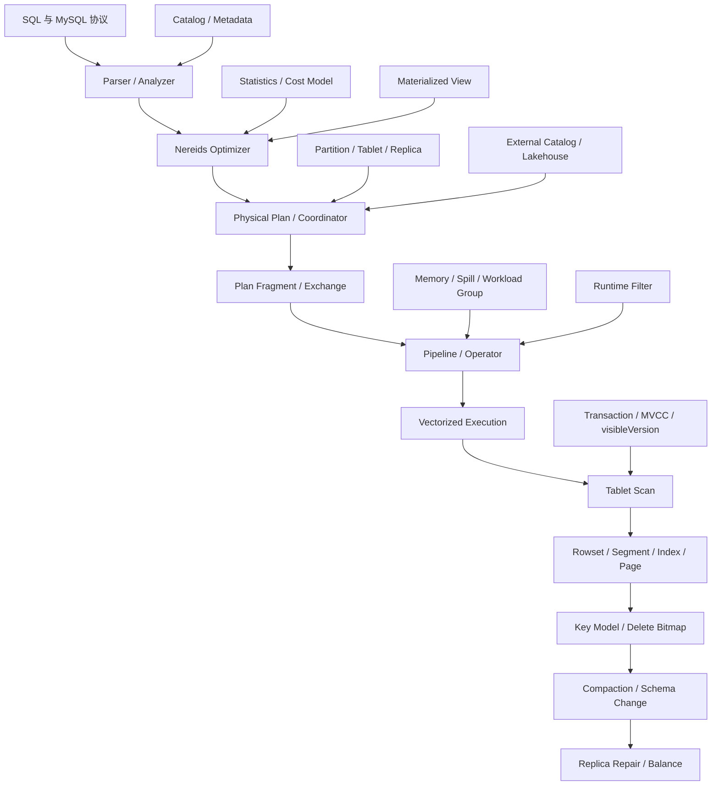

# Apache Doris 学习路线图

## 1. 这份路线图适合谁

这份路线图面向已经开始阅读 Doris 源码，希望建立完整内核知识体系的开发者。

当前已经具备的基础是：

- FE 元数据管理：Catalog、EditLog、Image、BDBJE 和 FE HA
- Doris 事务状态：PREPARE、COMMITTED、VISIBLE、ABORTED
- Partition 的 `nextVersion` 与 `visibleVersion`
- Tablet、Replica、Rowset、Segment 的基本关系
- Publish Version、版本连续性和 Rowset 版本图
- MVCC 查询快照
- Compaction 的基本作用
- 存算一体与存算分离的主要架构差异
- 一次数据写入从路由到最终可见的大体流程

配套文档：

- [Doris 元数据管理探讨](doris_metadata_management_discussion.md)
- [Doris 事务与 MVCC 实现探讨](doris_transaction_mvcc_discussion.md)
- [Doris 数据写入全流程](doris_data_write_full_flow.md)

因此，这份路线图不再从“什么是 Partition”开始，而是从它的镜像问题继续：

```text
一条 SELECT 到底如何从 SQL 变成分布式任务，
又如何在 BE 中找到正确版本的数据并完成计算？
```

## 2. Doris 内核知识全景



可以把这些内容分成三条主线：

```text
控制面：Catalog -> Analyzer -> Optimizer -> Coordinator
执行面：Fragment -> Pipeline -> Operator -> Exchange
存储面：Tablet -> Rowset -> Segment -> Index -> Page
```

事务、版本、统计信息、资源管理和后台维护横跨这三条主线。

## 3. 推荐学习顺序

### 主干必修

```text
阶段 0：元数据、写入、事务和 MVCC               已有基础
阶段 1：一条 SELECT 的端到端生命周期             下一步
阶段 2：Nereids 优化器
阶段 3：MPP、Fragment、Exchange 和 Pipeline
阶段 4：向量化执行引擎
阶段 5：Segment 物理存储与索引
阶段 6：Key 模型、Unique Key MOW 和 Delete Bitmap
阶段 7：Compaction、Replica Repair 和 Schema Change
阶段 8：统计信息、Runtime Filter 和性能诊断
阶段 9：内存、Spill、Workload Group 和系统稳定性
```

### 专题选修

```text
专题 A：数据分布、Colocate 与 Bucket Shuffle
专题 B：同步/异步物化视图
专题 C：External Catalog 与 Lakehouse
专题 D：存算分离、Meta Service 与 Recycler
专题 E：备份恢复、Binlog 与 CCR
专题 F：安全、权限与审计
```

建议先完成主干的阶段 1 到阶段 6。到这里，Doris 的一次写入和一次查询就都能在脑中完整跑通。阶段 7 到阶段 9 解决的是系统如何长期、稳定、高性能地运行。

---

## 4. 阶段 0：元数据、写入、事务与 MVCC

### 当前基础

- [x] 理解 FE 内存 Catalog、Image 和 EditLog
- [x] 理解 FE Master/Follower 的元数据复制与恢复
- [x] 理解 Table、Partition、MaterializedIndex、Tablet、Replica
- [x] 理解 FE 全局事务与 BE 本地事务的区别
- [x] 理解 pending Rowset 与正式 Rowset
- [x] 理解 COMMITTED 和 VISIBLE 的区别
- [x] 理解 Partition 版本连续性
- [x] 理解查询携带 `visibleVersion`
- [x] 理解 BE 通过版本图寻找连续 Rowset 路径
- [x] 理解 Compaction 不改变逻辑版本
- [x] 理解存算一体和存算分离的主要区别

### 建议验收

能够不看源码解释下面的问题：

1. 为什么事务 COMMITTED 后仍不能被查询看到？
2. 为什么版本 10 Publish 失败会挡住版本 11？
3. 为什么查询不能扫描所有 `endVersion <= visibleVersion` 的 Rowset？
4. 为什么某个 Tablet 本批没有数据，也可能需要空 Rowset？
5. Tablet 和 Replica 的区别是什么？
6. 存算分离为什么不需要向三个持久化 BE 副本分别 Publish？

---

## 5. 阶段 1：一条 SELECT 的端到端生命周期

这是下一阶段最推荐的主题。它可以将已经掌握的元数据和 MVCC，与优化器、MPP 执行和存储读取连接起来。

### 学习目标

建立下面这条完整链路：

```text
MySQL Protocol
-> SQL Parser
-> Logical Plan
-> Analyzer
-> Nereids Rewrite/Optimize
-> Physical Plan
-> Plan Fragment
-> Coordinator
-> Fragment Instance
-> Pipeline Task
-> Scan/Join/Aggregate
-> Result Sink
-> Client
```

### 核心问题

- SQL 是如何进入 FE 的？
- Parser 的输出是什么？
- Analyzer 如何绑定 Database、Table、Column 和 Function？
- Logical Plan 与 Physical Plan 有什么区别？
- 一个 Physical Plan 为什么要拆成多个 Fragment？
- Coordinator 如何选择 BE 并启动 Fragment Instance？
- 查询在哪里固定 Partition 的 `visibleVersion`？
- FE 如何为 Tablet 选择可查询 Replica？
- BE 如何从 Tablet 找到连续 Rowset 路径？
- 查询结果如何跨 Exchange 汇总并返回客户端？
- 取消、超时和错误如何从 FE 传播到所有 BE？

### 推荐源码入口

FE：

- `fe/fe-core/src/main/java/org/apache/doris/qe/StmtExecutor.java`
- `fe/fe-core/src/main/java/org/apache/doris/nereids/NereidsPlanner.java`
- `fe/fe-core/src/main/java/org/apache/doris/qe/Coordinator.java`
- `fe/fe-core/src/main/java/org/apache/doris/planner/OlapScanNode.java`

BE：

- `be/src/service/internal_service.cpp`
- `be/src/exec/pipeline/pipeline_fragment_context.cpp`
- `be/src/exec/pipeline/pipeline_task.cpp`
- `be/src/exec/operator/olap_scan_operator.cpp`
- `be/src/exec/scan/olap_scanner.cpp`
- `be/src/storage/tablet/tablet_reader.cpp`

### 实践任务

选择一条简单查询：

```sql
SELECT user_id, SUM(amount)
FROM sales
WHERE dt = '2026-08-18'
GROUP BY user_id
ORDER BY SUM(amount) DESC
LIMIT 10;
```

依次观察：

1. `EXPLAIN` 中的 Scan、Aggregate、TopN 和 Exchange。
2. FE 最终生成多少 Plan Fragment。
3. 每个 Fragment 有多少 Instance。
4. Query Profile 中每个 Pipeline 和 Operator 的耗时。
5. Scan 实际选择了哪些 Partition、Tablet 和 Replica。
6. ScanRange 中携带了什么版本。

### 完成标准

- [ ] 能画出一条 SELECT 的 FE/BE 时序图
- [ ] 能解释 Plan、Fragment、Instance、Pipeline、Operator 的层次
- [ ] 能指出查询快照版本在哪里产生、在哪里被使用
- [ ] 能从 Query Profile 判断时间花在 Scan、Exchange 还是计算

---

## 6. 阶段 2：Nereids 查询优化器

### 学习目标

理解 Doris 如何从“语义正确的逻辑计划”中选择“成本较低的物理计划”。

```text
Parsed Plan
-> Bind / Analyze
-> Logical Rewrite
-> Memo / Exploration
-> Cost Based Optimization
-> Physical Plan
-> Post Process
```

### 核心主题

- Unbound Plan 与 Bound Plan
- Logical Plan 与 Physical Plan
- Rule 和 Job 调度
- Memo、Group 和 GroupExpression
- Logical Rewrite
- Join Reorder
- Physical Property
- Distribution Property
- Cost Model
- Cardinality Estimation
- Partition/Tablet Pruning
- Predicate Pushdown
- Runtime Filter 生成
- Materialized View Rewrite

### 核心问题

- 为什么 Analyzer 不是简单的名称替换？
- 一条规则在什么阶段运行？
- Memo 为什么能够保存多个等价计划？
- Join 顺序由规则还是 Cost 决定？
- Broadcast Join 和 Shuffle Join 如何选择？
- Distribution Property 如何影响 Exchange？
- 统计信息不准确会怎样选错计划？
- 为什么同一条 SQL 在数据量变化后可能产生不同计划？

### 推荐源码入口

- `fe/fe-core/src/main/java/org/apache/doris/nereids/NereidsPlanner.java`
- `fe/fe-core/src/main/java/org/apache/doris/nereids/jobs/executor/Analyzer.java`
- `fe/fe-core/src/main/java/org/apache/doris/nereids/jobs/executor/Rewriter.java`
- `fe/fe-core/src/main/java/org/apache/doris/nereids/jobs/executor/Optimizer.java`
- `fe/fe-core/src/main/java/org/apache/doris/nereids/memo/`
- `fe/fe-core/src/main/java/org/apache/doris/nereids/rules/`
- `fe/fe-core/src/main/java/org/apache/doris/nereids/cost/`
- `fe/fe-core/src/main/java/org/apache/doris/nereids/stats/`

### 实践任务

准备三张大小明显不同的表，观察：

```text
小表 Broadcast
大表 Hash Shuffle
Colocate 表避免 Shuffle
统计信息缺失时 Join 顺序变化
```

对同一条 SQL 分别使用：

- `EXPLAIN`
- `EXPLAIN VERBOSE`
- `EXPLAIN SHAPE PLAN`

比较 Logical Plan、Physical Plan 和分布方式。

### 完成标准

- [ ] 能解释 Analyzer、Rewrite、Optimize、Post Process 的边界
- [ ] 能解释 Memo 中为什么存在多个等价表达式
- [ ] 能说明一个 Join 为什么选择 Broadcast 或 Shuffle
- [ ] 能定位一个错误执行计划是规则问题、统计问题还是 Cost 问题

---

## 7. 阶段 3：MPP、Fragment、Exchange 与 Pipeline

### 学习目标

理解一个物理计划如何在多台 BE 上并行执行。

### 核心层次

```text
Query
  -> Plan Fragment
     -> Fragment Instance
        -> Pipeline
           -> Pipeline Task
              -> Operator
```

### Exchange 类型

```text
Broadcast Exchange：把小表发送给所有 Probe 节点
Hash Shuffle Exchange：相同 Key 发送到同一目标
Bucket Shuffle：利用 Tablet bucket 映射减少网络重分布
Gather Exchange：把结果汇总到单个节点
Local Exchange：同一 BE 内重新分发 Block
```

### 核心问题

- Fragment 为什么以 Exchange 为边界？
- Fragment Instance 数量由什么决定？
- Pipeline 如何把 Pull 模型拆成可调度 Task？
- Source、Transform、Sink Operator 有什么区别？
- Dependency 如何避免线程阻塞？
- Exchange 如何处理乱序、背压、EOS 和错误？
- Pipeline 并发度过高为什么也可能变慢？
- Local Exchange 解决什么问题？

### 推荐源码入口

- `fe/fe-core/src/main/java/org/apache/doris/planner/PlanFragment.java`
- `fe/fe-core/src/main/java/org/apache/doris/qe/Coordinator.java`
- `be/src/exec/pipeline/pipeline.h`
- `be/src/exec/pipeline/pipeline.cpp`
- `be/src/exec/pipeline/pipeline_task.cpp`
- `be/src/exec/pipeline/task_scheduler.cpp`
- `be/src/exec/pipeline/dependency.cpp`
- `be/src/exec/operator/exchange_source_operator.cpp`
- `be/src/exec/operator/exchange_sink_operator.cpp`

### 实践任务

分别分析：

1. 单表聚合。
2. Broadcast Hash Join。
3. Partitioned Hash Join。
4. 全局 Order By + Limit。

为每条查询画出 Fragment 和 Exchange，并从 Profile 验证发送行数和接收行数。

### 完成标准

- [ ] 能从 Physical Plan 手工切分 Fragment
- [ ] 能解释每个 Exchange 的分区方式
- [ ] 能区分 Fragment 并行度与 Pipeline 并行度
- [ ] 能从 Profile 判断 Shuffle 倾斜和 Exchange 背压

---

## 8. 阶段 4：向量化执行引擎

### 学习目标

理解 BE 为什么以 Block/Column 批量处理数据，以及常见算子如何在列式结构上执行。

### 核心结构

```text
Block
  -> ColumnWithTypeAndName
     -> IDataType
     -> IColumn
        -> ColumnVector
        -> ColumnString
        -> ColumnNullable
        -> ColumnDictionary
```

### 核心主题

- Block 生命周期
- Column 和 DataType
- Nullable 的 NullMap
- 常量列与低基数字典
- Vectorized Expression
- Hash Join
- Hash Aggregate
- Sort / TopN
- Window Function
- SIMD
- Arena 和内存复用
- Operator 的 `get_block()`、`sink()`、`pull()` 等接口

### 核心问题

- 向量化为什么比逐行 Volcano 模型快？
- Block 大小如何影响缓存、函数调用和延迟？
- Nullable 为什么经常带来额外分支和内存访问？
- Hash Join 的 Build Side 和 Probe Side 分别保存什么？
- Aggregate State 如何创建、更新、合并和序列化？
- TopN 为什么不一定需要完整排序？

### 推荐源码入口

- `be/src/core/block/block.h`
- `be/src/core/column/`
- `be/src/core/data_type/`
- `be/src/exprs/`
- `be/src/exec/operator/join_build_sink_operator.cpp`
- `be/src/exec/operator/hashjoin_probe_operator.cpp`
- `be/src/exec/operator/aggregation_sink_operator.cpp`
- `be/src/exec/operator/aggregation_source_operator.cpp`

### 完成标准

- [ ] 能解释一个 Block 的列、类型和行数如何表示
- [ ] 能描述 Filter、Project、Aggregate 如何批量处理 Block
- [ ] 能解释 Hash Join 的 Build/Probe 生命周期
- [ ] 能从 Profile 看出算子 CPU、内存和输出行数

---

## 9. 阶段 5：Segment 物理存储与索引

### 学习目标

继续向 Rowset 内部深入，理解数据如何编码到 Segment，以及查询如何在解压数据前完成裁剪。

### 物理层次

```text
Tablet
  -> Rowset
     -> Segment
        -> Column
           -> Data Page
           -> Ordinal Index
           -> ZoneMap
           -> Bitmap/Bloom/Inverted Index
```

### 核心主题

- Segment V2
- Page 编码和压缩
- Dictionary Encoding
- RLE、FOR、Bit Shuffle
- Short Key Index
- Ordinal Index
- ZoneMap
- Bloom Filter
- Bitmap Index
- Inverted Index
- Primary Key Index
- Segment Iterator
- Predicate Pushdown
- Late Materialization

### 核心问题

- Short Key Index 为什么只保存 Key 前缀？
- ZoneMap 能排除什么，不能排除什么？
- Bloom Filter 为什么可能误判但不能漏判？
- Inverted Index 和 Bitmap Index 分别适合什么数据？
- 查询怎样从 Tablet 削减到 Rowset、Segment、Page 和行？
- 编码和压缩如何影响 CPU 与 IO？

### 推荐源码入口

- `be/src/storage/segment/`
- `be/src/storage/index/`
- `be/src/storage/rowset/`
- `be/src/exec/scan/olap_scanner.cpp`
- `be/src/storage/tablet/tablet_reader.cpp`

### 实践任务

建立包含以下列的测试表：

```text
高基数 ID
低基数字符串
时间列
全文检索列
可空列
```

分别添加 Bloom、Bitmap 和 Inverted Index，观察 Profile 中：

- RowsRead
- RowsFilteredByIndex
- Segment/Rowset 数量
- IO 时间
- Decompression 时间

### 完成标准

- [ ] 能从 Tablet 一直解释到 Page
- [ ] 能为不同列选择合适索引
- [ ] 能解释谓词在哪一层完成过滤
- [ ] 能判断查询慢是裁剪不足、远程 IO 还是解码 CPU 高

---

## 10. 阶段 6：Key 模型、MOW 与 Delete Bitmap

### 学习目标

理解 Doris 三种 Key 模型怎样影响写入、查询和 Compaction。

### 三种 Key 模型

| 模型 | 主要语义 | 查询/维护特点 |
|---|---|---|
| Duplicate Key | 保留明细行 | 写入简单，查询处理全部记录 |
| Aggregate Key | 相同 Key 按聚合函数合并 | 写入和 Compaction 执行聚合 |
| Unique Key | 相同 Key 只保留逻辑最新值 | 需要版本、Sequence 和删除机制 |

### Unique Key 重点

- Merge-on-Read 与 Merge-on-Write
- Sequence Column
- Delete Sign
- Partial Update
- Flexible Partial Update
- Primary Key Index
- Delete Bitmap
- Segment 内重复 Key
- Rowset 间重复 Key

Delete Bitmap 可以近似理解为：

```text
(rowsetId, segmentId, version)
  -> 被后续版本逻辑删除的 rowId 集合
```

### 核心问题

- MOW 为什么不直接修改旧 Segment？
- 新 Rowset 如何找到历史中的同 Key 记录？
- Sequence Column 如何决定哪条记录获胜？
- Delete Bitmap 为什么需要带版本？
- Commit 和 Publish 分别处理哪些 Delete Bitmap 工作？
- Compaction 后 Rowset ID 变化，Delete Bitmap 如何转换？
- 存算分离为什么需要 Delete Bitmap Update Lock？

### 推荐源码入口

- `be/src/storage/tablet/tablet_meta.h`
- `be/src/storage/delete/`
- `be/src/storage/tablet/tablet.cpp`
- `be/src/storage/rowset_builder.cpp`
- `be/src/storage/segment/segment_writer.cpp`
- `be/src/cloud/cloud_engine_calc_delete_bitmap_task.cpp`
- `fe/fe-core/src/main/java/org/apache/doris/cloud/transaction/CloudGlobalTransactionMgr.java`

### 实践任务

对同一 Unique Key 连续执行：

```text
INSERT 新 Key
UPDATE 已有 Key
DELETE Key
带 Sequence 的乱序 UPDATE
固定列 Partial Update
Flexible Partial Update
```

观察每次写入后的 Rowset、版本和 Delete Bitmap 变化。

### 完成标准

- [ ] 能比较 Duplicate、Aggregate、Unique 三种模型
- [ ] 能解释 MOW 查询为什么仍然是快照读
- [ ] 能说明 Delete Bitmap 的 Key 和 Value 表达什么
- [ ] 能解释 Partial Update 为什么比完整 UPSERT 更复杂

---

## 11. 阶段 7：后台维护机制

这一阶段包含三个互相关联的主题：Compaction、副本维护和 Schema Change。

### 11.1 Compaction

核心内容：

- Cumulative Compaction
- Base Compaction
- Full Compaction
- Time Series / Size Based Policy
- Cumulative Point
- Compaction Score
- Vertical Compaction
- Segment Compaction
- Stale Rowset GC
- Write Amplification

核心问题：

```text
Compaction 如何在不改变逻辑版本的情况下替换 Rowset？
为什么 Compaction 跟不上会导致 TOO_MANY_VERSION？
Compaction 如何处理 Aggregate Key、Unique Key 和 Delete Bitmap？
```

源码入口：

- `be/src/storage/compaction/`
- `be/src/storage/tablet/tablet.cpp`
- `be/src/storage/version_graph.cpp`

### 11.2 Replica Repair 与 Balance

核心内容：

- Tablet Checker
- Tablet Scheduler
- Clone Task
- Replica Catch-up
- `lastFailedVersion`
- `lastSuccessVersion`
- Backend Decommission
- Rebalance
- Colocate Repair

核心问题：

```text
写成功的副本为什么仍可能不健康？
缺少版本和缺少副本有什么区别？
扩容、缩容和下线 BE 时 Tablet 如何迁移？
```

源码入口：

- `fe/fe-core/src/main/java/org/apache/doris/clone/TabletChecker.java`
- `fe/fe-core/src/main/java/org/apache/doris/clone/TabletScheduler.java`
- `fe/fe-core/src/main/java/org/apache/doris/clone/TabletSchedCtx.java`

### 11.3 Schema Change

核心内容：

- Light Schema Change
- Heavy Schema Change
- Shadow Index
- Watershed Transaction ID
- 新旧 Index 双写
- 历史 Rowset 转换
- 最终 Index Swap

Schema Change 是对现有知识的综合检验：

```text
FE 元数据
+ 事务分水岭
+ MaterializedIndex
+ Tablet/Replica
+ Rowset 转换
+ Publish Version
= 在线 Schema Change
```

源码入口：

- `fe/fe-core/src/main/java/org/apache/doris/alter/`
- `be/src/storage/schema_change/`

### 完成标准

- [ ] 能区分三种主要 Compaction
- [ ] 能解释 Replica 的失败版本如何指导 Repair
- [ ] 能描述一个 BE 下线后的副本迁移流程
- [ ] 能解释 Heavy Schema Change 如何不丢失并发写入

---

## 12. 阶段 8：统计信息、Runtime Filter 与性能诊断

### 12.1 Statistics 与 Cost Model

核心内容：

- Row Count
- NDV
- Null Count
- Min/Max
- Data Size
- Histogram
- Auto Analyze
- Sampling
- Statistics Cache
- Join Cardinality Estimation
- Cost Model

核心问题：

- CBO 如何估算 Filter 和 Join 的输出行数？
- NDV 错误为什么可能改变 Join 顺序？
- 统计信息缺失时使用什么默认估算？
- Broadcast 选择错误是统计、Cost 还是规则问题？

源码入口：

- `fe/fe-core/src/main/java/org/apache/doris/statistics/`
- `fe/fe-core/src/main/java/org/apache/doris/nereids/stats/`
- `fe/fe-core/src/main/java/org/apache/doris/nereids/cost/`

### 12.2 Runtime Filter

```text
Join Build Side
  -> 生成 Bloom / IN / MinMax Filter
  -> 跨 Fragment 发送
  -> Scan/Probe Side 提前过滤数据
```

需要理解：

- Runtime Filter 生成与裁剪
- Local 与 Remote Runtime Filter
- Bloom、IN、MinMax、Bitmap Filter
- Filter 等待时间
- Runtime Filter 下推到 Scan
- Runtime Filter 与 Partition Pruning

源码入口：

- `fe/fe-core/src/main/java/org/apache/doris/nereids/processor/post/RuntimeFilterGenerator.java`
- `be/src/exec/runtime_filter/`

### 12.3 Query Profile

需要能够定位：

- Scan 行数异常
- Join Build Side 过大
- 数据倾斜
- Exchange 网络瓶颈
- Runtime Filter 到达太晚
- Compaction 导致的 Rowset 过多
- 远程 IO 或 Cache Miss
- Operator CPU 热点

### 完成标准

- [ ] 能判断一个错误计划是否源自统计信息
- [ ] 能解释 Runtime Filter 的产生、传输和消费
- [ ] 能用 Profile 找出查询的主要瓶颈
- [ ] 能区分计划问题、数据分布问题和执行问题

---

## 13. 阶段 9：内存、Spill、Workload Group 与稳定性

### 学习目标

理解 Doris 如何在多个查询、导入、Compaction 并发时控制资源，避免单个任务拖垮 BE。

### 核心主题

- MemTracker
- Query Memory Limit
- Load Memory Limit
- Workload Group
- Admission Control
- Memory Arbitration
- Hash Join Spill
- Aggregate Spill
- Sort Spill
- Scan Buffer
- Load Backpressure
- Data Cache
- Thread Pool 与 Task Scheduler

### 核心问题

- 内存从进程、Workload Group 到 Query 如何分层记账？
- 一个 Hash Join 为什么可能消耗远大于输入文件的数据量？
- 哪些 Operator 可以 Spill，Spill 的触发条件是什么？
- 导入、查询和 Compaction 如何争夺内存与 IO？
- Workload Group 的 CPU、内存和并发限制如何生效？
- 为什么“限制内存”有时反而导致更多磁盘和网络开销？

### 推荐源码入口

- `be/src/runtime/memory/`
- `be/src/runtime/workload_group/`
- `be/src/exec/pipeline/`
- `be/src/exec/spill/`
- `fe/fe-core/src/main/java/org/apache/doris/resource/workloadgroup/`

### 完成标准

- [ ] 能画出 Doris 的内存记账层次
- [ ] 能解释 Join/Aggregate/Sort 的 Spill 生命周期
- [ ] 能分析 Query OOM 与进程 OOM 的区别
- [ ] 能为导入和在线查询设计基本资源隔离方案

---

## 14. 专题 A：数据分布与 Join

### 学习内容

- RANGE/LIST Partition
- HASH/RANDOM Distribution
- Bucket 数量
- Tablet Pruning
- Colocate Group
- Bucket Shuffle Join
- 数据倾斜
- Dynamic Partition
- Auto Partition
- Rebalance

### 核心问题

```text
为什么 Partition 和 Bucket 是两层切分？
Bucket 数量过多或过少分别有什么问题？
Colocate Join 为什么可以避免网络 Shuffle？
扩容后 Colocate Group 如何维持 bucket 对齐？
```

---

## 15. 专题 B：物化视图

### 同步物化索引

- 与基表同事务写入
- 每个 Partition 下拥有自己的 Tablet
- Rollup Job
- 基表与 Rollup 的版本一致性

### 异步物化视图 MTMV

- 完整刷新与 Partition 增量刷新
- 基表变化跟踪
- 刷新任务调度
- 透明查询改写
- 等价性判断

### 核心问题

```text
同步物化索引为什么属于同一个 OlapTable？
异步物化视图为什么需要独立刷新事务？
优化器如何证明查询可以由物化视图回答？
```

---

## 16. 专题 C：External Catalog 与 Lakehouse

### 学习内容

- Hive、Iceberg、Hudi、Paimon
- JDBC、Elasticsearch、Trino Connector
- External Catalog 元数据缓存
- Split 枚举
- 文件和 Partition 裁剪
- Predicate Pushdown
- Schema Evolution
- Iceberg Snapshot
- Credential 与访问控制

### 需要建立的对比

```text
Doris 内表：Partition version + Tablet + Rowset MVCC
Iceberg：Snapshot + Manifest + Data/Delete Files
Hive：Partition + File
```

外部表不能直接套用 Doris 内表的 Rowset/Publish 模型。

---

## 17. 专题 D：存算分离

### 学习内容

- `CloudGlobalTransactionMgr`
- Meta Service
- FoundationDB 事务 KV
- CloudTablet / CloudRowset
- Object Storage
- Compute Group
- Data Cache
- Cloud Compaction
- Storage Vault
- Recycler
- Lazy Commit
- Delete Bitmap Update Lock

### 核心链路

```text
写入：Cloud BE -> Object Storage -> 临时 RowsetMeta -> Meta Service Commit
查询：FE 获取快照版本 -> Cloud BE 同步 RowsetMeta -> Cache/Object Storage
回收：Meta Service 元数据判断 -> Recycler 删除失效对象
```

### 核心问题

- 为什么对象文件写完仍不可见？
- Meta Service 如何原子完成版本分配和 Rowset 正式化？
- Lazy Commit 与存算一体的 Publish 有什么本质区别？
- Compute BE 为什么只是近似无状态？
- 缓存丢失为什么不影响正确性？
- 如何避免 Compaction 和查询引用的旧文件被过早删除？

---

## 18. 专题 E：高可用、备份与灾备

### 学习内容

- FE Master/Follower/Observer
- BE Replica HA
- Backup/Restore
- Snapshot
- Binlog
- CCR
- 跨集群复制
- 元数据恢复
- Cloud Snapshot

### 核心问题

- FE 元数据恢复和 BE 数据恢复分别依赖什么？
- Snapshot 如何保证 Rowset 文件和元数据一致？
- CCR 如何按事务和版本顺序同步数据？
- 跨集群复制如何处理目标端已有版本？

---

## 19. 专题 F：安全与可观测性

### 安全

- User、Role、Privilege
- Row Policy
- Data Masking
- LDAP
- External Catalog Credential
- Audit Log

### 可观测性

- Query Profile
- Runtime Profile
- FE/BE Metrics
- Trace
- Audit Log
- `SHOW PROC`
- `SHOW TABLET`
- `SHOW TRANSACTION`
- Compaction Status
- FE/BE 日志关联

最终目标是能够从一个用户现象逐层定位：

```text
SQL / Plan
-> Fragment / Operator
-> Tablet / Rowset
-> Transaction / Version
-> Resource / Node / Network
```

---

## 20. 推荐的源码阅读方法

### 20.1 不要只沿调用栈一直追

Doris 的调用链经常跨越：

```text
Java FE
-> Thrift/Protobuf
-> C++ BE
-> 异步 Task
-> 回调/RPC
-> 后台 Daemon
```

更有效的方式是先确认五件事：

1. 状态由谁拥有？
2. 谁可以修改它？
3. 持久化边界在哪里？
4. 失败以后由谁重试或清理？
5. 查询可见性的最终闸门是什么？

### 20.2 每个主题都画三张图

```text
对象关系图：有哪些核心对象，它们如何引用
正常时序图：一次成功请求如何完成
失败时序图：任意一步失败后如何恢复
```

### 20.3 使用具体 ID 追踪

调试时记录：

```text
queryId
loadId
transactionId
dbId / tableId / partitionId
indexId / tabletId / replicaId
rowsetId / version
backendId
```

这些 ID 是跨 FE、BE、Profile 和日志拼接完整链路的基础。

### 20.4 每读完一个模块都做一个小实验

推荐实验方式：

- 用 `EXPLAIN` 验证优化器结论。
- 用 Query Profile 验证执行时序。
- 用 `SHOW TABLET` 验证副本和版本。
- 用 `SHOW TRANSACTION` 验证事务状态。
- 用 Compaction API 验证 Rowset 替换。
- 使用 Debug Point 或测试用例构造失败路径。

---

## 21. 阶段性里程碑

### 里程碑一：能解释一次读写闭环

- [ ] 能解释一行数据如何写成 Rowset 并变为 VISIBLE
- [ ] 能解释一条 SELECT 如何固定快照并读取 Rowset
- [ ] 能解释 FE 和 BE 各自保存哪些状态

### 里程碑二：能解释分布式执行

- [ ] 能从 SQL 画出 Physical Plan
- [ ] 能从 Physical Plan 切分 Fragment
- [ ] 能说明每个 Exchange 为什么存在
- [ ] 能从 Profile 验证实际执行与计划一致

### 里程碑三：能解释数据如何被高效读取

- [ ] 能说明 Segment、Page、编码和索引
- [ ] 能说明 Predicate Pushdown 的各层裁剪
- [ ] 能说明 Key Model 与 Delete Bitmap

### 里程碑四：能排查生产问题

- [ ] 能分析慢查询和错误执行计划
- [ ] 能分析版本堆积和 Compaction 压力
- [ ] 能分析副本缺失、版本缺口和 Repair
- [ ] 能分析内存、Spill 和 Workload Group

### 里程碑五：能参与 Doris 内核开发

- [ ] 能找到一个功能的 FE/BE 边界
- [ ] 能识别状态所有权和持久化边界
- [ ] 能为正常路径和失败路径设计测试
- [ ] 能评估修改对事务、版本和兼容性的影响

---

## 22. 最短主线

如果暂时不想铺得太开，只走一条最短但完整的路线：

```text
1. 一条 SELECT 的完整生命周期
2. Fragment、Exchange 与 Pipeline
3. Block 和向量化 Operator
4. TabletReader、Rowset、Segment 和索引
5. Unique Key MOW 与 Delete Bitmap
6. Compaction 与 Replica Repair
7. Statistics、Runtime Filter 和 Query Profile
8. Memory、Spill 与 Workload Group
```

这条路线完成后，再进入物化视图、Lakehouse、CCR 和存算分离等专题，会轻松很多，因为它们都建立在同一组基本概念之上。

## 23. 下一篇建议

下一篇最适合整理的文档是：

```text
Doris 查询执行全流程：
一条 SELECT 如何从 SQL 经过 Nereids、Fragment、Pipeline，
最终根据 visibleVersion 读取 Tablet/Rowset 并返回结果
```

它能够把已经完成的“数据如何写进去”和接下来的“数据如何被读出来”连接成完整闭环。
