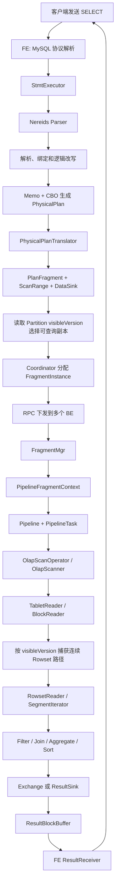
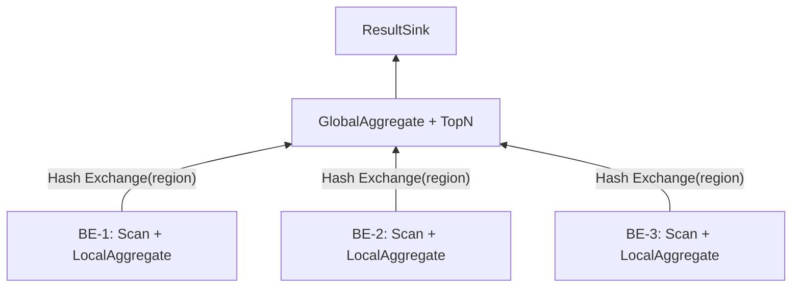
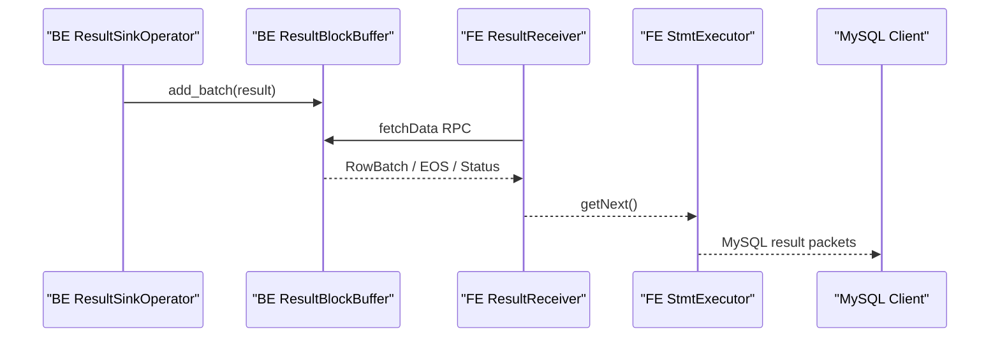

# 一条 SELECT 在 Apache Doris 中是如何执行的

> 从 SQL、Nereids、Fragment、Pipeline，一直到 BE 根据 `visibleVersion` 选择 Rowset 并返回结果

本文以普通 OLAP `SELECT` 为主线，解释一条查询如何从客户端进入 FE，经过 Nereids 生成分布式计划，再由多个 BE 通过 Pipeline 并行执行，最终从 Tablet 的 Rowset/Segment 中读取数据并返回客户端。

文中以当前 Doris 源码中的核心对象为准，但省略了一些特殊分支，例如外表、缓存命中、异步物化视图、倒排索引查询、全文检索和 Arrow Flight。不同版本的类名与内部细节可能调整，整体分层通常保持稳定。

---

## 1. 先看全流程



一句话概括：

> FE 决定“算什么、去哪些 Tablet 算、读到哪个版本”；BE 决定“如何并行执行这些算子、用哪些 Rowset/Segment 实际读出数据”。

---

## 2. 先认识执行过程中的对象

| 对象 | 所在位置 | 作用 |
|---|---|---|
| SQL Statement | FE | 客户端提交的语句 |
| LogicalPlan | FE / Nereids | 表达查询语义，不承诺具体执行方式 |
| PhysicalPlan | FE / Nereids | 确定 Join、聚合、数据分布等物理算法 |
| PlanFragment | FE 生成，BE 执行 | 被 Exchange 切开的分布式计划片段 |
| FragmentInstance | BE | 某个 Fragment 在某台 BE 上的一次执行实例 |
| Pipeline | BE | 一条可流水执行的 Operator 链 |
| PipelineTask | BE | Pipeline 的一个可调度执行任务 |
| Operator | BE | Scan、Filter、Join、Aggregate、Exchange、Sink 等算子 |
| ScanRange | FE 生成，BE 消费 | 一个 Tablet 扫描任务及副本位置、版本等信息 |
| Partition | FE 元数据 | 分区裁剪和 `visibleVersion` 的主要边界 |
| Tablet | FE + BE | 数据分片；FE 管副本元数据，BE 持有并读取实际数据 |
| Rowset | BE | 一次写入或 Compaction 形成的数据集合，带版本范围 |
| Segment | BE | Rowset 内真正的列式数据文件及索引 |
| Block | BE | 向量化执行引擎在算子之间传递的一批列数据 |

几个层级不要混在一起：

```text
一条 Query
  └── 多个 PlanFragment
        └── 每个 Fragment 可有多个 FragmentInstance
              └── 每个 Instance 可拆成多个 Pipeline
                    └── 每个 Pipeline 可生成多个 PipelineTask
                          └── Task 驱动一串 Operator 处理 Block
```

---

## 3. 阶段一：客户端 SQL 进入 FE

客户端通常通过 MySQL 协议发送：

```sql
SELECT region, SUM(amount) AS total
FROM sales
WHERE dt = '2026-08-20'
GROUP BY region
ORDER BY total DESC
LIMIT 10;
```

FE 的连接处理线程接收命令，完成协议级解析、会话状态维护和命令分发。普通查询随后交给 `StmtExecutor`。

主要入口可从这些文件开始阅读：

- `fe/fe-core/src/main/java/org/apache/doris/qe/MysqlConnectProcessor.java`
- `fe/fe-core/src/main/java/org/apache/doris/qe/ConnectProcessor.java`
- `fe/fe-core/src/main/java/org/apache/doris/qe/StmtExecutor.java`

`StmtExecutor` 负责把“一条 SQL”串成完整生命周期，包括：

1. 建立语句上下文和 Query ID。
2. 选择并调用 Planner。
3. 创建 Coordinator。
4. 下发分布式执行计划。
5. 拉取查询结果并通过客户端连接返回。
6. 处理超时、取消、错误和 Profile。

FE 并不负责扫描数据文件。它是查询的控制中心，也是分布式计划的发起方。

---

## 4. 阶段二：Nereids 把 SQL 变成逻辑计划

### 4.1 Parse：先得到语法结构

Nereids Parser 将 SQL 文本解析为语法树和未绑定的逻辑计划。此时的表名、列名可能还只是字符串，例如 `sales.amount` 尚未与 Catalog 中的实际对象绑定。

### 4.2 Analyze：把名字绑定到真实元数据

Analyzer 根据当前 Catalog、Database、Table、Session 和权限信息完成：

- 表、列、函数和类型绑定；
- `*` 展开、别名解析和类型推导；
- 子查询、CTE、View 等语义处理；
- 权限与合法性检查；
- 读取参与查询的表、Partition、Tablet 等元数据。

分析完成后，逻辑计划已经知道自己访问的是哪些真实对象。

### 4.3 Rewrite：先做与代价无关的等价变换

典型逻辑改写包括：

- 常量折叠；
- 谓词下推；
- Projection 裁剪；
- Partition 裁剪；
- 子查询改写；
- 聚合、Join 和表达式规范化；
- 物化视图透明改写等。

逻辑改写只改变执行表达，不应改变查询语义。

---

## 5. 阶段三：Nereids CBO 生成 PhysicalPlan

Nereids 使用 Memo 保存等价计划组，结合统计信息与代价模型寻找物理执行方案。它需要回答的问题包括：

- Join 顺序是什么？
- 使用 Hash Join、Nested Loop Join，还是其他算法？
- Build 端和 Probe 端分别是谁？
- 小表是否 Broadcast？大表是否需要 Shuffle？
- 聚合是一阶段还是局部聚合加全局聚合？
- Sort、TopN、Limit 在哪里执行？
- 数据需要满足什么 Distribution 和 Order 属性？

得到的 `PhysicalPlan` 已经包含具体物理算子和数据分布要求，但它仍是 FE 内部的 Nereids 计划树，不能直接作为 BE 的执行请求。

核心入口：

- `fe/fe-core/src/main/java/org/apache/doris/nereids/NereidsPlanner.java`

---

## 6. 阶段四：PhysicalPlan 被翻译成 Fragment

`PhysicalPlanTranslator` 将 Nereids PhysicalPlan 翻译为 Doris 分布式执行层认识的对象：

- `PlanFragment`；
- `PlanNode`，例如 `OlapScanNode`、Join、Aggregate、Sort；
- `DataSink`，例如 Exchange Sink 或 Result Sink；
- Tuple/Slot Descriptor；
- ScanRange 与其他执行参数。

核心文件：

- `fe/fe-core/src/main/java/org/apache/doris/nereids/glue/translator/PhysicalPlanTranslator.java`
- `fe/fe-core/src/main/java/org/apache/doris/planner/PlanFragment.java`

### 6.1 Fragment 为什么存在

单机查询可以把整棵算子树放在一个进程里执行；MPP 查询需要在不同 BE 之间重新分布数据。Exchange 就是网络边界，通常也会切开 Fragment。

例如：



可以把它理解为两个 Fragment：

- 下游扫描 Fragment：分散到数据所在的多个 BE，执行 Scan 和局部聚合；
- 上游汇总 Fragment：接收 Exchange 数据，执行全局聚合、TopN 和 ResultSink。

实际 Fragment 数量和形态由优化器决定，上图只是便于理解的典型方案。

### 6.2 Fragment 不等于 FragmentInstance

`PlanFragment` 是计划模板；`FragmentInstance` 是这个模板在某台 BE 上的实际运行实例。

扫描 Fragment 往往有多个 Instance，因为 Tablet 分布在多个 BE 上；最终汇总 Fragment 可能只有一个 Instance，也可能先并行执行再汇总。

---

## 7. 阶段五：FE 做 Partition、Tablet 和副本选择

`OlapScanNode` 根据谓词完成 Partition/Tablet 裁剪，然后为选中的 Tablet 构造 ScanRange。

核心文件：

- `fe/fe-core/src/main/java/org/apache/doris/planner/OlapScanNode.java`

一个 ScanRange 大致告诉 BE：

```text
扫描哪个 Tablet
读取哪个逻辑版本
有哪些可选副本及其 BE 地址
扫描哪些列
下推哪些谓词、KeyRange、Runtime Filter 信息
```

### 7.1 visibleVersion 在这里进入查询计划

对存算一体模式，FE 通常读取：

```java
visibleVersion = partition.getVisibleVersion();
```

然后把该值放入 Tablet ScanRange。假设某 Partition 的 `visibleVersion = 12`，它表达的是：

> 这次扫描只允许看到该 Partition 中已经发布到版本 12 的数据。

即使查询执行期间版本 13、14 又变为可见，这条已经下发的扫描仍以 12 为版本上界，因此不会在半途中把新发布的数据混进来。

### 7.2 visibleVersion 不是全库统一版本

需要特别注意：

- Doris 的版本主要是 Partition 维度；
- 一条查询可能访问多个 Partition；
- 每个 ScanRange 携带自己所属 Partition 的版本；
- 不应把它理解为数据库所有表共享的单一 MVCC 时间戳。

它更像“一组参与本次扫描的 Partition 快照上界”。具体跨表、跨 Partition 可见性还受事务发布状态和查询规划时读取到的元数据状态约束。

### 7.3 FE 还要选择追上该版本的副本

一个 Tablet 可能有多个 Replica。FE 会根据存活状态、版本是否追平、磁盘状态和调度策略，选择可查询副本。

本地存储模式下，副本至少应具备查询要求的 `visibleVersion`。如果一个副本只追到 11，而查询要求 12，FE 通常不会把本次 ScanRange 发给它。

因此职责分工是：

```text
FE：选择“声称能够读取到目标版本”的副本
BE：收到任务后再次按本地 Tablet 状态捕获真实可读 Rowset
```

### 7.4 存算分离模式的差别

存算分离模式下，Tablet/Rowset 元数据主要来自 Meta Service，数据位于对象存储。FE 仍需把查询快照版本传给 BE，但快照版本获取、Tablet 元数据同步和副本语义不同于本地多副本模式。

在启用 Cloud Snapshot Version 的路径中，ScanRange 的版本可能在 Coordinator 阶段统一更新，而不是在 `OlapScanNode.addScanRangeLocations()` 中直接读取本地 `Partition.visibleVersion`。

无论哪种模式，关键约束不变：BE 必须针对查询指定的版本建立稳定读视图。

---

## 8. 阶段六：Coordinator 生成并下发 FragmentInstance

FE 的 `Coordinator` / `NereidsCoordinator` 负责把 Fragment 模板变成可执行的分布式任务。

核心文件：

- `fe/fe-core/src/main/java/org/apache/doris/qe/Coordinator.java`
- `fe/fe-core/src/main/java/org/apache/doris/qe/NereidsCoordinator.java`

Coordinator 的主要工作包括：

1. 根据 ScanRange 与数据位置，将 Tablet 扫描任务分配给 BE。
2. 为每个 Fragment 创建一个或多个 FragmentInstance。
3. 建立上下游 Exchange 的发送端和接收端关系。
4. 传递 Descriptor、Query Options、内存限制、超时和 Workload Group。
5. 注册 Runtime Filter、结果接收器和查询状态。
6. 通过 RPC 将执行参数下发到各 BE。

这里有一个重要的本地化原则：

> FE 尽量把 Tablet ScanRange 分配到持有可查询副本的 BE，让计算靠近数据；需要重分布的中间结果再通过 Exchange 传输。

---

## 9. 阶段七：BE 接收 Fragment 并建立 Pipeline

BE 收到 `exec_plan_fragment` RPC 后，主链路大致是：

```text
PInternalService::exec_plan_fragment
  -> FragmentMgr::exec_plan_fragment
  -> PipelineFragmentContext::prepare
  -> 构造 Operator / Pipeline / PipelineTask
  -> PipelineFragmentContext::submit
  -> TaskScheduler 调度执行
```

核心文件：

- `be/src/service/internal_service.cpp`
- `be/src/runtime/fragment_mgr.cpp`
- `be/src/exec/pipeline/pipeline_fragment_context.cpp`
- `be/src/exec/pipeline/pipeline.cpp`
- `be/src/exec/pipeline/pipeline_task.cpp`
- `be/src/exec/pipeline/task_scheduler.cpp`

### 9.1 Pipeline 是什么

Pipeline 是可以流水化执行的一组 Operator。一个简化的扫描链可能是：

```text
OlapScanOperator(Source)
  -> FilterOperator
  -> ProjectOperator
  -> AggregateOperator
  -> ExchangeSinkOperator(Sink)
```

Source 产生 `Block`，中间算子不断变换 `Block`，Sink 消费或发送 `Block`。

遇到 Hash Join、Aggregate、Sort、Exchange 等需要积累数据或等待上游的算子时，执行图可能拆成多个 Pipeline，并通过共享状态和 Dependency 连接。

### 9.2 PipelineTask 为什么不是一条线程跑到底

TaskScheduler 驱动 PipelineTask 分批处理数据。Task 可能因为以下条件暂时不可运行：

- Scan 等待磁盘或对象存储 I/O；
- Exchange Receiver 尚无数据；
- Hash Join 的 Build 端尚未准备好；
- Result Buffer 已满，需要背压；
- 内存压力触发 Spill；
- Runtime Filter 尚未就绪。

Dependency 将这些条件表示成“是否 Ready”。未就绪的 Task 让出执行资源，就绪后再回到调度队列。这种模型避免大量工作线程长时间阻塞。

---

## 10. 阶段八：OlapScanOperator 开始读取 Tablet

典型扫描调用链可以简化为：

```text
OlapScanOperator
  -> ScannerContext / OlapScanner
  -> BlockReader / TabletReader
  -> ReadSource
  -> RowsetReader
  -> SegmentIterator
  -> vectorized::Block
```

核心文件：

- `be/src/exec/operator/olap_scan_operator.cpp`
- `be/src/exec/scan/olap_scanner.cpp`
- `be/src/storage/tablet/tablet_reader.cpp`
- `be/src/storage/rowset/beta_rowset_reader.cpp`

一个 Tablet ScanRange 中的目标版本 `V` 会进入 Reader 参数，普通快照读取的版本区间通常可理解为：

```text
[0, V]
```

例如 ScanRange 要求版本 12，`OlapScanner` 会以 `[0, 12]` 建立 Tablet 读取源。

---

## 11. BE 不是扫描“所有小于等于 visibleVersion 的 Rowset”

这是整条链路中最容易误解的地方。

### 11.1 为什么 Rowset 有版本范围

普通写入可能形成单版本 Rowset：

```text
[0-1] [2-2] [3-3] [4-4] [5-5]
```

Compaction 可以把若干相邻 Rowset 合并成一个更大的 Rowset，例如：

```text
[2-2] + [3-3] + [4-4]  ->  [2-4]
```

在旧 Rowset 尚未完成回收时，本地可能暂时同时存在：

```text
[2-2] [3-3] [4-4] [2-4]
```

如果查询简单地扫描所有 `endVersion <= 5` 的 Rowset，就会同时读到原始 Rowset 和 Compaction 产物，造成数据重复。

### 11.2 正确做法：从版本图中找一条连续路径

BE 根据目标区间 `[0, 5]` 从 VersionGraph 捕获一条：

- 覆盖完整；
- 中间没有版本缺口；
- Rowset 之间不重叠；
- 恰好到达目标版本；

的路径。

可选择：

```text
[0-1] -> [2-2] -> [3-3] -> [4-4] -> [5-5]
```

也可选择：

```text
[0-1] -> [2-4] -> [5-5]
```

但绝不能把 `[2-2] [3-3] [4-4]` 与 `[2-4]` 一起扫描。

相关入口：

- `BaseTablet::capture_read_source()`
- `BaseTablet::capture_consistent_rowsets_unlocked()`
- `VersionGraph::capture_consistent_versions()`
- `be/src/storage/tablet/base_tablet.cpp`
- `be/src/storage/version_graph.cpp`

### 11.3 路径不连续会怎样

假设目标是 `[0, 12]`，本地只有：

```text
[0-9] [11-12]
```

版本 10 缺失，BE 无法构造一致读取路径。正常情况下 FE 本应选择已经追上目标版本的健康副本；如果实际捕获时仍缺版本，查询会失败、尝试其他容错路径，或在特定配置下采取明确允许的缺版本行为，而不是悄悄把 10 跳过去并返回一个看似完整的结果。

### 11.4 Compaction 不改变查询的逻辑快照

Compaction 主要改变“同一批逻辑版本由哪些物理 Rowset 承载”：

```text
压缩前：[0-1] [2-2] [3-3] [4-4] [5-5]
压缩后：[0-1] [2-4] [5-5]
```

两条路径都表达版本 5 的同一份逻辑数据。Compaction 的价值是：

- 减少 Rowset 和 Segment 数量；
- 降低多路归并成本；
- 减少文件打开、元数据和索引访问；
- 改善顺序 I/O、缓存命中和查询稳定性。

它不是一次新的用户事务，也不会仅因物理文件被合并就推进 Partition 的 `visibleVersion`。

---

## 12. RowsetReader 和 SegmentIterator 真正读取数据

捕获连续 Rowset 路径后，每个 Rowset 创建对应 Reader，再下沉到 Segment。

在这一层会发生大量存储侧优化：

- 只读取查询需要的列；
- 根据 KeyRange 跳过无关范围；
- 使用 ZoneMap、Bloom Filter、Bitmap、倒排索引等过滤；
- Page Cache 与文件缓存；
- 谓词下推和延迟物化；
- Delete Predicate 处理；
- Unique Key Merge-on-Write 的 Delete Bitmap 过滤；
- 根据 Key 模型进行归并、去重或聚合。

存储层输出的是向量化 `Block`，不是逐行对象。一个 Block 中每一列是连续的列向量，后续表达式、过滤、Join 和聚合可以按批处理，降低函数调用与虚函数分派成本，并更好地利用 CPU Cache 和 SIMD。

### 12.1 不同 Key 模型的读取差异

| 模型 | 读取时的主要语义 |
|---|---|
| Duplicate Key | 保留明细行，通常不需要按 Key 去重 |
| Aggregate Key | 相同 Key 的 Value 列按聚合函数合并 |
| Unique Key Merge-on-Read | 读取时归并多个版本并选出最终行 |
| Unique Key Merge-on-Write | 写入发布阶段生成 Delete Bitmap，查询过滤被覆盖行，减少读时归并 |

因此，“找到 Rowset”只是建立物理快照；要得到正确的最终行，还需要 Reader 按表模型处理 Rowset 之间的数据语义。

---

## 13. Block 在 Pipeline 中继续流动

Scan 产生 Block 后，后续 Operator 对其执行：

```text
Scan
  -> Predicate / Projection
  -> Join Probe
  -> Local Aggregate
  -> Exchange Sink
```

另一个 BE 或另一个 FragmentInstance 中：

```text
Exchange Source
  -> Global Aggregate
  -> TopN / Limit
  -> ResultSink
```

### 13.1 Exchange 的几种典型分布

- `Broadcast`：把较小输入发送给所有目标 Instance，常用于小表 Join。
- `Hash Shuffle`：按 Join Key 或 Group Key 哈希分区，相同 Key 进入同一目标。
- `Gather`：把多个上游结果汇聚到一个目标，常用于最终结果阶段。
- `Bucket Shuffle`：利用表的 Bucket 分布减少不必要的数据移动。

Exchange Sender 与 Receiver 之间有缓冲和背压。下游消费不及时，上游不会无限制地把中间 Block 堆在内存中。

### 13.2 Runtime Filter

以 Hash Join 为例，Build 端可以根据已构建的 Hash Table 生成 Runtime Filter，再将其发送给 Probe 端 Scan。Scan 利用 Filter 提前排除不可能匹配的数据，减少读取和网络传输。

Runtime Filter 是运行时优化，不改变 SQL 语义；Filter 未及时到达时，查询仍可按正确但可能较慢的路径继续执行。

---

## 14. 最终结果如何回到客户端

根 Fragment 的 `ResultSinkOperator` 将最终 Block 按客户端协议编码，并写入 BE 的结果缓冲区。

核心文件：

- `be/src/exec/operator/result_sink_operator.cpp`
- `be/src/runtime/result_block_buffer.cpp`
- `fe/fe-core/src/main/java/org/apache/doris/qe/ResultReceiver.java`

返回链路为：



结果并不是等整条查询全部结束后才一次性返回。只要根 Fragment 能持续产出结果、协议和算子语义允许，FE 就可以分批拉取并向客户端发送。

`ORDER BY`、全局聚合等阻塞算子可能必须先消费大量输入，因而首行延迟会明显高于普通流式 Scan。

---

## 15. 用示例把整条链串起来

仍以这条 SQL 为例：

```sql
SELECT region, SUM(amount) AS total
FROM sales
WHERE dt = '2026-08-20'
GROUP BY region
ORDER BY total DESC
LIMIT 10;
```

### 15.1 FE 规划阶段

1. Parser 生成未绑定 LogicalPlan。
2. Analyzer 将 `sales`、`region`、`amount`、`dt` 绑定到 Catalog 元数据。
3. Rewrite 将 `dt = '2026-08-20'` 用于 Partition 裁剪和谓词下推。
4. CBO 选择局部聚合加全局聚合，并确定 Exchange 分布。
5. Translator 生成 Scan Fragment 和汇总 Fragment。
6. `OlapScanNode` 找到目标 Partition 下的 Tablet。
7. 假设目标 Partition 当前 `visibleVersion = 27`，FE 将 27 写入这些 Tablet 的 ScanRange。
8. FE 为每个 Tablet 选择已追到版本 27 的可查询副本。
9. Coordinator 将 ScanRange 分配给相关 BE 并下发 FragmentInstance。

### 15.2 BE 执行阶段

1. 每台 BE 为收到的 FragmentInstance 构建 PipelineTask。
2. `OlapScanner` 对每个 Tablet 使用目标区间 `[0, 27]` 建立 ReadSource。
3. VersionGraph 选择覆盖 `[0, 27]` 的连续 Rowset 路径。
4. SegmentIterator 读取 `region`、`amount` 及过滤所需列。
5. 存储层跳过无关数据页，输出 Block。
6. 局部 Aggregate 先在各 BE 上计算每个 `region` 的部分和。
7. Exchange 按 `region` Hash Shuffle，使相同 region 到达同一上游 Instance。
8. 全局 Aggregate 合并部分和，TopN 取前 10 条。
9. ResultSink 写入 ResultBlockBuffer。
10. FE 拉取结果并通过 MySQL 协议返回客户端。

### 15.3 查询期间又有版本 28 发布会怎样

不会影响这次已经建立的 `[0, 27]` 读取：

```text
查询 Q1：固定读取到 27
新写入：发布版本 28
后续查询 Q2：可能读取到 28
```

这正是 `visibleVersion` 在查询链路中的核心意义：把并发变化的数据世界，转换成当前查询可稳定读取的版本边界。

---

## 16. 慢查询会阻塞后续导入吗

通常不会。

慢查询持有的是旧版本对应 Rowset 的引用或读取快照。版本 28、29 可以继续写入、Commit 和 Publish，新的查询可以看到新版本；旧查询仍读取 27。

但慢查询会影响物理回收：

- Compaction 可以生成新的 Rowset 路径；
- 已被替代的旧 Rowset 不能在仍有查询引用时立即删除；
- 长时间查询可能增加旧版本文件保留时间、磁盘占用和缓存压力。

所以它一般不会阻塞逻辑版本推进，却可能延迟旧物理数据回收。

---

## 17. 失败、取消和超时如何传播

查询是一个分布式任务，任何关键 FragmentInstance 失败都可能导致整条查询失败。

典型传播方向：

```text
BE Operator / Scanner 出错
  -> PipelineTask / PipelineFragmentContext 记录错误并取消
  -> BE 向 FE Coordinator 汇报状态
  -> Coordinator 取消同一 Query 的其他 FragmentInstance
  -> ResultReceiver 返回错误
  -> StmtExecutor 向客户端返回错误包
```

客户端主动取消、连接断开、查询超时、内存超限和 Workload Group 规则也会触发取消。各 Pipeline 的 Dependency 会被唤醒，使等待中的 Task 能及时退出并释放资源。

---

## 18. 如何观察一条 SELECT

### 18.1 EXPLAIN

`EXPLAIN` 适合观察：

- 扫描了哪些 Partition 和 Tablet；
- Join 顺序与 Join 类型；
- Exchange 分布方式；
- 聚合阶段；
- 谓词和 Runtime Filter；
- Fragment 划分。

### 18.2 Query Profile

Profile 更接近真实执行，可重点关注：

- Scan 的行数、字节数与 I/O 时间；
- `RowsRead` 与最终输出行数的差距；
- Segment、Page、索引过滤效果；
- Scanner 并发度；
- Exchange 发送/接收时间和网络量；
- Join Build/Probe 时间；
- Aggregate、Sort、TopN 耗时；
- Dependency Wait Time；
- 内存峰值与 Spill；
- ResultSink 和客户端拉取是否形成背压。

### 18.3 常见定位思路

| 现象 | 优先检查 |
|---|---|
| 扫描数据量过大 | Partition 裁剪、谓词下推、索引过滤、统计信息 |
| Join 网络量过大 | Join 顺序、Broadcast/Shuffle 选择、Runtime Filter |
| 首行返回很慢 | Sort、全局聚合、Join Build 等阻塞算子 |
| 某个 Instance 特别慢 | Tablet 数据倾斜、热点 BE、慢盘、对象存储 I/O |
| Rowset 数量很多 | Compaction 状态、导入批次是否过碎 |
| FE 一直等结果 | 根 Fragment、ResultSink、Exchange 或客户端背压 |
| 版本缺失错误 | Replica 版本、Publish 状态、Tablet 健康度 |

---

## 19. 几个常见误解

### 误解一：Nereids 直接在 FE 执行查询

不是。Nereids 负责分析与优化，数据密集型执行主要发生在 BE。

### 误解二：一个 Fragment 只在一台 BE 上运行一次

不是。Fragment 是模板，同一个 Fragment 可以产生多个 FragmentInstance，分布在多个 BE。

### 误解三：Pipeline 就是 Fragment 的新名字

不是。Fragment 是分布式网络边界；Pipeline 是单个 FragmentInstance 内部的执行和调度边界。

### 误解四：查询会扫描所有版本不超过 visibleVersion 的 Rowset

不准确。BE 要选择一条覆盖目标版本区间的连续、无重叠 Rowset 路径。

### 误解五：Compaction 会让查询看到一个新版本

不会。Compaction 改变物理组织，不改变同一逻辑版本的可见数据。

### 误解六：visibleVersion 是整个数据库的全局时间戳

不是。它主要是 Partition 级逻辑版本，ScanRange 携带对应分区的版本上界。

### 误解七：查询开始后，新导入就不能 Publish

通常不是。旧查询读旧快照，新导入继续发布新版本；旧 Rowset 的物理删除需要等待引用释放。

---

## 20. 给初学者的类比：一次全国仓库盘点

可以把一条查询想成总部发起的一次全国仓库盘点：

- SQL：总部提出“统计 8 月 20 日各地区销售额前十名”。
- Nereids：计划部门决定先去哪几个仓库、每个仓库统计什么、结果怎么汇总。
- Fragment：把全国任务拆成“各仓库本地统计”和“总部汇总排名”。
- FragmentInstance：某个仓库真正收到的一张执行工单。
- Pipeline：仓库里的流水线，依次取货单、过滤日期、按地区汇总、装箱发送。
- Tablet：仓库中的一个货区。
- visibleVersion：盘点通知写明“只统计编号 27 及以前已经正式入账的单据”。
- Rowset：一批批入账单据，可能是一批一个编号，也可能把连续几批归档成一个编号范围。
- VersionGraph：档案管理员为 `[0, 27]` 选择一套不缺批次、也不重复的档案。
- Compaction：把很多小档案盒整理成一个大档案盒，内容和入账边界没有变化。
- Segment：档案盒中真正按列组织的明细页和索引。
- Exchange：各仓库把局部统计按地区发给负责该地区汇总的节点。
- ResultSink：汇总完成后，把前十名交回总部并返回客户端。

最重要的是这句话：

> `visibleVersion` 决定盘点截止到哪一天账，连续 Rowset 路径决定用哪套不重不漏的档案完成这次盘点。

---

## 21. 推荐源码阅读顺序

不要一开始就扎进 Segment Reader。按控制流逐层下钻更容易建立完整模型：

1. `fe/fe-core/src/main/java/org/apache/doris/qe/StmtExecutor.java`
2. `fe/fe-core/src/main/java/org/apache/doris/nereids/NereidsPlanner.java`
3. `fe/fe-core/src/main/java/org/apache/doris/nereids/glue/translator/PhysicalPlanTranslator.java`
4. `fe/fe-core/src/main/java/org/apache/doris/planner/OlapScanNode.java`
5. `fe/fe-core/src/main/java/org/apache/doris/qe/Coordinator.java`
6. `be/src/service/internal_service.cpp`
7. `be/src/runtime/fragment_mgr.cpp`
8. `be/src/exec/pipeline/pipeline_fragment_context.cpp`
9. `be/src/exec/operator/olap_scan_operator.cpp`
10. `be/src/exec/scan/olap_scanner.cpp`
11. `be/src/storage/tablet/tablet_reader.cpp`
12. `be/src/storage/tablet/base_tablet.cpp`
13. `be/src/storage/version_graph.cpp`
14. `be/src/storage/rowset/beta_rowset_reader.cpp`
15. `be/src/exec/operator/result_sink_operator.cpp`
16. `be/src/runtime/result_block_buffer.cpp`
17. `fe/fe-core/src/main/java/org/apache/doris/qe/ResultReceiver.java`

可以一边执行 `EXPLAIN` 和查看 Query Profile，一边在上述入口设置日志或断点。这样看到的不是孤立类，而是 SQL 从 FE 到 BE、再回 FE 的完整闭环。

---

## 22. 最终总结

一条 Doris `SELECT` 的完整执行可以压缩成六步：

1. **SQL 语义化**：FE 接收 SQL，Nereids 完成解析、绑定和逻辑改写。
2. **物理优化**：CBO 决定 Join、聚合、排序与数据分布方式。
3. **分布式拆分**：PhysicalPlan 被翻译成 Fragment、ScanRange 和 DataSink。
4. **快照与调度**：FE 固化各 Partition 的 `visibleVersion`，选择 Tablet 副本并分配 FragmentInstance。
5. **向量化执行**：BE 构建 PipelineTask；Scan 按目标版本捕获连续 Rowset 路径，从 Segment 读取 Block，再完成 Join、Aggregate、Sort 和 Exchange。
6. **结果回传**：根 Fragment 的 ResultSink 写入缓冲区，FE 分批拉取并通过 MySQL 协议返回客户端。

把三个边界记住，Doris 查询执行就不会再显得混乱：

```text
Fragment：跨 BE 的分布式边界
Pipeline：单个 FragmentInstance 内的调度边界
visibleVersion + 连续 Rowset 路径：存储快照的正确性边界
```
